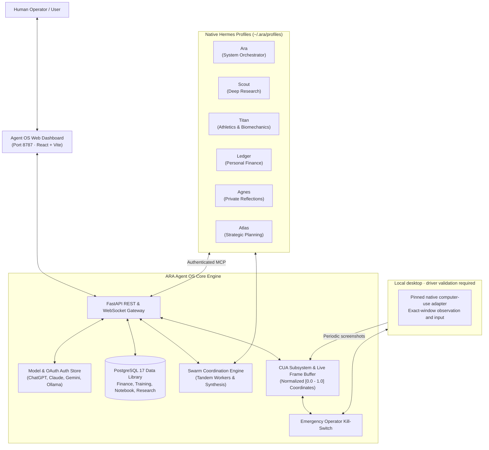

# ARA · Agent OS

[](https://www.python.org/)
[](LICENSE)
[](agent-os/docs/VERIFICATION.md)
[]()

> **A local-first, privacy-centric Personal AI Operating System.**  
> Agent OS connects independent data, specialized AI agents, coordinated worker teams, and managed local desktop control into a locally hosted personal workspace.

---

## ✦ Overview

**Agent OS capabilities:**
- **Data Precedes Agents**: Your information (finances, training notes, private journals, research) is stored in persistent, ACID-compliant PostgreSQL tables that belong to you—independent of any LLM provider or profile lifecycle.
- **Specialized Native Profiles**: One system orchestrator (**Ara**) coordinates independent specialist agents with their own native working directories, tool permissions, and memory boundaries.
- **Coordinated Worker Teams**: Profiles can spawn research, coding, analysis and custom workers. Dependencies run in stages, independent workers run concurrently, and a coordinator synthesizes their reported results.
- **Managed Local Desktop Control**: Periodic screenshots, accessibility inspection and normalized input through the pinned native adapter, with explicit grants, supervised approvals and an emergency stop. Physical driver compatibility requires separate validation.
- **Dual-Mode Independence**: Works in **Fleet Mode** with the web dashboard, or in **Standalone Node Mode** with Hermes via stdio MCP—even when the Agent OS server is offline.

---

## ✦ System Architecture



---

## ✦ Product Surfaces & Core Features

### 1. The Specialist Agent Roster
| Agent | Role & Domain | Built-in Capabilities |
|---|---|---|
| **Ara** | **System Orchestrator** | Coordinates specialists, plans multi-step workflows, aggregates findings, cross-agent delegation. |
| **Scout** | **Deep Research** | Empirical investigations, source credibility analysis, web exploration, and structured synthesis. |
| **Titan** | **Athletics & Training** | Workout logging, exercise analytics, volume progression, and biomechanics tracking. |
| **Ledger** | **Personal Finance** | Double-entry transaction ledgers, exact decimal currency accounting, expense categorization. |
| **Agnes** | **Private Reflections** | Introspective journaling, cognitive processing, private memory reflection (isolated storage). |
| **Atlas** | **Strategic Planning** | Goal decomposition, milestone tracking, task prioritization, and Kanban scheduling. |

---

### 2. Multi-Agent Swarm Intelligence
Profiles can spawn coordinated specialist swarms to tackle complex or multi-phase tasks:
- **`research`**: Deploys a Lead Researcher (`scoper`), Source Analyst (`gatherer`), and Fact Checker (`verifier`).
- **`coding`**: Deploys a System Architect (`architect`), Implementation Engineer (`coder`), and QA Reviewer (`reviewer`).
- **`analysis`**: Deploys a Data Analyst (`analyst`), Critical Evaluator (`critic`), and Strategic Advisor (`advisor`).
- **`custom`**: Configurable custom specialist teams tailored to domain-specific workflows.
- **Intelligent vs. Explicit Policies**: Profiles can autonomously evaluate task complexity to trigger swarms only when needed, or operate exclusively on explicit command.

---

### 3. Managed Local Desktop Control

- **Observation**: Screenshots with a one-second interval between captures, plus accessibility inspection of the local desktop.
- **Input**: The adapter validates the exact observed window, process identity and image dimensions before native dispatch. Grants and approval requirements are checked after waiting for device access.
- **Intervention**: The emergency stop blocks new managed inputs and interrupts active transports. Already delivered actions cannot be undone; uncertain effects require inspection.
- **Supported scope**: Driver presence is distinct from physical readiness. Remote desktop routing, Android/iOS control and arbitrary semantic scripting are unavailable through this managed path.

See [native computer control](agent-os/docs/CUA_SYSTEM_CONTROL.md) for setup and validation limits.

---

### 4. Independent Data Library
Seven independent PostgreSQL data modules stored securely on your local database:
- **Finance**: Exact decimal accounting (never floats), multi-currency support, category aggregation.
- **Training**: Structured workout logs, sets, reps, weight, RPE, and notes.
- **Notebook & Reflections**: Markdown notes and private reflections with explicit profile binding grants.
- **Planning**: Kanban-style tasks (`planned`, `in_progress`, `done`, `paused`) with target dates and priorities.
- **Custom**: User-defined structured JSON Schema models with real-time validation.

---

## ✦ Quick Start & Setup

### Prerequisites
- **Operating System**: Linux (Ubuntu, Debian, Fedora, Arch) or macOS (12.3+)
- **Python**: 3.12 or newer
- **Node.js**: ≥ 22.12 (Node 24 recommended)
- **Container Engine**: Docker & Docker Compose (or an existing PostgreSQL 17 instance)
- **Package Manager**: `uv` recommended for Python environment management

### 1. Clone & Bootstrap
```bash
git clone git@github.com:coding-nyx/agent-os.git
cd agent-os/agent-os

# Run the automated setup script
bash scripts/setup.sh
```

### 2. Launch the System
```bash
# Start PostgreSQL container and the Agent OS combined API & Web Server
bash scripts/start.sh
```
Open **[http://localhost:8787](http://localhost:8787)** in your browser to access the dashboard.

### 3. Model Configuration (Connections)
Agent OS supports both API-key and subscription-based providers:
- **OAuth Providers**: Sign in directly to ChatGPT / Codex subscription accounts.
- **Custom Endpoints**: Connect Anthropic, OpenAI, Gemini, OpenRouter, DeepSeek, or local Ollama/vLLM endpoints.
- Re-run setup anytime non-interactively:
  ```bash
  .venv/bin/ara setup --use-existing --replace-models --non-interactive
  ```

---

## ✦ CLI & Standalone Usage

Agent OS provides the `ara` CLI tool inside `.venv/bin/ara`:

```bash
# Start the API and Dashboard server on a custom port
ara serve --port 8787

# Manage CUA (Computer-Using Agent)
ara cua devices     # Discover local displays and connected Android devices
ara cua mcp         # Run standalone stdio JSON-RPC MCP server for local Hermes agents

# Direct Profile Interaction
ara chat ara        # Launch native terminal chat session with Ara
ara chat scout      # Launch native terminal chat session with Scout

# Backup and Disaster Recovery
ara backup                      # Create an encrypted snapshot bundle
ara backup-key --output key.txt # Save private recovery key
ara restore snapshot.ara --key key.txt --target ./restored-state
```

---

## ✦ Standalone Hermes Integration

Hermes agents can use CUA computer control on any machine—even when the Agent OS web server and database are offline.

Add this entry to your local Hermes `config.yaml`:
```yaml
mcp_servers:
  cua:
    command: "ara"
    args: ["cua", "mcp", "--profile", "coding-agent"]
```
Configure the profile's explicit observation/input grants first. Available tools:

- `ara_cua_list_devices`: Inspect the local desktop adapter and driver availability.
- `ara_cua_computer`: Execute supported normalized clicks, drags, typing, key combinations and visual snapshots.
- `ara_cua_semantic`: Compatibility endpoint that refuses arbitrary OS scripting; use separately authorized terminal tools.
- `ara_cua_ui_tree`: Inspect UI hierarchy without burning vision tokens.

---

## ✦ Verification & Testing

The automated suite covers data integrity, native model protocols, swarm execution, managed desktop policy and browser interfaces. Native adapter tests use a fake driver transport; they do not certify physical hardware:

```bash
cd agent-os
.venv/bin/pytest -v
```

See the [verification report](agent-os/docs/VERIFICATION.md) for recorded results and validation limits.

---

## ✦ Repository Layout

```
agent-os/
├── agent-os/                   # Core application root
│   ├── src/ara_os/             # Backend Python package
│   │   ├── app.py              # FastAPI REST, WebSocket streaming & MCP routes
│   │   ├── cli.py              # 'ara' command line dispatcher
│   │   ├── cua/                # Standalone CUA subsystem (macOS, Android, Linux)
│   │   ├── swarms.py           # Multi-agent swarm execution engine
│   │   ├── profiles.py         # Native Hermes profile provisioning & sync
│   │   ├── mcp.py              # Model Context Protocol tools & dispatcher
│   │   └── domains.py          # PostgreSQL dataset domain logic
│   ├── web/                    # React 19 + TypeScript + Vite frontend
│   │   ├── src/main.tsx        # Dashboard shell, routing & navigation
│   │   ├── src/agents.tsx      # Specialist workspaces & Swarms panel
│   │   └── src/system_control.tsx # Live CUA streaming canvas, HUD & kill-switch
│   ├── tests/                  # Automated pytest suite
│   ├── scripts/                # Setup, start, and verification scripts
│   └── docs/                   # Architectural specifications & documentation
│       ├── CUA_SYSTEM_CONTROL.md # Managed native desktop policy and target validation
│       ├── SWARMS.md           # Multi-agent swarm engine documentation
│       └── PRODUCT-SURFACES.md # UI contracts & failure semantics
└── README.md                   # Repository overview
```

---

## ✦ License

Built with sovereignty and privacy in mind. Licensed under the [MIT License](LICENSE).
