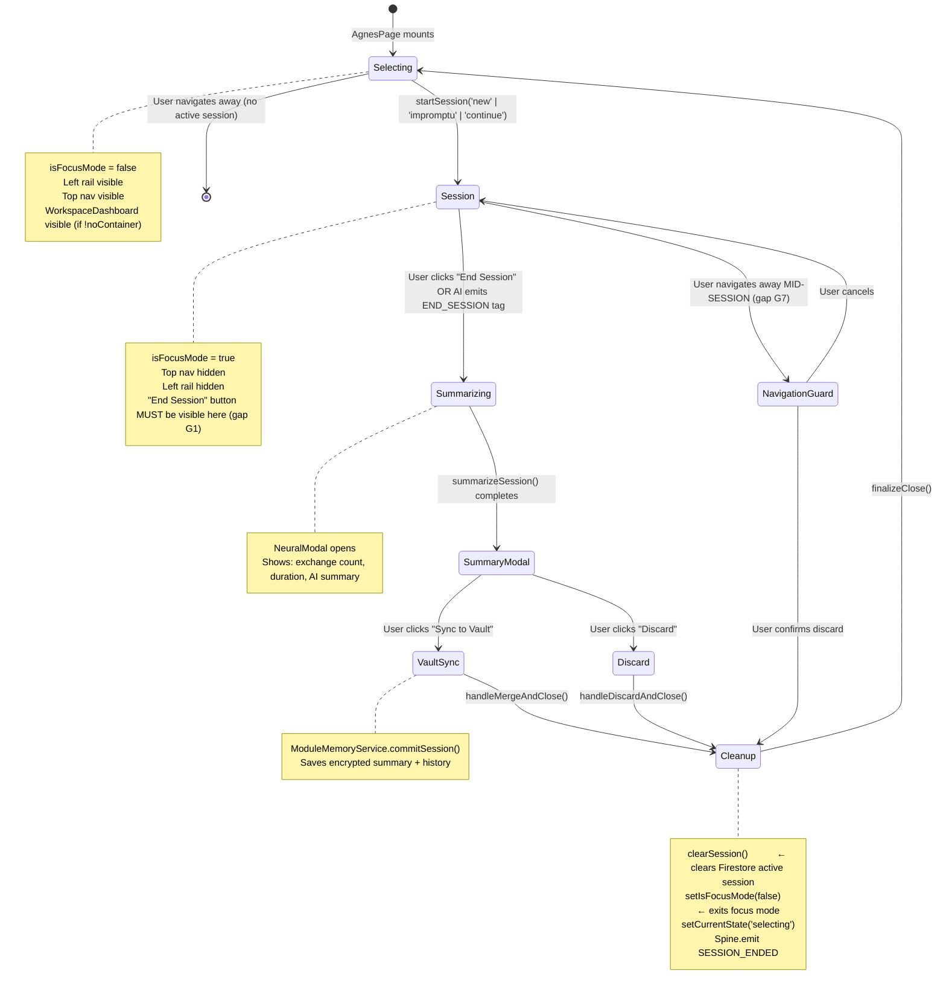

# Agnes Session Lifecycle — Architectural Analysis Report
> **Scope:** Agnes therapy session lifecycle · Nexus orchestrator chat · Session state management · Structural gaps  
> **Generated:** Architectural audit pass — all referenced line numbers are exact

---

## Table of Contents
1. [Executive Summary](#1-executive-summary)
2. [Session Lifecycle — Full Trace](#2-session-lifecycle--full-trace)
3. [Critical Bug: The Focus-Mode End-Button Blackout](#3-critical-bug-the-focus-mode-end-button-blackout)
4. [State Flow Map](#4-state-flow-map)
5. [Gap Analysis — Full Inventory](#5-gap-analysis--full-inventory)
6. [Nexus / Orchestrator Session Model Comparison](#6-nexus--orchestrator-session-model-comparison)
7. [Ideal Session Lifecycle Diagram](#7-ideal-session-lifecycle-diagram)
8. [Implementation Plan](#8-implementation-plan)
9. [Action Tag Specification — `END_SESSION`](#9-action-tag-specification--end_session)
10. [File × Change Matrix](#10-file--change-matrix)

---

## 1. Executive Summary

Agnes has **all the code to end a session** (`endSession`, `handleMergeAndClose`, `handleDiscardAndClose`, `clearSession`, `summarizeSession` all exist and are wired correctly) but the **End Session button is rendered invisible and non-interactive** whenever a session is actually active, because `isFocusMode=true` is set on session start and the `NexusChat` component wraps all `headerActions` in a focus-mode opacity-0/pointer-events-none guard.

The result: the user enters a therapy session and **has no accessible UI path to end it**. There is no keyboard shortcut, no floating escape button, no AI action tag, and no navigation guard warning. The session can only be abandoned by closing the tab (which saves the raw history but never runs the summarize→merge→cleanup flow).

Additionally, `isFocusMode` lives in a **global Zustand store** (`ui-store.ts`) and is never reset when the user navigates away mid-session, so the focus-mode visual state bleeds into other modules.

---

## 2. Session Lifecycle — Full Trace

### 2.1 Session START path

```
User clicks "New Session" or "Impromptu"  (AgnesPage.tsx:266-284, 311-329)
  └── startSession('new' | 'impromptu')    (AgnesPage.tsx:129)
        ├── setSessionStartedAt(Date.now()) (AgnesPage.tsx:131)
        ├── setIsFocusMode(true)            (AgnesPage.tsx:132)  ← DIRECT call to UIStore
        ├── setCurrentState('session')      (AgnesPage.tsx:141)
        └── setMessages([...initialMsg...]) (AgnesPage.tsx:150)
```

There is also a redundant/parallel path via the `useEffect` at **AgnesPage.tsx:102–104**:

```typescript
useEffect(() => {
  setSessionActive?.(currentState === 'session');   // AgnesPage.tsx:103
}, [currentState, setSessionActive]);
```

`setSessionActive` is the `stableSetSessionActive` callback from `UnifiedModulePage.tsx:65–67`:

```typescript
const stableSetSessionActive = useCallback((active: boolean) => {
  setIsFocusMode(active);    // UnifiedModulePage.tsx:66
}, [setIsFocusMode]);
```

So focus mode is set **twice** on session start — once directly in `startSession` and once via the `currentState` effect. This is harmless but redundant and introduces a subtle async ordering risk.

#### What `setIsFocusMode(true)` does (ui-store.ts:16–21)
```typescript
setIsFocusMode: (val) => set({ 
  isFocusMode: val,
  isLeftRailVisible: !val,   // hides left rail (AgnesSidebar)
  isRightRailVisible: !val   // hides right rail (unused by Agnes)
}),
```

It also triggers in `ModuleLayout.tsx:137` to **hide the top navigation header entirely**:
```typescript
{(!hideNavigation && !isFocusMode) && (
  <motion.header ...>   // ModuleLayout.tsx:138–183 — GONE in focus mode
```

And in `UnifiedModulePage.tsx:224` to **hide the WorkspaceDashboard** below the chat:
```typescript
{RenderDashboard && !isFocusMode && !noContainer && (  // Agnes uses noContainer=true anyway
```

#### useModuleAI session tracking
`use-module-ai.ts:294–303` emits a `SESSION_STARTED` Spine event on first message:
```typescript
if (messages.length === 0) {
  Spine.emit({ type: 'SESSION_STARTED', source: moduleId, ... });
}
```
This is only emitted on the **first user turn**, not when the session is initiated — meaning an impromptu session that receives no user messages never fires `SESSION_STARTED`.

---

### 2.2 Session END path — the broken flow

The `endSession` function at **AgnesPage.tsx:153–163** is correctly implemented:

```typescript
const endSession = async () => {
  setIsSummarizing(true);
  try {
    const summary = await summarizeSession();   // use-module-ai.ts:571–587
    setSessionSummary(summary);                 // triggers NeuralModal
  } catch (e) {
    console.error("Summary failed:", e);
  } finally {
    setIsSummarizing(false);
  }
};
```

It is wired to the "End" button at **AgnesPage.tsx:359–367**:

```tsx
<NeuralButton 
  size="sm" 
  variant="ghost" 
  onClick={endSession}          // ← correctly bound
  loading={isSummarizing} 
  className="flex items-center gap-2 px-4 rounded-full border-white/5 hover:border-rose-500/20 hover:text-rose-400"
>
  <LogOut className="w-3 h-3" /> End
</NeuralButton>
```

This button is passed as `headerActions` to `NexusChat`. This is where the flow breaks — see Section 3.

After the user sees the summary modal:
- **"Sync to Vault"** → `handleMergeAndClose()` (AgnesPage.tsx:173–210): commits session to `ModuleMemoryService`, then calls `finalizeClose()`
- **"Discard"** → `handleDiscardAndClose()` (AgnesPage.tsx:212–219): calls `finalizeClose()` directly

`finalizeClose()` at **AgnesPage.tsx:165–171**:
```typescript
const finalizeClose = async () => {
  await clearSession();        // use-module-ai.ts:547–569 — clears Firestore + sessionStorage
  setIsFocusMode(false);       // exits focus mode
  setCurrentState('selecting'); // returns to session selector UI
  setSessionType(null);
  setSessionSummary(null);
};
```

`clearSession()` at **use-module-ai.ts:547–569** also emits `SESSION_ENDED` on the Spine event bus. ✅

**The cleanup pipeline itself is correct and complete.** The only problem is that the user can never reach `endSession()` because the button that calls it is hidden.

---

## 3. Critical Bug: The Focus-Mode End-Button Blackout

### Location
**`NexusChat.tsx:85–91`**

```tsx
headerActions={
  <div className="flex items-center gap-4">
    <div className={cn(
      "transition-all duration-500", 
      isFocusMode ? "opacity-0 pointer-events-none scale-95" : "opacity-100"  // ← THE BUG
    )}>
      {headerActions}   {/* AgnesTelemetryHeader + End button */}
    </div>
  </div>
}
```

### Root cause
`NexusChat` was designed so that `headerActions` (like telemetry widgets) fade out during a focus session to reduce visual noise. But it wraps **all** `headerActions` in the same fade container — including the "End" button. There is no mechanism to mark some actions as "focus-safe" (i.e., always visible).

### Consequence chain
```
isFocusMode=true (set by startSession)
  → NexusChat wrapper div: opacity-0 + pointer-events-none
    → AgnesTelemetryHeader hidden ✓ (intentional)
    → "End" NeuralButton hidden ✗ (unintentional, blocks session exit)
      → User is trapped in session with no UI exit
        → Tab close is the only escape
          → summarize + merge never runs
            → session data is raw-dumped to Firestore without summary
```

### Secondary: ModuleLayout header also gone
In `ModuleLayout.tsx:137`, the entire top nav (including the back arrow) is hidden when `isFocusMode=true`. So the "← back" escape route is also blocked.

### Global state leak
`isFocusMode` is in **Zustand** (ui-store.ts), which persists across navigation within the SPA. If the user navigates away from Agnes mid-session (e.g., via a direct URL change or Nexus redirect), `isFocusMode` stays `true` and will corrupt the layout of whatever module they land on — its header and rails will be hidden, and its `ChatInterface` will render in focus-mode layout.

---

## 4. State Flow Map

```
ui-store.ts (Zustand — global)
├── isFocusMode: boolean
│   ├── SET TO TRUE by:
│   │   ├── AgnesContent.startSession() → setIsFocusMode(true)  [AgnesPage.tsx:132]
│   │   └── AgnesContent useEffect → setSessionActive(true) → stableSetSessionActive(true) → setIsFocusMode(true) [AgnesPage.tsx:102]
│   └── SET TO FALSE by:
│       └── finalizeClose() → setIsFocusMode(false)  [AgnesPage.tsx:167]
│           └── (ONLY reachable if user can click "End" button — which is hidden)
│
├── isLeftRailVisible: boolean  (mirrors !isFocusMode on set)
└── isRightRailVisible: boolean (mirrors !isFocusMode on set)

AgnesContent (local state)
├── currentState: 'selecting' | 'session'
│   ├── 'selecting' → shows session selector UI
│   └── 'session'   → shows NexusChat
├── sessionType: 'impromptu' | 'new' | null
├── isSummarizing: boolean
├── isClosingSession: boolean
└── sessionSummary: string | null  (triggers NeuralModal when non-null)

useModuleAI (hook state)
├── messages: Message[]          (persisted to Firestore + sessionStorage)
├── isProcessing: boolean
├── streamingText: string
├── error: string | null
└── quota: GuestQuota
```

---

## 5. Gap Analysis — Full Inventory

| # | Gap | Severity | Location |
|---|-----|----------|----------|
| G1 | **End button invisible in focus mode** — `isFocusMode` wrapper in `NexusChat` hides `headerActions` including the only End button | 🔴 Critical | `NexusChat.tsx:87` |
| G2 | **No focus-safe action slot in `NexusChat`** — no prop like `focusSafeActions` that bypasses the opacity wrapper | 🔴 Critical | `NexusChat.tsx:11–30` |
| G3 | **No floating "End Session" escape overlay** — no always-visible UI element (FAB, corner pill, keyboard shortcut) for session exit in deep focus mode | 🟠 High | `AgnesPage.tsx` missing |
| G4 | **No `END_SESSION` action tag** — Agnes AI cannot proactively close a session (e.g., after offering a closing ritual) | 🟠 High | `src/modules/agnes/services/actions.ts` |
| G5 | **`isFocusMode` global state not reset on navigation** — Zustand state persists across module navigation, causing focus-mode layout to bleed into other modules | 🟠 High | `ui-store.ts` + router |
| G6 | **Duplicate `setIsFocusMode` calls on session start** — once in `startSession` (L132) and once via `useEffect`/`setSessionActive` (L102) | 🟡 Medium | `AgnesPage.tsx:102,132` |
| G7 | **No `beforeunload` user warning** — navigating away mid-session loses the summarize/merge flow silently (raw flush only) | 🟡 Medium | `use-module-ai.ts:256` |
| G8 | **`SESSION_STARTED` only emits on first user turn** — not on `startSession()`, so zero-message sessions are not tracked | 🟡 Medium | `use-module-ai.ts:294` |
| G9 | **No keyboard shortcut for session end** — focus mode may be used in accessibility contexts | 🟡 Medium | `AgnesPage.tsx` |
| G10 | **WorkspaceDashboard never visible in Agnes** — `noContainer=true` suppresses it regardless of `isFocusMode` | 🟢 Low | `AgnesPage.tsx:459` / `UnifiedModulePage.tsx:224` |
| G11 | **Left rail (AgnesSidebar) hidden in session** — profile context disappears exactly when it would be most useful | 🟢 Low | `ui-store.ts:19` |

---

## 6. Nexus / Orchestrator Session Model Comparison

The Orchestrator (`OrchestratorPage.tsx`) uses a fundamentally different model — **no session concept at all**.

| Aspect | Agnes | Nexus (Orchestrator) |
|--------|-------|---------------------|
| **Session lifecycle** | `selecting → session → (end) → selecting` | `ONBOARDING → DASHBOARD` (permanent) |
| **Focus mode** | Yes — set on session start | Never set — not consumed |
| **End session** | Has `endSession()` + `finalizeClose()` (but broken UI path) | No concept — chat is always open |
| **`clearSession()`** | Called on session end | Never called |
| **`summarizeSession()`** | Called on session end | Never called |
| **Memory commit** | `ModuleMemoryService.commitSession()` on "Sync to Vault" | Continuous auto-save via `flushActiveSession` |
| **`setSessionActive` prop** | Passed down, sets `isFocusMode` | Not passed (no `UnifiedModulePage` wrapper) |
| **Persistence** | Vault-encrypted E2E | Core profile (Firestore, no E2E encryption) |
| **`headerActions`** | Telemetry + End button (both broken in focus mode) | Not used |

Nexus has no "session" because it is always-on persistent orchestration. The Nexus `NexusDashboard` sits outside `UnifiedModulePage` entirely. **This is correct design** — Nexus should never have focus mode or session end.

---

## 7. Ideal Session Lifecycle Diagram



---

## 8. Implementation Plan

### Fix G1+G2 — Expose End Session button in focus mode (CRITICAL)

**Approach A — `focusSafeActions` prop on `NexusChat` (Recommended)**

Add a new prop to `NexusChat` that renders actions outside the focus-mode opacity wrapper:

```
NexusChat.tsx
  Props: add  focusSafeActions?: ReactNode
  Render: place <focusSafeActions> in headerActions div but OUTSIDE
          the isFocusMode opacity-0 wrapper
```

Agnes passes the End button as `focusSafeActions` and the telemetry widget as `headerActions`:

```
AgnesPage.tsx  (AgnesContent, ~line 349–370)
  NexusChat prop: headerActions    = <AgnesTelemetryHeader />        (fades in focus mode ✓)
  NexusChat prop: focusSafeActions = <EndSessionButton onClick={endSession} />  (always visible)
```

**Approach B — Floating escape overlay inside `AgnesContent` (Supplement)**

Render a fixed/absolute position "End Session" pill inside the session `<motion.div>` (AgnesPage.tsx:342–373) that is always visible regardless of `NexusChat` internals. This is the belt-and-suspenders approach:

```
AgnesPage.tsx — inside the `key="session"` motion.div
  Add: <EndSessionOverlay onClick={endSession} loading={isSummarizing} />
       Position: fixed, bottom-right or top-right corner
       Visibility: always, with subtle animation on focus mode entry
```

### Fix G3 — Floating "End Session" component

**New file: `src/modules/agnes/components/AgnesEndSessionOverlay.tsx`**

- Position: `fixed bottom-6 right-6` (or `top-6 right-6` to avoid chat input)
- Renders: rose-tinted `LogOut` icon button with "End Session" label
- Animates in when `currentState === 'session'` via `AnimatePresence`
- Keyboard shortcut: `Escape` key listener (with confirmation if `messages.length > 0`)
- Only renders inside `AgnesContent` — does not affect other modules

### Fix G4 — `END_SESSION` action tag

**Modify: `src/modules/agnes/services/actions.ts`**

Register a new action:

```typescript
ActionHub.register('agnes', 'end_session', async ({ pushAssistantMessage }) => {
  // Emit a custom DOM event that AgnesContent listens for
  window.dispatchEvent(new CustomEvent('agnes:end-session-requested'));
  // Optionally push a closing message
  pushAssistantMessage?.('Session synthesis initiated. Please review the summary before we close.');
});
```

**Modify: `AgnesContent` in `AgnesPage.tsx`**

Add a `useEffect` that listens for `'agnes:end-session-requested'` and calls `endSession()`.

**Modify: Agnes system prompt** (`src/modules/agnes/prompts/agnes-session-prompt.ts`)

Document the `end_session` action so Agnes AI knows when to emit it (e.g., after a natural closing ritual, after explicit user request to end).

### Fix G5 — Reset `isFocusMode` on navigation away

**Option A — React Router `useEffect` cleanup in `AgnesContent`**

```typescript
// AgnesPage.tsx — inside AgnesContent
useEffect(() => {
  return () => {
    // On unmount (navigation away), always exit focus mode
    setIsFocusMode(false);
  };
}, [setIsFocusMode]);
```

**Option B — Module-scoped focus mode (Longer term)**

Replace `isFocusMode` in `ui-store.ts` with `focusModeModule: string | null`. Focus mode is only considered active for a specific module, preventing bleed. This is a larger refactor.

**Recommended short term: Option A** — simple one-liner in `AgnesContent` cleanup.

### Fix G6 — Remove duplicate `setIsFocusMode` calls

Remove the direct `setIsFocusMode(true)` call from `startSession()` at **AgnesPage.tsx:132**. The `useEffect` at line 102 already handles this reactively when `currentState` changes to `'session'`. The direct call is redundant and can race with the effect.

```typescript
// AgnesPage.tsx:129–151 — remove line 132
const startSession = async (type: 'impromptu' | 'new' | 'continue') => {
  setSessionStartedAt(Date.now());
  // REMOVE: setIsFocusMode(true);  ← handled by the useEffect at L102
  if (type === 'continue') {
    setCurrentState('session');
    return;
  }
  setSessionType(type);
  setCurrentState('session');
  // ...
};
```

### Fix G7 — Navigation guard (`beforeunload` warning)

**Modify: `AgnesContent` in `AgnesPage.tsx`**

```typescript
useEffect(() => {
  if (currentState !== 'session' || messages.length === 0) return;
  
  const handleBeforeUnload = (e: BeforeUnloadEvent) => {
    e.preventDefault();
    e.returnValue = '';  // Triggers browser's native "leave page?" dialog
  };
  
  window.addEventListener('beforeunload', handleBeforeUnload);
  return () => window.removeEventListener('beforeunload', handleBeforeUnload);
}, [currentState, messages.length]);
```

For in-app navigation (React Router), use `useBlocker` (React Router v6.7+) to show an Agnes-themed confirmation modal instead of the browser native dialog.

### Fix G8 — Emit `SESSION_STARTED` on session init

**Modify: `startSession()` in `AgnesPage.tsx`**

Emit a Spine event (or a local effect) when the session starts, not when the first message is sent. This requires either:
- Passing `emitSpineEvent` up from `useModuleAI` (expose it from the hook return)
- Or using a `useEffect` watching `currentState === 'session'`

---

## 9. Action Tag Specification — `END_SESSION`

Agnes AI should be able to autonomously signal session closure. This fits the existing `ActionHub` pattern.

### Registration (actions.ts)

```typescript
ActionHub.register('agnes', 'end_session', async ({ payload, pushAssistantMessage }) => {
  const closingMessage = typeof payload?.closing_message === 'string'
    ? payload.closing_message
    : null;

  if (closingMessage && pushAssistantMessage) {
    pushAssistantMessage(closingMessage);
  }

  // Fire DOM event — AgnesContent listens and calls endSession()
  window.dispatchEvent(new CustomEvent('agnes:end-session-requested', {
    detail: { source: 'ai', payload }
  }));
});
```

### System prompt addition (`agnes-session-prompt.ts`)

```
AVAILABLE ACTIONS:
...existing actions...
- end_session: Initiate a graceful session closure. Use after a natural therapeutic closing 
  ritual, when the user explicitly asks to end, or when session duration suggests natural 
  completion. Include a closing_message in the payload.
  
  Example emission:
  <action:end_session>{"closing_message": "This has been meaningful work. Your reflection will be preserved securely."}</action:end_session>
```

### Listener in `AgnesContent` (`AgnesPage.tsx`)

```typescript
useEffect(() => {
  const handleAIEndSession = () => {
    if (currentState === 'session' && !isSummarizing) {
      endSession();
    }
  };
  
  window.addEventListener('agnes:end-session-requested', handleAIEndSession);
  return () => window.removeEventListener('agnes:end-session-requested', handleAIEndSession);
}, [currentState, isSummarizing, endSession]);
```

---

## 10. File × Change Matrix

| File | Change Type | Priority | Description |
|------|-------------|----------|-------------|
| `src/core/components/NexusChat.tsx` | **Modify** | 🔴 P0 | Add `focusSafeActions?: ReactNode` prop; render it outside the `isFocusMode` opacity wrapper so always-visible actions (End Session) can live there |
| `src/modules/agnes/AgnesPage.tsx` | **Modify** | 🔴 P0 | Move End button to `focusSafeActions`; add cleanup `useEffect` to reset `isFocusMode` on unmount; remove duplicate `setIsFocusMode(true)` from `startSession()`; add AI end-session event listener |
| `src/modules/agnes/components/AgnesEndSessionOverlay.tsx` | **Create** | 🟠 P1 | Floating escape overlay — fixed-position End Session button with `Escape` key support, always visible during active session |
| `src/modules/agnes/services/actions.ts` | **Modify** | 🟠 P1 | Register `end_session` action handler; dispatch `agnes:end-session-requested` DOM event |
| `src/modules/agnes/prompts/agnes-session-prompt.ts` | **Modify** | 🟠 P1 | Document `end_session` action tag in system prompt so Agnes AI knows when and how to emit it |
| `src/lib/stores/ui-store.ts` | **Modify** | 🟡 P2 | Consider adding `focusModeModule: string \| null` to scope focus mode to a specific module and prevent global bleed |
| `src/modules/agnes/AgnesPage.tsx` | **Modify** | 🟡 P2 | Add `useBlocker` (React Router) or `beforeunload` handler to warn user when navigating away mid-session |
| `src/lib/hooks/use-module-ai.ts` | **Modify** | 🟡 P2 | Move `SESSION_STARTED` Spine emit to be triggered on session init, not first message (requires exposing a `startSessionTracking()` call or moving emit to a passed callback) |

---

### Minimal Viable Fix (P0 only — unblocks session exit)

1. Add `focusSafeActions?: ReactNode` prop to `NexusChat.tsx` — render it outside opacity wrapper
2. In `AgnesPage.tsx`, pass End button via `focusSafeActions` not `headerActions`
3. Add `useEffect` cleanup in `AgnesContent` to call `setIsFocusMode(false)` on unmount

These three changes, totalling ~15 lines of code, restore the user's ability to end a session.

---

*End of report. All line numbers reference the codebase snapshot at time of analysis.*
