# ARA Host-Node Networking, Optimization & AgentMesh Federation Roadmap

Status: Architectural roadmap and engineering contract under the [ARA Master Plan](ARA-AGENT-OS-MASTER-PLAN.md) and [Host/Node Sync and Recovery Contract](ARA-HOST-NODE-SYNC-AND-RECOVERY.md). This document formalizes the evaluation of [google/agentmesh](https://github.com/google/agentmesh), establishes the migration from short-polling HTTP to persistent multiplexed streams, and charts the long-term adoption of decentralized Agent-to-Agent (A2A) tool federation.

---

## 1. Context & Architectural Assessment

### 1.1 The Evaluation of `google/agentmesh`
An architectural audit of Google's Agent Mesh (`google/agentmesh`, formerly SAM / Sovereign Agent Mesh) was conducted to evaluate its viability for connecting ARA Host (coordinator, PostgreSQL domain store, recovery archive, web UI) and ARA Nodes (execution runners, local Hermes profile runtimes, detached Git worktrees, CUA drivers).

#### AgentMesh Architectural Profile
* **Substrate**: Decentralized peer-to-peer overlay network running on `go-libp2p` and `py-libp2p`.
* **Identity & Access**: Ed25519 node keypairs; centralized issuance of **Biscuit tokens** (cryptographic, decentralized capability tokens with Datalog attenuation) via `agentmesh-control-plane`.
* **Transport & Discovery**: Libp2p Kademlia DHT, rendezvous/relay routers (`agentmesh-router`), and stream wrappers (`p2phttp`, `gostream`).
* **Protocols**: Protocol Buffers (`api/agentmesh.proto`), Model Context Protocol (MCP), and OpenAI-compatible chat endpoints.

#### Findings for ARA's Host $\leftrightarrow$ Node Topology
| Dimension | Google AgentMesh Characteristics | ARA Host $\leftrightarrow$ Node Requirements | Assessment / Fit |
| :--- | :--- | :--- | :--- |
| **Topology** | Symmetric, ad-hoc P2P mesh (any agent calls any agent). | Asymmetric hub-and-spoke (Host coordinates, schedules, archives; Node executes). | **Mismatched**: ARA does not require full mesh routing for central coordination. |
| **Runtime Footprint** | External Go daemon (`agentmesh-node`) running as a sidecar process. | Single-script, pure Python 3.12 deployment (`bash scripts/setup-node.sh`). | **Sub-optimal**: Introduces cross-compilation, daemon supervision, and memory overhead on edge nodes. |
| **Bulk State Sync** | Small-packet stream framing over libp2p. | Multi-megabyte SQLite WAL backups and tarball snapshots (`/sync`). | **Inefficient**: P2P muxed streams are inferior to native HTTP/2 chunked streams for large binary state. |
| **Crash & Offline Durability** | Ephemeral RPC and pub/sub signaling. | Local SQLite outbox (`tasks.sqlite3`), deterministic receipts, sequence hashing. | **Neutral**: ARA's journal is still required on top of AgentMesh. |
| **Capability Attenuation** | Biscuit Datalog tokens allow fine-grained offline attenuation. | Swarm worker tool grants (filesystem, terminal, web, CUA) need strict fencing. | **High Value**: Biscuit tokens are ideal for child-agent permission delegation. |
| **Direct P2P Tool Sharing** | Direct agent-to-agent MCP tool invocation across NATs without central proxy. | Swarm workers on Node A calling specialized tools/models on Node B. | **High Value**: Strong fit for distributed multi-node swarms (Phase 3). |

**Conclusion**: AgentMesh is **not** an optimized replacement for ARA's core Host-to-Node control plane. However, its core primitives (Biscuit tokens and P2P MCP tool federation) offer significant value for **horizontal worker-to-worker swarm collaboration**.

---

## 2. Core Architectural Principles & Invariants

All phases of this networking roadmap must preserve the following system invariants:

1. **Native Runtime Primacy**: The pinned native Hermes agent loop, CLI, and profile structures remain authoritative on the executing machine. No networking layer may proxy or re-implement the LLM loop.
2. **Durable Local Journaling**: All task admissions and event emissions must commit to the node's local SQLite journal (`tasks.sqlite3`) *before* transmission over the network. Network disconnects must never interrupt local execution.
3. **Passive Replica Fencing**: The Host maintains passive state replicas and recovery snapshots; it never acts as a concurrent live writer to an active node's profile database.
4. **Zero Unattended Native Daemons on Minimal Nodes**: Node bootstrapping via `scripts/setup-node.sh` must remain lightweight and manageable within the Python virtual environment without requiring system-level daemon managers unless explicitly opted into.
5. **Deterministic Reconnection**: State and event synchronization must rely on immutable content hashes (`fingerprint(data)`) and monotonic sequence numbers, ensuring idempotent retries without event duplication.

---

## 3. Multi-Phase Implementation Roadmap

```mermaid
flowchart LR
    subgraph Phase1["Phase 1: Real-Time Persistent Link (Near-Term)"]
        direction TB
        P1_1["WebSocket / SSE Control Stream\n(Sub-10ms task push)"]
        P1_2["Direct Binary Snapshot Sync\n(Streaming HTTP/2 + SHA-256)"]
        P1_3["Preserve SQLite Journal & Outbox\n(Zero execution disruption)"]
    end

    subgraph Phase2["Phase 2: Zero-Trust Security & Edge Mesh (Mid-Term)"]
        direction TB
        P2_1["Mutual TLS (mTLS) Machine Certs\n(Self-sovereign node pairing)"]
        P2_2["WireGuard / Tailscale Transport\n(Transparent NAT & edge traversal)"]
        P2_3["Biscuit Capability Attenuation\n(Cryptographic worker tool grants)"]
    end

    subgraph Phase3["Phase 3: AgentMesh P2P Federation (Long-Term)"]
        direction TB
        P3_1["Worker-to-Worker MCP Federation\n(Direct node-to-node tool routing)"]
        P3_2["Google AgentMesh Interop\n(api/agentmesh.proto compatibility)"]
        P3_3["Cross-Cluster Swarm Delegations\n(Decentralized multi-org mesh)"]
    end

    Phase1 ==> Phase2 ==> Phase3
```



---

### Phase 1: Real-Time Persistent Control Plane & Streaming Sync (Near-Term)

**Objective**: Eliminate the 2-second short-polling delay in `ara node work`, reduce CPU/network idle chatter, and optimize bulk snapshot replication.

#### Key Deliverables:
1. **Persistent Duplex Control Channel (`/api/v1/nodes/stream`)**:
   * Implement a persistent WebSocket or HTTP/2 Server-Sent Events (SSE) connection between Node and Host.
   * Host pushes task assignments (`task.assigned`) instantly upon admission (< 10ms dispatch latency vs. current 0–2000ms delay).
   * Node streams real-time task progress and step events (`swarm.started`, `worker.progress`, `step.output`) without polling batch boundaries.
   * Heartbeat / Keepalive protocol: 20-second ping/pong with immediate offline detection.
2. **Streaming Binary Recovery Sync (`/api/v1/nodes/sync/binary`)**:
   * Replace base64 JSON encoding of native tarballs with raw binary streaming (`Content-Type: application/gzip`).
   * Stream chunks directly to disk with inline SHA-256 computation to minimize node and host RAM allocation during large snapshot uploads.
   * Resumable upload chunking for environments with unstable network links.
3. **Outbox Drain & Reconnection Replay**:
   * Refactor [`ara_os.node_execution.exchange()`](file:///home/pacman/Projects/ara/agent-os/src/ara_os/node_execution.py#L30) to act as a reactive stream listener.
   * On disconnect, execution continues via local SQLite [`Journal`](file:///home/pacman/Projects/ara/agent-os/src/ara_os/task_journal.py#L20).
   * Upon reconnection, the node performs an atomic handshake: exchanges last acknowledged sequence numbers, replays unacknowledged event batches, and resumes the real-time stream.

---

### Phase 2: Zero-Trust Security & Edge Overlay Network (Mid-Term)

**Objective**: Harden host-node communication across public networks and adopt decentralized cryptographic capabilities.

#### Key Deliverables:
1. **Mutual TLS (mTLS) & Node Cryptographic Identity**:
   * Replace simple pre-shared bearer tokens (`X-ARA-Node-Key`) with asymmetric Ed25519 or ECDSA certificate authentication.
   * `ara node pair` generates local private keys on the node and exchanges signed CSRs with the Host CA during interactive enrollment.
   * Node private keys never leave the executing machine.
2. **Transparent Overlay Network Integration (WireGuard / Tailscale Engine)**:
   * Provide native configuration presets for WireGuard or embedded Tailscale (`tsnet`) for nodes deployed on remote WANs, home networks, or mobile environments.
   * Bypass complex application-level NAT punching while preserving standard HTTP/2 and WebSocket transport semantics.
3. **Biscuit Token Integration for Swarm Delegations**:
   * Adopt **Biscuit cryptographic tokens** for worker execution grants.
   * When the Host orchestrator delegates a swarm task to a Node with tool restrictions (e.g., `toolsets: [web, terminal]`, `workspace: /path`), it issues a signed Biscuit token.
   * The node runtime or child agent can attenuate (further restrict) the token (e.g., restricting terminal commands to specific directories) before passing it to sub-workers, with local verification and zero network round-trips.

---

### Phase 3: P2P Agent-to-Agent Swarm Federation & AgentMesh Interoperability (Long-Term)

**Objective**: Enable horizontal node-to-node tool sharing and compatibility with Google AgentMesh and decentralized agent networks.

#### Key Deliverables:
1. **Direct Node-to-Node Worker Tool Routing**:
   * Enable worker agents on Node A (e.g., a lightweight cloud runner) to directly invoke specialized local MCP tools on Node B (e.g., a local Mac mini with CUA ScreenCaptureKit or local Ollama GPU) without tunneling payload bytes through the Host coordinator.
   * Host coordinates routing metadata and permissions; data exchange occurs peer-to-peer.
2. **Google AgentMesh Adapter**:
   * Implement an optional sidecar bridge adhering to `api/agentmesh.proto`.
   * Allow ARA profiles to publish their native MCP capabilities to an external Google AgentMesh network.
   * Allow ARA swarms to discover and invoke tools registered on an external Agent Mesh by third-party agents.
3. **Decentralized Multi-Host Federation**:
   * Support cross-organization collaboration where independent ARA Host installations discover and delegate tasks across boundaries using decentralized public-key registries.

---

## 4. Protocol & Wire Specifications (Phase 1 Baseline)

### 4.1 Control Channel WebSocket Frame Specification

Endpoint: `wss://<host>/api/v1/nodes/stream`  
Headers: `X-ARA-Node-Key: <token>` (Phase 1) $\rightarrow$ mTLS Client Certificate (Phase 2)

#### Frame Types
1. **`node.hello`** (Node $\rightarrow$ Host, on connection):
   ```json
   {
     "type": "node.hello",
     "machine_id": "m-7a1b4c9e",
     "contract": "ara-execution/1",
     "cursor": {
       "task_id": "d3b07384...",
       "last_sequence": 14
     }
   }
   ```
2. **`task.assign`** (Host $\rightarrow$ Node):
   ```json
   {
     "type": "task.assign",
     "task_id": "e4f18392...",
     "profile_id": "p-coding-agent",
     "request": {
       "contract": "ara-execution/1",
       "native_name": "coding-agent",
       "preset": "coding",
       "task": "Implement feature X",
       "workers": [...]
     }
   }
   ```
3. **`task.event`** (Node $\rightarrow$ Host):
   ```json
   {
     "type": "task.event",
     "task_id": "e4f18392...",
     "sequence": 1,
     "fingerprint": "a1c2e3...",
     "event": {
       "type": "swarm.started",
       "data": { "stage": 1 }
     }
   }
   ```
4. **`task.ack`** (Host $\rightarrow$ Node):
   ```json
   {
     "type": "task.ack",
     "task_id": "e4f18392...",
     "acknowledged_sequence": 1
   }
   ```

---

## 5. Verification, Benchmarks & Success Metrics

| Metric | Current v0.1 Baseline | Phase 1 Target | Phase 2/3 Target |
| :--- | :--- | :--- | :--- |
| **Task Dispatch Latency** | 1000–2000 ms (polling) | **< 15 ms** (push stream) | < 15 ms |
| **Event Ingestion Latency** | 2000 ms (batch poll) | **< 20 ms** (stream push) | < 20 ms |
| **Idle CPU / Network Overhead** | Continuous polling (0.5 req/s) | **0 req/s** (idle keepalive only) | 0 req/s |
| **Snapshot Sync Throughput** | ~12 MB/s (base64 JSON decode) | **> 80 MB/s** (streaming binary) | Wire-speed |
| **Offline Recovery Resilience** | 100% (SQLite journal) | **100%** (unbroken guarantee) | 100% |
| **Node Daemon Dependencies** | 0 external binaries | **0 external binaries** | Optional sidecar |

---

## 6. Document History & Related Contracts

* [ARA Master Plan](ARA-AGENT-OS-MASTER-PLAN.md) — Core architecture, lifecycle and hosting boundaries.
* [Host/Node Sync and Recovery Contract](ARA-HOST-NODE-SYNC-AND-RECOVERY.md) — Passive replica rules, snapshot boundaries, and failover semantics.
* [Multi-Agent Swarms Specification](../../agent-os/docs/SWARMS.md) — Node execution, worktree isolation, and task journals.
* [Google AgentMesh Repository](https://github.com/google/agentmesh) — Upstream reference for A2A protocols and Biscuit token security.
