# ARA Sovereign Voice & Visual Avatar Implementation Roadmap

Status: Architectural roadmap and engineering contract under the [ARA Master Plan](ARA-AGENT-OS-MASTER-PLAN.md) and [Product Surfaces Contract](../../agent-os/docs/PRODUCT-SURFACES.md). This document formalizes the evaluation and integration of **[debpalash/VoiceStudio](https://github.com/debpalash/VoiceStudio)** (for local-first STT/TTS and zero-shot voice cloning) and **[openspline/openspline](https://github.com/openspline/openspline)** (for real-time, audio-driven lip-synced visual avatars).

---

## 1. Context & Subsystem Roles

ARA's conversational model currently operates on chained text and native transcription/speech requests ([`UPSTREAM-DECISIONS.md`](../../agent-os/docs/UPSTREAM-DECISIONS.md#L13)). To evolve into a fully sovereign, low-latency multimodal companion, ARA requires two distinct subsystems:

1. **Audio & Voice Synthesis Engine (`debpalash/VoiceStudio`)**:
   * **Role**: The "voice box" and "ears" of the operating system.
   * **Capabilities**: Zero-shot voice cloning from audio samples, parameter-driven voice design (pitch, tone, accent, age), local speech-to-text (STT) transcription, and multi-engine TTS execution (`OmniVoice`, `CosyVoice`, `MLX-Audio`, `Sherpa-ONNX`).
   * **Interface**: Decoupled Model Context Protocol (MCP) server (`debpalash/VoiceStudio`) and local HTTP/WebSocket endpoints.
2. **Visual Avatar Layer (`openspline/openspline`)**:
   * **Role**: The "face" and visual presence of specialist agent profiles in the React dashboard.
   * **Capabilities**: Generates real-time, audio-conditioned talking head video (60–90+ FPS) from a single static profile portrait. Synthesizes continuous idle micro-movements (breathing, blinking) during listening states to prevent static freezes or awkward loop cuts.
   * **Interface**: Python SDK / streaming video canvas (WebRTC / MediaStream).

---

## 2. Core Architectural Principles & Invariants

1. **Graceful Degradation & Independent Failure**:
   * Microphone capture, STT transcription, TTS synthesis, and avatar rendering fail independently.
   * If VoiceStudio is unavailable, standard typed chat and cloud STT/TTS fallbacks remain fully functional.
   * If Openspline is unavailable or the host lacks an NVIDIA GPU, the UI seamlessly falls back to static profile artwork with zero user disruption.
2. **License Isolation (AGPL-3.0 vs. MIT)**:
   * Ara Agent OS is licensed under **MIT**. VoiceStudio is licensed under **AGPL-3.0**.
   * VoiceStudio source code will **never** be vendored or imported into `ara_os` directly. It must run as an external, decoupled process accessed strictly via its network API (REST/WebSocket) or standard stdio/SSE **Model Context Protocol (MCP)** boundary.
3. **Local Sovereignty & Persona Privacy**:
   * Voice cloning reference audio and synthesized speech must never leave the local host unless an external cloud provider is explicitly configured.
   * Each native profile maintains its own isolated voice and visual assets under its native home: `~/.hermes/profiles/<native-name>/voice/` and `avatar/`.
4. **Streaming Duplex Performance**:
   * Voice output must not wait for the LLM to complete its entire response. TTS streaming must begin chunking and synthesizing audio on the first sentence boundary (< 500ms time-to-first-audio target).

---

## 3. Multi-Phase Voice & Avatar Roadmap

```mermaid
flowchart LR
    subgraph Phase1["Phase 1: Local Voice Synthesis (Near-Term)"]
        direction TB
        P1_1["VoiceStudio MCP Server Integration\n(Stdio/HTTP tool calls)"]
        P1_2["Per-Profile Voice Seeds\n(Zero-shot persona cloning)"]
        P1_3["Local STT / Transcription Provider\n(Whisper / Sherpa-ONNX fallback)"]
    end

    subgraph Phase2["Phase 2: Streaming Duplex Audio (Mid-Term)"]
        direction TB
        P2_1["WebSocket Audio Gateway (/api/audio/stream)\n(Low-latency duplex PCM)"]
        P2_2["Sentence-Chunked Streaming TTS\n(Sub-500ms time-to-first-audio)"]
        P2_3["Barge-In / Interruption Detection\n(Instant speech cancelation)"]
    end

    subgraph Phase3["Phase 3: Real-Time Avatar Personas (Long-Term)"]
        direction TB
        P3_1["Openspline Visual Daemon Integration\n(NVIDIA CUDA GPU hosts)"]
        P3_2["WebRTC / Canvas Video Viewer\n(React 19 dashboard integration)"]
        P3_3["Idle Motion & State Synchronization\n(Listening, thinking, speaking)"]
    end

    Phase1 ==> Phase2 ==> Phase3
```

---

### Phase 1: Local Voice Synthesis & Persona Cloning (Near-Term)

**Objective**: Introduce high-quality, local-first voice synthesis and assign unique vocal identities to each specialist agent without cloud API costs.

#### Deliverables:
1. **Decoupled VoiceStudio MCP Integration**:
   * Implement an external service connector in `ara_os.mcp` pointing to the VoiceStudio daemon.
   * Expose voice tools to the host: `voice_generate_speech(text, voice_id)`, `voice_clone(sample_path, name)`, and `voice_transcribe(audio_path)`.
   * Add a `VoiceStudio` provider option to `/api/v1/profiles/{id}/voice-settings`.
2. **Specialist Profile Voice Seeds**:
   * Create standard directory conventions for profile audio assets:
     * `~/.hermes/profiles/<name>/voice/seed.wav` (5–10s reference sample).
     * `~/.hermes/profiles/<name>/voice/traits.json` (pitch, speed, tone descriptors).
   * Initial specialist assignments:
     * **Ara** (System Orchestrator): Measured, articulate, neutral-timbre voice.
     * **Scout** (Deep Research): Fast, analytical cadence.
     * **Titan** (Athletics & Training): Resonant, high-energy tone.
     * **Agnes** (Private Reflections): Warm, gentle, contemplative tone.
     * **Ledger** (Finance): Precise, calm, deliberate voice.
     * **Atlas** (Strategic Planning): Confident, structured, direct tone.
3. **Batch Speech Synthesis**:
   * Replace external cloud API calls in `/api/audio/speak` with local VoiceStudio synthesis using the executing profile's seed.

---

### Phase 2: Streaming Duplex Audio & Interruption Handling (Mid-Term)

**Objective**: Transform voice from turn-based request/response into a continuous, fluid conversational experience.

#### Deliverables:
1. **Duplex WebSocket Gateway (`/api/v1/voice/stream`)**:
   * Establish a persistent bidirectional audio socket between the browser and ARA Host.
   * Client streams Opus/PCM microphone chunks; server streams back synthesized audio frames.
2. **First-Sentence Streaming Pipeline**:
   * Hook into Hermes' streaming token output. As soon as a sentence terminator (`.`, `?`, `!`, `\n`) is reached, dispatch that text slice to VoiceStudio's streaming TTS queue.
   * Audio begins playing on the client while the model generates subsequent sentences.
3. **Barge-In (Interruption) Management**:
   * When client-side VAD (Voice Activity Detection) senses user speech during playback, the client immediately sends a `voice.interrupt` frame.
   * ARA halts active TTS generation, cancels ongoing LLM token generation, and flushes audio buffers.

---

### Phase 3: Real-Time Visual Avatar Personas with Openspline (Long-Term)

**Objective**: Give specialist profiles an animated talking head in the web interface, rendering lip-synced video in real time.

#### Deliverables:
1. **Openspline Host Service Daemon (`ara-avatar`)**:
   * Provide a lightweight Python daemon wrapping `openspline` for GPU-enabled hosts.
   * Preflight hardware checks during `ara setup`: check for NVIDIA GPU with $\ge$ 8 GB VRAM. If unsupported, disable avatar features cleanly.
2. **Profile Portrait Bindings**:
   * Store high-resolution front-facing portrait images:
     * `~/.hermes/profiles/<name>/avatar/portrait.jpg`
   * Openspline pre-processes the portrait into facial feature embeddings on profile load.
3. **Audio-Conditioned Video Streaming**:
   * Pipe VoiceStudio's real-time PCM audio stream directly into Openspline's audio input queue.
   * Stream generated video frames (H.264 / WebRTC) directly to a dedicated `<AvatarCanvas />` component in the React dashboard.
4. **Natural Idle Motion**:
   * Configure Openspline's background idle loop to produce subtle breathing and eye-blinks when the agent is waiting or listening to user speech.

---

## 4. Hardware Matrix & Deployment Profiles

| Deployment Profile | Target Hardware | Supported Audio Capabilities | Avatar Rendering |
| :--- | :--- | :--- | :--- |
| **High-End Linux Workstation** | NVIDIA RTX 3090 / 4080 / 4090 / Blackwell | Full VoiceStudio (CUDA) + Zero-shot Cloning + Real-time Streaming | **Full Openspline Real-Time Avatars (60–90+ FPS)** |
| **Self-Hosted Mac mini Host** | Apple Silicon M2 / M3 / M4 (16GB+ RAM) | VoiceStudio via **MLX-Audio / MPS** + Zero-shot Cloning + Streaming | Fallback to animated SVGs / static portraits (GPU unsupported) |
| **Headless Linux / VPS Host** | Multi-core x86_64 / ARM64 CPU (No GPU) | VoiceStudio via lightweight engines (`Sherpa-ONNX` / `KittenTTS`) | Static profile portraits |
| **Execution Nodes (Runners)** | Minimal laptops / edge boxes | Headless CLI / CUA only; voice handled by Host coordinator | None |

---

## 5. Security, Privacy & Safety Contracts

1. **Local Voice Safeguards**:
   * Voice cloning tools are restricted to authorized operator sessions. The MCP server will not clone arbitrary third-party voices without explicit operator approval.
2. **Secret Scrubber Exclusions**:
   * Audio recordings and voice seeds are classified as media assets; they are excluded from ordinary sync manifests and encrypted during recovery bundle generation.
3. **Operator Override**:
   * The global CUA / agent emergency kill switch instantly halts all active audio streams, microphone listeners, and avatar video renderers.

---

## 6. Document History & Related Contracts

* [ARA Master Plan](ARA-AGENT-OS-MASTER-PLAN.md) — Product requirements and platform architecture.
* [Product Surfaces Contract](../../agent-os/docs/PRODUCT-SURFACES.md) — UI contracts and failure semantics for voice controls.
* [Host/Node Networking & AgentMesh Roadmap](ARA-NODE-HOST-NETWORKING-AND-AGENTMESH-ROADMAP.md) — Host-node transport and multi-agent protocols.
* [VoiceStudio Repository](https://github.com/debpalash/VoiceStudio) — Upstream reference for local TTS/STT and MCP voice server.
* [Openspline Repository](https://github.com/openspline/openspline) — Upstream reference for real-time lip-synced avatar generation.
