# Nexus Spine Event Flow Diagrams

Generated from `docs/nexus-flows.md`.

Legend:
- Solid arrows: direct emit/listen relationships.
- Dashed arrows: cascade derivations between events.

### VITAL_UPDATED
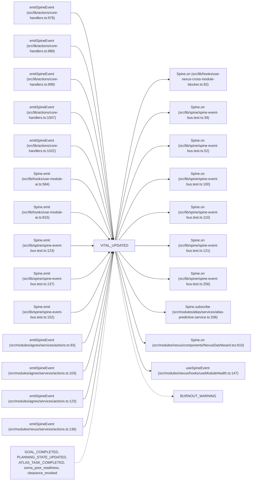

Emitters: emitSpineEvent (src/lib/actions/core-handlers.ts:978); emitSpineEvent (src/lib/actions/core-handlers.ts:989); emitSpineEvent (src/lib/actions/core-handlers.ts:999); emitSpineEvent (src/lib/actions/core-handlers.ts:1007); emitSpineEvent (src/lib/actions/core-handlers.ts:1022); Spine.emit (src/lib/hooks/use-module-ai.ts:584); Spine.emit (src/lib/hooks/use-module-ai.ts:815); Spine.emit (src/lib/spine/spine-event-bus.test.ts:123); Spine.emit (src/lib/spine/spine-event-bus.test.ts:137); Spine.emit (src/lib/spine/spine-event-bus.test.ts:152); emitSpineEvent (src/modules/agnes/services/actions.ts:93); emitSpineEvent (src/modules/agnes/services/actions.ts:103); emitSpineEvent (src/modules/agnes/services/actions.ts:123); emitSpineEvent (src/modules/nexus/services/actions.ts:136)

Listeners: Spine.on (src/lib/hooks/use-nexus-cross-module-blocker.ts:92); Spine.on (src/lib/spine/spine-event-bus.test.ts:39); Spine.on (src/lib/spine/spine-event-bus.test.ts:52); Spine.on (src/lib/spine/spine-event-bus.test.ts:100); Spine.on (src/lib/spine/spine-event-bus.test.ts:110); Spine.on (src/lib/spine/spine-event-bus.test.ts:121); Spine.on (src/lib/spine/spine-event-bus.test.ts:256); Spine.subscribe (src/modules/atlas/services/atlas-predictive-service.ts:336); Spine.on (src/modules/nexus/components/NexusDashboard.tsx:610); useSpineEvent (src/modules/nexus/hooks/useModuleHealth.ts:147)

Cascades to: BURNOUT_WARNING

Cascades from: GOAL_COMPLETED, PLANNING_STATE_UPDATED, ATLAS_TASK_COMPLETED, soma_poor_readiness, clearance_revoked

### REDUCE_TRAINING_LOAD
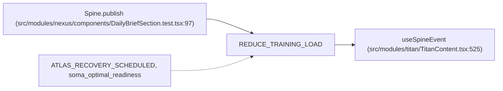

Emitters: Spine.publish (src/modules/nexus/components/DailyBriefSection.test.tsx:97)

Listeners: useSpineEvent (src/modules/titan/TitanContent.tsx:525)

Cascades to: —

Cascades from: ATLAS_RECOVERY_SCHEDULED, soma_optimal_readiness

### BLOCK_HIGH_INTENSITY
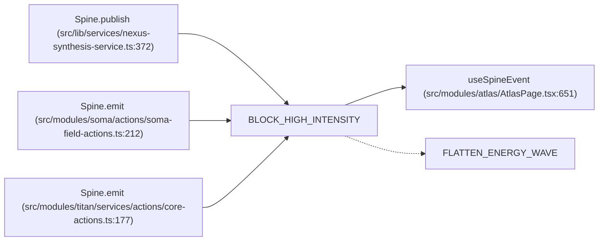

Emitters: Spine.publish (src/lib/services/nexus-synthesis-service.ts:372); Spine.emit (src/modules/soma/actions/soma-field-actions.ts:212); Spine.emit (src/modules/titan/services/actions/core-actions.ts:177)

Listeners: useSpineEvent (src/modules/atlas/AtlasPage.tsx:651)

Cascades to: FLATTEN_ENERGY_WAVE

Cascades from: —

### FLATTEN_ENERGY_WAVE
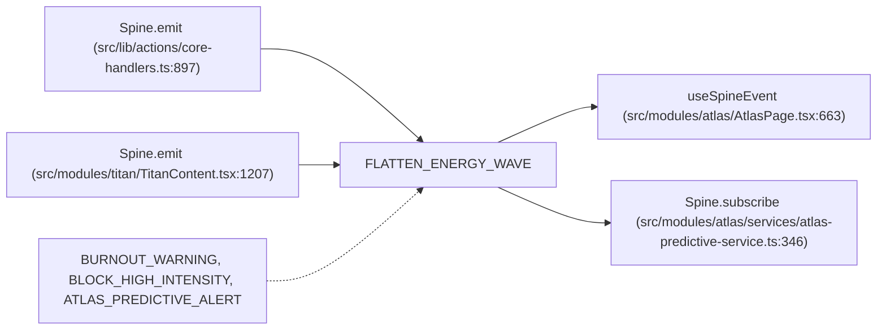

Emitters: Spine.emit (src/lib/actions/core-handlers.ts:897); Spine.emit (src/modules/titan/TitanContent.tsx:1207)

Listeners: useSpineEvent (src/modules/atlas/AtlasPage.tsx:663); Spine.subscribe (src/modules/atlas/services/atlas-predictive-service.ts:346)

Cascades to: —

Cascades from: BURNOUT_WARNING, BLOCK_HIGH_INTENSITY, ATLAS_PREDICTIVE_ALERT

### RECOVERY_AVAILABLE
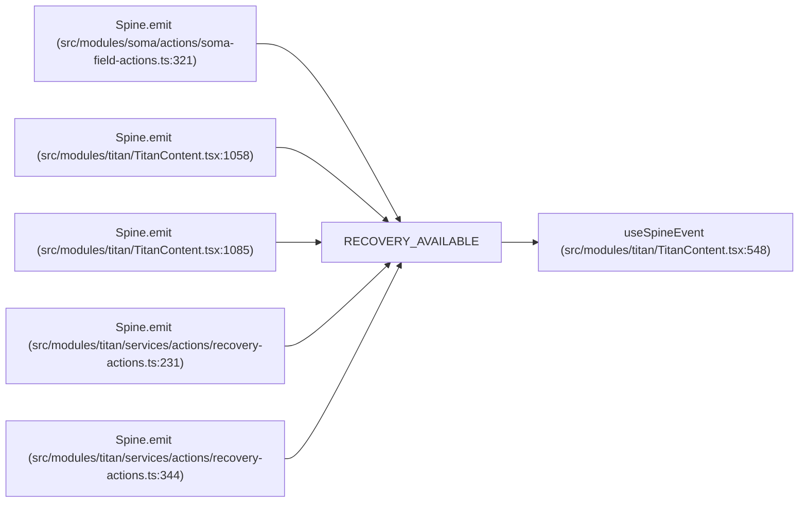

Emitters: Spine.emit (src/modules/soma/actions/soma-field-actions.ts:321); Spine.emit (src/modules/titan/TitanContent.tsx:1058); Spine.emit (src/modules/titan/TitanContent.tsx:1085); Spine.emit (src/modules/titan/services/actions/recovery-actions.ts:231); Spine.emit (src/modules/titan/services/actions/recovery-actions.ts:344)

Listeners: useSpineEvent (src/modules/titan/TitanContent.tsx:548)

Cascades to: —

Cascades from: —

### BURNOUT_WARNING
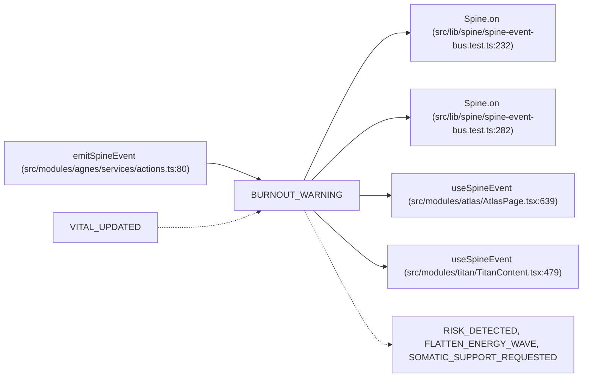

Emitters: emitSpineEvent (src/modules/agnes/services/actions.ts:80)

Listeners: Spine.on (src/lib/spine/spine-event-bus.test.ts:232); Spine.on (src/lib/spine/spine-event-bus.test.ts:282); useSpineEvent (src/modules/atlas/AtlasPage.tsx:639); useSpineEvent (src/modules/titan/TitanContent.tsx:479)

Cascades to: RISK_DETECTED, FLATTEN_ENERGY_WAVE, SOMATIC_SUPPORT_REQUESTED

Cascades from: VITAL_UPDATED

### CLEARANCE_DENIED
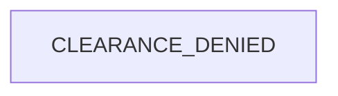

Emitters: —

Listeners: —

Cascades to: —

Cascades from: —

### CLEARANCE_GRANTED
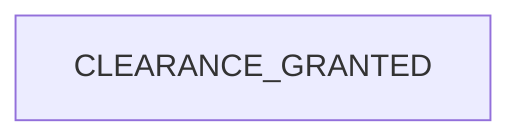

Emitters: —

Listeners: —

Cascades to: —

Cascades from: —

### COGNITIVE_OVERLOAD
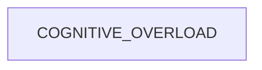

Emitters: —

Listeners: —

Cascades to: —

Cascades from: —

### SECURITY_POLICY_UPDATED


Emitters: —

Listeners: —

Cascades to: —

Cascades from: —

### FINANCIAL_STRESS
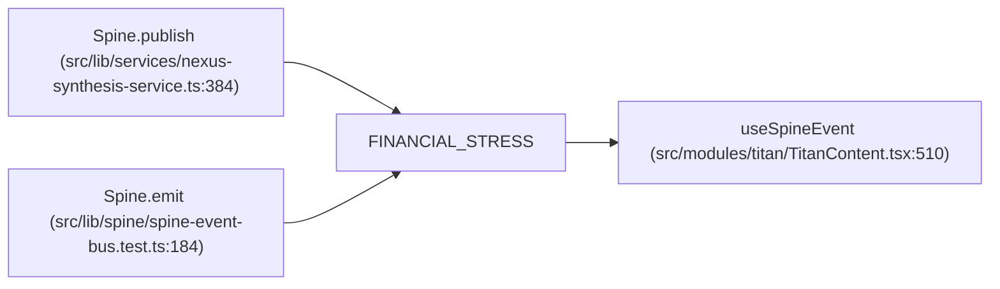

Emitters: Spine.publish (src/lib/services/nexus-synthesis-service.ts:384); Spine.emit (src/lib/spine/spine-event-bus.test.ts:184)

Listeners: useSpineEvent (src/modules/titan/TitanContent.tsx:510)

Cascades to: —

Cascades from: —

### MEDICAL_ALERT
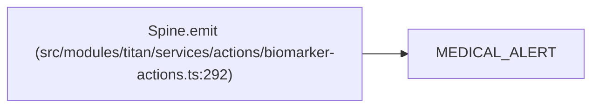

Emitters: Spine.emit (src/modules/titan/services/actions/biomarker-actions.ts:292)

Listeners: —

Cascades to: —

Cascades from: —

### CRISIS_DETECTED
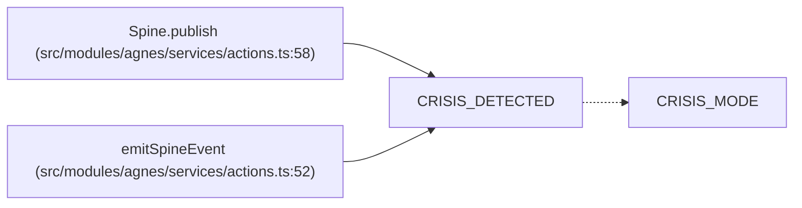

Emitters: Spine.publish (src/modules/agnes/services/actions.ts:58); emitSpineEvent (src/modules/agnes/services/actions.ts:52)

Listeners: —

Cascades to: CRISIS_MODE

Cascades from: —

### DRAFT_PROPOSED
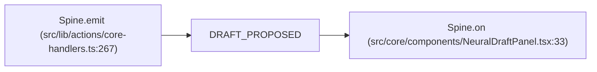

Emitters: Spine.emit (src/lib/actions/core-handlers.ts:267)

Listeners: Spine.on (src/core/components/NeuralDraftPanel.tsx:33)

Cascades to: —

Cascades from: —

### DRAFT_APPROVED
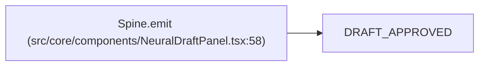

Emitters: Spine.emit (src/core/components/NeuralDraftPanel.tsx:58)

Listeners: —

Cascades to: —

Cascades from: —

### DRAFT_DISMISSED
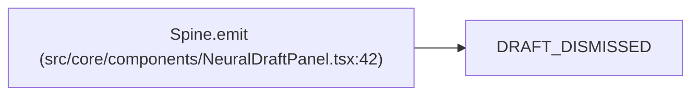

Emitters: Spine.emit (src/core/components/NeuralDraftPanel.tsx:42)

Listeners: —

Cascades to: —

Cascades from: —

### SESSION_STARTED
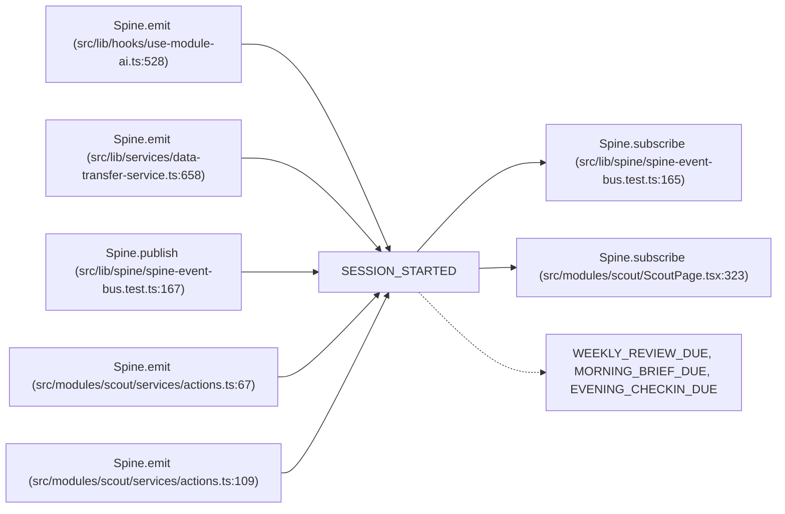

Emitters: Spine.emit (src/lib/hooks/use-module-ai.ts:528); Spine.emit (src/lib/services/data-transfer-service.ts:658); Spine.publish (src/lib/spine/spine-event-bus.test.ts:167); Spine.emit (src/modules/scout/services/actions.ts:67); Spine.emit (src/modules/scout/services/actions.ts:109)

Listeners: Spine.subscribe (src/lib/spine/spine-event-bus.test.ts:165); Spine.subscribe (src/modules/scout/ScoutPage.tsx:323)

Cascades to: WEEKLY_REVIEW_DUE, MORNING_BRIEF_DUE, EVENING_CHECKIN_DUE

Cascades from: —

### SESSION_ENDED
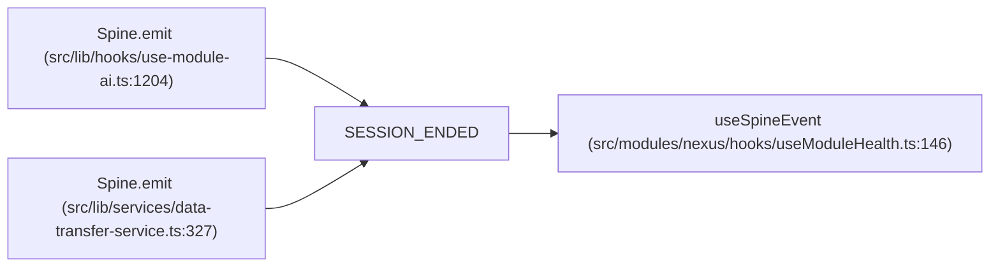

Emitters: Spine.emit (src/lib/hooks/use-module-ai.ts:1204); Spine.emit (src/lib/services/data-transfer-service.ts:327)

Listeners: useSpineEvent (src/modules/nexus/hooks/useModuleHealth.ts:146)

Cascades to: —

Cascades from: —

### MODULE_DELEGATED
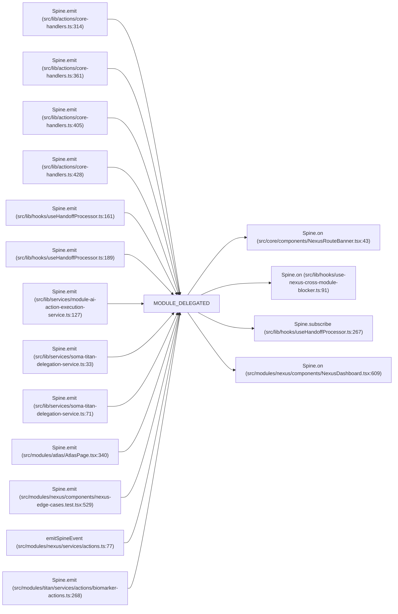

Emitters: Spine.emit (src/lib/actions/core-handlers.ts:314); Spine.emit (src/lib/actions/core-handlers.ts:361); Spine.emit (src/lib/actions/core-handlers.ts:405); Spine.emit (src/lib/actions/core-handlers.ts:428); Spine.emit (src/lib/hooks/useHandoffProcessor.ts:161); Spine.emit (src/lib/hooks/useHandoffProcessor.ts:189); Spine.emit (src/lib/services/module-ai-action-execution-service.ts:127); Spine.emit (src/lib/services/soma-titan-delegation-service.ts:33); Spine.emit (src/lib/services/soma-titan-delegation-service.ts:71); Spine.emit (src/modules/atlas/AtlasPage.tsx:340); Spine.emit (src/modules/nexus/components/nexus-edge-cases.test.tsx:529); emitSpineEvent (src/modules/nexus/services/actions.ts:77); Spine.emit (src/modules/titan/services/actions/biomarker-actions.ts:268)

Listeners: Spine.on (src/core/components/NexusRouteBanner.tsx:43); Spine.on (src/lib/hooks/use-nexus-cross-module-blocker.ts:91); Spine.subscribe (src/lib/hooks/useHandoffProcessor.ts:267); Spine.on (src/modules/nexus/components/NexusDashboard.tsx:609)

Cascades to: —

Cascades from: —

### MODULE_HANDOFF_RECEIVED
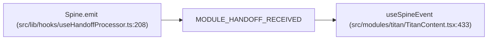

Emitters: Spine.emit (src/lib/hooks/useHandoffProcessor.ts:208)

Listeners: useSpineEvent (src/modules/titan/TitanContent.tsx:433)

Cascades to: —

Cascades from: —

### TITAN_PROPOSAL
```mermaid
flowchart LR
  TITAN_PROPOSAL["TITAN_PROPOSAL"]
  TITAN_PROPOSAL_em_0["emitSpineEvent (src/modules/titan/services/actions/proposal-actions.ts:5)"] --> TITAN_PROPOSAL
  TITAN_PROPOSAL_em_1["emitSpineEvent (src/modules/titan/services/actions/proposal-actions.ts:19)"] --> TITAN_PROPOSAL
  TITAN_PROPOSAL_em_2["emitSpineEvent (src/modules/titan/services/actions/proposal-actions.ts:33)"] --> TITAN_PROPOSAL
  TITAN_PROPOSAL --> TITAN_PROPOSAL_li_0["useSpineEvent (src/modules/titan/TitanContent.tsx:313)"]
```

Emitters: emitSpineEvent (src/modules/titan/services/actions/proposal-actions.ts:5); emitSpineEvent (src/modules/titan/services/actions/proposal-actions.ts:19); emitSpineEvent (src/modules/titan/services/actions/proposal-actions.ts:33)

Listeners: useSpineEvent (src/modules/titan/TitanContent.tsx:313)

Cascades to: —

Cascades from: —

### PLANNING_OVERLOAD
```mermaid
flowchart LR
  PLANNING_OVERLOAD["PLANNING_OVERLOAD"]
  PLANNING_OVERLOAD_em_0["Spine.emit (src/modules/atlas/services/atlas-predictive-service.ts:200)"] --> PLANNING_OVERLOAD
  PLANNING_OVERLOAD --> PLANNING_OVERLOAD_li_0["Spine.subscribe (src/modules/atlas/services/atlas-predictive-service.ts:367)"]
```

Emitters: Spine.emit (src/modules/atlas/services/atlas-predictive-service.ts:200)

Listeners: Spine.subscribe (src/modules/atlas/services/atlas-predictive-service.ts:367)

Cascades to: —

Cascades from: —

### DEADLINE_CRUNCH
```mermaid
flowchart LR
  DEADLINE_CRUNCH["DEADLINE_CRUNCH"]
  DEADLINE_CRUNCH --> DEADLINE_CRUNCH_li_0["Spine.on (src/lib/services/intelligence-pipeline.ts:47)"]
  DEADLINE_CRUNCH_cf_0["DEADLINE_PRESSURE_CHANGED"] -.-> DEADLINE_CRUNCH
```

Emitters: —

Listeners: Spine.on (src/lib/services/intelligence-pipeline.ts:47)

Cascades to: —

Cascades from: DEADLINE_PRESSURE_CHANGED

### COMPOUND_STRESS
```mermaid
flowchart LR
  COMPOUND_STRESS["COMPOUND_STRESS"]
  COMPOUND_STRESS_em_0["emitSpineEvent (src/modules/agnes/services/actions.ts:91)"] --> COMPOUND_STRESS
  COMPOUND_STRESS_em_1["emitSpineEvent (src/modules/agnes/services/actions.ts:121)"] --> COMPOUND_STRESS
  COMPOUND_STRESS --> COMPOUND_STRESS_li_0["useSpineEvent (src/modules/titan/TitanContent.tsx:459)"]
  COMPOUND_STRESS_cf_0["SOMA_READINESS_UPDATED, TITAN_BODY_WEIGHT_LOGGED"] -.-> COMPOUND_STRESS
```

Emitters: emitSpineEvent (src/modules/agnes/services/actions.ts:91); emitSpineEvent (src/modules/agnes/services/actions.ts:121)

Listeners: useSpineEvent (src/modules/titan/TitanContent.tsx:459)

Cascades to: —

Cascades from: SOMA_READINESS_UPDATED, TITAN_BODY_WEIGHT_LOGGED

### CRISIS_MODE
```mermaid
flowchart LR
  CRISIS_MODE["CRISIS_MODE"]
  CRISIS_MODE_em_0["Spine.publish (src/lib/services/nexus-synthesis-service.ts:396)"] --> CRISIS_MODE
  CRISIS_MODE_em_1["Spine.emit (src/modules/atlas/services/atlas-predictive-service.ts:404)"] --> CRISIS_MODE
  CRISIS_MODE --> CRISIS_MODE_li_0["Spine.subscribe (src/modules/atlas/services/atlas-predictive-service.ts:376)"]
  CRISIS_MODE_cf_0["CRISIS_DETECTED"] -.-> CRISIS_MODE
```

Emitters: Spine.publish (src/lib/services/nexus-synthesis-service.ts:396); Spine.emit (src/modules/atlas/services/atlas-predictive-service.ts:404)

Listeners: Spine.subscribe (src/modules/atlas/services/atlas-predictive-service.ts:376)

Cascades to: —

Cascades from: CRISIS_DETECTED

### EXECUTION_COLLAPSE
```mermaid
flowchart LR
  EXECUTION_COLLAPSE["EXECUTION_COLLAPSE"]
```

Emitters: —

Listeners: —

Cascades to: —

Cascades from: —

### STREAK_BROKEN
```mermaid
flowchart LR
  STREAK_BROKEN["STREAK_BROKEN"]
```

Emitters: —

Listeners: —

Cascades to: —

Cascades from: —

### TASK_COMPLETED
```mermaid
flowchart LR
  TASK_COMPLETED["TASK_COMPLETED"]
  TASK_COMPLETED_em_0["emitSpineEvent (src/modules/atlas/__tests__/atlas-data-integrity.test.ts:565)"] --> TASK_COMPLETED
```

Emitters: emitSpineEvent (src/modules/atlas/__tests__/atlas-data-integrity.test.ts:565)

Listeners: —

Cascades to: —

Cascades from: —

### DEADLINE_APPROACHING
```mermaid
flowchart LR
  DEADLINE_APPROACHING["DEADLINE_APPROACHING"]
  DEADLINE_APPROACHING_em_0["emitSpineEvent (src/modules/atlas/services/actions/task-actions.ts:410)"] --> DEADLINE_APPROACHING
```

Emitters: emitSpineEvent (src/modules/atlas/services/actions/task-actions.ts:410)

Listeners: —

Cascades to: —

Cascades from: —

### HABIT_STREAK_BROKEN
```mermaid
flowchart LR
  HABIT_STREAK_BROKEN["HABIT_STREAK_BROKEN"]
  HABIT_STREAK_BROKEN_em_0["emitSpineEvent (src/modules/atlas/services/actions/habit-actions.ts:65)"] --> HABIT_STREAK_BROKEN
  HABIT_STREAK_BROKEN_em_1["Spine.emit (src/modules/atlas/services/atlas-review-service.ts:31)"] --> HABIT_STREAK_BROKEN
  HABIT_STREAK_BROKEN -.-> HABIT_STREAK_BROKEN_ct_0["SOMATIC_SUPPORT_REQUESTED"]
```

Emitters: emitSpineEvent (src/modules/atlas/services/actions/habit-actions.ts:65); Spine.emit (src/modules/atlas/services/atlas-review-service.ts:31)

Listeners: —

Cascades to: SOMATIC_SUPPORT_REQUESTED

Cascades from: —

### TEMPORAL_REVIEW_COMPLETE
```mermaid
flowchart LR
  TEMPORAL_REVIEW_COMPLETE["TEMPORAL_REVIEW_COMPLETE"]
  TEMPORAL_REVIEW_COMPLETE_em_0["emitSpineEvent (src/modules/atlas/services/actions/routine-actions.ts:169)"] --> TEMPORAL_REVIEW_COMPLETE
```

Emitters: emitSpineEvent (src/modules/atlas/services/actions/routine-actions.ts:169)

Listeners: —

Cascades to: —

Cascades from: —

### DELEGATION_REQUEST
```mermaid
flowchart LR
  DELEGATION_REQUEST["DELEGATION_REQUEST"]
  DELEGATION_REQUEST_em_0["emitSpineEvent (src/modules/atlas/services/actions/task-actions.ts:438)"] --> DELEGATION_REQUEST
```

Emitters: emitSpineEvent (src/modules/atlas/services/actions/task-actions.ts:438)

Listeners: —

Cascades to: —

Cascades from: —

### NSV_CALIBRATION_REQUEST
```mermaid
flowchart LR
  NSV_CALIBRATION_REQUEST["NSV_CALIBRATION_REQUEST"]
  NSV_CALIBRATION_REQUEST_em_0["emitSpineEvent (src/lib/actions/analysis-actions.ts:489)"] --> NSV_CALIBRATION_REQUEST
  NSV_CALIBRATION_REQUEST_em_1["emitSpineEvent (src/lib/actions/analysis-actions.ts:747)"] --> NSV_CALIBRATION_REQUEST
  NSV_CALIBRATION_REQUEST_em_2["emitSpineEvent (src/modules/atlas/services/actions/energy-actions.ts:91)"] --> NSV_CALIBRATION_REQUEST
```

Emitters: emitSpineEvent (src/lib/actions/analysis-actions.ts:489); emitSpineEvent (src/lib/actions/analysis-actions.ts:747); emitSpineEvent (src/modules/atlas/services/actions/energy-actions.ts:91)

Listeners: —

Cascades to: —

Cascades from: —

### SCHEMA_EXTENDED
```mermaid
flowchart LR
  SCHEMA_EXTENDED["SCHEMA_EXTENDED"]
  SCHEMA_EXTENDED_em_0["Spine.emit (src/lib/schema-registry.ts:327)"] --> SCHEMA_EXTENDED
```

Emitters: Spine.emit (src/lib/schema-registry.ts:327)

Listeners: —

Cascades to: —

Cascades from: —

### SCHEMA_MODIFIED
```mermaid
flowchart LR
  SCHEMA_MODIFIED["SCHEMA_MODIFIED"]
  SCHEMA_MODIFIED_em_0["Spine.emit (src/lib/schema-registry.ts:358)"] --> SCHEMA_MODIFIED
```

Emitters: Spine.emit (src/lib/schema-registry.ts:358)

Listeners: —

Cascades to: —

Cascades from: —

### SCHEMA_MIGRATED
```mermaid
flowchart LR
  SCHEMA_MIGRATED["SCHEMA_MIGRATED"]
  SCHEMA_MIGRATED_em_0["Spine.emit (src/lib/schema-registry.ts:500)"] --> SCHEMA_MIGRATED
  SCHEMA_MIGRATED_em_1["Spine.emit (src/lib/services/migration-service.ts:257)"] --> SCHEMA_MIGRATED
  SCHEMA_MIGRATED_em_2["Spine.emit (src/lib/services/migration-service.ts:355)"] --> SCHEMA_MIGRATED
```

Emitters: Spine.emit (src/lib/schema-registry.ts:500); Spine.emit (src/lib/services/migration-service.ts:257); Spine.emit (src/lib/services/migration-service.ts:355)

Listeners: —

Cascades to: —

Cascades from: —

### FIELD_CREATED
```mermaid
flowchart LR
  FIELD_CREATED["FIELD_CREATED"]
  FIELD_CREATED_em_0["emitSpineEvent (src/lib/actions/field-suggestion-actions.ts:470)"] --> FIELD_CREATED
  FIELD_CREATED_em_1["emitSpineEvent (src/modules/ledger/actions/ledger-field-actions.ts:381)"] --> FIELD_CREATED
```

Emitters: emitSpineEvent (src/lib/actions/field-suggestion-actions.ts:470); emitSpineEvent (src/modules/ledger/actions/ledger-field-actions.ts:381)

Listeners: —

Cascades to: —

Cascades from: —

### FIELD_DELETED
```mermaid
flowchart LR
  FIELD_DELETED["FIELD_DELETED"]
  FIELD_DELETED_em_0["emitSpineEvent (src/lib/actions/field-suggestion-actions.ts:592)"] --> FIELD_DELETED
  FIELD_DELETED_em_1["emitSpineEvent (src/modules/ledger/actions/ledger-field-actions.ts:414)"] --> FIELD_DELETED
```

Emitters: emitSpineEvent (src/lib/actions/field-suggestion-actions.ts:592); emitSpineEvent (src/modules/ledger/actions/ledger-field-actions.ts:414)

Listeners: —

Cascades to: —

Cascades from: —

### FIELD_VALUE_UPDATED
```mermaid
flowchart LR
  FIELD_VALUE_UPDATED["FIELD_VALUE_UPDATED"]
  FIELD_VALUE_UPDATED_em_0["emitSpineEvent (src/modules/ledger/actions/ledger-field-actions.ts:573)"] --> FIELD_VALUE_UPDATED
```

Emitters: emitSpineEvent (src/modules/ledger/actions/ledger-field-actions.ts:573)

Listeners: —

Cascades to: —

Cascades from: —

### SPENDING_DETECTED
```mermaid
flowchart LR
  SPENDING_DETECTED["SPENDING_DETECTED"]
  SPENDING_DETECTED --> SPENDING_DETECTED_li_0["Spine.on (src/lib/services/intelligence-pipeline.ts:21)"]
```

Emitters: —

Listeners: Spine.on (src/lib/services/intelligence-pipeline.ts:21)

Cascades to: —

Cascades from: —

### CONFLICT_DETECTED
```mermaid
flowchart LR
  CONFLICT_DETECTED["CONFLICT_DETECTED"]
  CONFLICT_DETECTED_em_0["Spine.publish (src/lib/services/nexus-synthesis-service.ts:310)"] --> CONFLICT_DETECTED
  CONFLICT_DETECTED --> CONFLICT_DETECTED_li_0["Spine.on (src/lib/hooks/use-nexus-conflict-blocker.ts:52)"]
```

Emitters: Spine.publish (src/lib/services/nexus-synthesis-service.ts:310)

Listeners: Spine.on (src/lib/hooks/use-nexus-conflict-blocker.ts:52)

Cascades to: —

Cascades from: —

### CONFLICT_RESOLVED
```mermaid
flowchart LR
  CONFLICT_RESOLVED["CONFLICT_RESOLVED"]
  CONFLICT_RESOLVED_em_0["Spine.publish (src/lib/services/nexus-synthesis-service.ts:338)"] --> CONFLICT_RESOLVED
  CONFLICT_RESOLVED --> CONFLICT_RESOLVED_li_0["Spine.on (src/lib/hooks/use-nexus-conflict-blocker.ts:53)"]
```

Emitters: Spine.publish (src/lib/services/nexus-synthesis-service.ts:338)

Listeners: Spine.on (src/lib/hooks/use-nexus-conflict-blocker.ts:53)

Cascades to: —

Cascades from: —

### ATLAS_RECOVERY_SCHEDULED
```mermaid
flowchart LR
  ATLAS_RECOVERY_SCHEDULED["ATLAS_RECOVERY_SCHEDULED"]
  ATLAS_RECOVERY_SCHEDULED_em_0["Spine.emit (src/modules/atlas/components/WeeklyReviewModal.tsx:287)"] --> ATLAS_RECOVERY_SCHEDULED
  ATLAS_RECOVERY_SCHEDULED -.-> ATLAS_RECOVERY_SCHEDULED_ct_0["REDUCE_TRAINING_LOAD"]
```

Emitters: Spine.emit (src/modules/atlas/components/WeeklyReviewModal.tsx:287)

Listeners: —

Cascades to: REDUCE_TRAINING_LOAD

Cascades from: —

### ATLAS_PREDICTIVE_ALERT
```mermaid
flowchart LR
  ATLAS_PREDICTIVE_ALERT["ATLAS_PREDICTIVE_ALERT"]
  ATLAS_PREDICTIVE_ALERT_em_0["Spine.emit (src/modules/atlas/services/atlas-predictive-service.ts:167)"] --> ATLAS_PREDICTIVE_ALERT
  ATLAS_PREDICTIVE_ALERT_em_1["Spine.emit (src/modules/atlas/services/atlas-predictive-service.ts:349)"] --> ATLAS_PREDICTIVE_ALERT
  ATLAS_PREDICTIVE_ALERT -.-> ATLAS_PREDICTIVE_ALERT_ct_0["FLATTEN_ENERGY_WAVE"]
```

Emitters: Spine.emit (src/modules/atlas/services/atlas-predictive-service.ts:167); Spine.emit (src/modules/atlas/services/atlas-predictive-service.ts:349)

Listeners: —

Cascades to: FLATTEN_ENERGY_WAVE

Cascades from: —

### ATLAS_STATE_CHANGED
```mermaid
flowchart LR
  ATLAS_STATE_CHANGED["ATLAS_STATE_CHANGED"]
  ATLAS_STATE_CHANGED_em_0["emitSpineEvent (src/modules/atlas/services/actions/checkin-actions.ts:67)"] --> ATLAS_STATE_CHANGED
  ATLAS_STATE_CHANGED_em_1["emitSpineEvent (src/modules/atlas/services/actions/routine-actions.ts:407)"] --> ATLAS_STATE_CHANGED
  ATLAS_STATE_CHANGED_em_2["Spine.emit (src/modules/atlas/services/atlas-predictive-service.ts:421)"] --> ATLAS_STATE_CHANGED
  ATLAS_STATE_CHANGED_cf_0["ATLAS_GOAL_UPDATED"] -.-> ATLAS_STATE_CHANGED
  ATLAS_STATE_CHANGED -.-> ATLAS_STATE_CHANGED_ct_0["WEEKLY_REVIEW_DUE"]
```

Emitters: emitSpineEvent (src/modules/atlas/services/actions/checkin-actions.ts:67); emitSpineEvent (src/modules/atlas/services/actions/routine-actions.ts:407); Spine.emit (src/modules/atlas/services/atlas-predictive-service.ts:421)

Listeners: —

Cascades to: WEEKLY_REVIEW_DUE

Cascades from: ATLAS_GOAL_UPDATED

### GOAL_MISSING_PROGRESS
```mermaid
flowchart LR
  GOAL_MISSING_PROGRESS["GOAL_MISSING_PROGRESS"]
  GOAL_MISSING_PROGRESS_em_0["Spine.emit (src/modules/atlas/services/atlas-review-service.ts:56)"] --> GOAL_MISSING_PROGRESS
```

Emitters: Spine.emit (src/modules/atlas/services/atlas-review-service.ts:56)

Listeners: —

Cascades to: —

Cascades from: —

### ATLAS_TASK_COMPLETED
```mermaid
flowchart LR
  ATLAS_TASK_COMPLETED["ATLAS_TASK_COMPLETED"]
  ATLAS_TASK_COMPLETED_em_0["emitSpineEvent (src/modules/atlas/services/actions/task-actions.ts:284)"] --> ATLAS_TASK_COMPLETED
  ATLAS_TASK_COMPLETED -.-> ATLAS_TASK_COMPLETED_ct_0["VITAL_UPDATED"]
```

Emitters: emitSpineEvent (src/modules/atlas/services/actions/task-actions.ts:284)

Listeners: —

Cascades to: VITAL_UPDATED

Cascades from: —

### ATLAS_HABIT_LOGGED
```mermaid
flowchart LR
  ATLAS_HABIT_LOGGED["ATLAS_HABIT_LOGGED"]
  ATLAS_HABIT_LOGGED_em_0["emitSpineEvent (src/modules/atlas/services/actions/habit-actions.ts:238)"] --> ATLAS_HABIT_LOGGED
```

Emitters: emitSpineEvent (src/modules/atlas/services/actions/habit-actions.ts:238)

Listeners: —

Cascades to: —

Cascades from: —

### ATLAS_GOAL_MILESTONE
```mermaid
flowchart LR
  ATLAS_GOAL_MILESTONE["ATLAS_GOAL_MILESTONE"]
  ATLAS_GOAL_MILESTONE_cf_0["ATLAS_GOAL_UPDATED"] -.-> ATLAS_GOAL_MILESTONE
  ATLAS_GOAL_MILESTONE -.-> ATLAS_GOAL_MILESTONE_ct_0["SOMATIC_SUPPORT_REQUESTED"]
```

Emitters: —

Listeners: —

Cascades to: SOMATIC_SUPPORT_REQUESTED

Cascades from: ATLAS_GOAL_UPDATED

### ATLAS_GOAL_COMPLETED
```mermaid
flowchart LR
  ATLAS_GOAL_COMPLETED["ATLAS_GOAL_COMPLETED"]
  ATLAS_GOAL_COMPLETED_em_0["emitSpineEvent (src/modules/atlas/services/actions/goal-actions.ts:107)"] --> ATLAS_GOAL_COMPLETED
  ATLAS_GOAL_COMPLETED_em_1["emitSpineEvent (src/modules/atlas/services/actions/goal-actions.ts:252)"] --> ATLAS_GOAL_COMPLETED
```

Emitters: emitSpineEvent (src/modules/atlas/services/actions/goal-actions.ts:107); emitSpineEvent (src/modules/atlas/services/actions/goal-actions.ts:252)

Listeners: —

Cascades to: —

Cascades from: —

### ATLAS_ENERGY_UPDATED
```mermaid
flowchart LR
  ATLAS_ENERGY_UPDATED["ATLAS_ENERGY_UPDATED"]
```

Emitters: —

Listeners: —

Cascades to: —

Cascades from: —

### ATLAS_ENERGY_OVERLOAD
```mermaid
flowchart LR
  ATLAS_ENERGY_OVERLOAD["ATLAS_ENERGY_OVERLOAD"]
```

Emitters: —

Listeners: —

Cascades to: —

Cascades from: —

### ATLAS_RECOVERY_WINDOW_CREATED
```mermaid
flowchart LR
  ATLAS_RECOVERY_WINDOW_CREATED["ATLAS_RECOVERY_WINDOW_CREATED"]
```

Emitters: —

Listeners: —

Cascades to: —

Cascades from: —

### ATLAS_TASK_CREATED
```mermaid
flowchart LR
  ATLAS_TASK_CREATED["ATLAS_TASK_CREATED"]
```

Emitters: —

Listeners: —

Cascades to: —

Cascades from: —

### ATLAS_TASK_BLOCKED
```mermaid
flowchart LR
  ATLAS_TASK_BLOCKED["ATLAS_TASK_BLOCKED"]
```

Emitters: —

Listeners: —

Cascades to: —

Cascades from: —

### ATLAS_TASK_UNBLOCKED
```mermaid
flowchart LR
  ATLAS_TASK_UNBLOCKED["ATLAS_TASK_UNBLOCKED"]
```

Emitters: —

Listeners: —

Cascades to: —

Cascades from: —

### ATLAS_HABIT_MILESTONE
```mermaid
flowchart LR
  ATLAS_HABIT_MILESTONE["ATLAS_HABIT_MILESTONE"]
```

Emitters: —

Listeners: —

Cascades to: —

Cascades from: —

### ATLAS_FIELD_CREATED
```mermaid
flowchart LR
  ATLAS_FIELD_CREATED["ATLAS_FIELD_CREATED"]
```

Emitters: —

Listeners: —

Cascades to: —

Cascades from: —

### ATLAS_FIELD_DELETED
```mermaid
flowchart LR
  ATLAS_FIELD_DELETED["ATLAS_FIELD_DELETED"]
```

Emitters: —

Listeners: —

Cascades to: —

Cascades from: —

### ATLAS_FIELD_VALUE_UPDATED
```mermaid
flowchart LR
  ATLAS_FIELD_VALUE_UPDATED["ATLAS_FIELD_VALUE_UPDATED"]
```

Emitters: —

Listeners: —

Cascades to: —

Cascades from: —

### ATLAS_GOAL_UPDATED
```mermaid
flowchart LR
  ATLAS_GOAL_UPDATED["ATLAS_GOAL_UPDATED"]
  ATLAS_GOAL_UPDATED_em_0["emitSpineEvent (src/modules/atlas/services/actions/goal-actions.ts:51)"] --> ATLAS_GOAL_UPDATED
  ATLAS_GOAL_UPDATED_em_1["emitSpineEvent (src/modules/atlas/services/actions/goal-actions.ts:98)"] --> ATLAS_GOAL_UPDATED
  ATLAS_GOAL_UPDATED_em_2["emitSpineEvent (src/modules/atlas/services/actions/goal-actions.ts:168)"] --> ATLAS_GOAL_UPDATED
  ATLAS_GOAL_UPDATED_em_3["emitSpineEvent (src/modules/atlas/services/actions/goal-actions.ts:204)"] --> ATLAS_GOAL_UPDATED
  ATLAS_GOAL_UPDATED_em_4["emitSpineEvent (src/modules/atlas/services/actions/goal-actions.ts:243)"] --> ATLAS_GOAL_UPDATED
  ATLAS_GOAL_UPDATED -.-> ATLAS_GOAL_UPDATED_ct_0["ATLAS_STATE_CHANGED, ATLAS_GOAL_MILESTONE"]
```

Emitters: emitSpineEvent (src/modules/atlas/services/actions/goal-actions.ts:51); emitSpineEvent (src/modules/atlas/services/actions/goal-actions.ts:98); emitSpineEvent (src/modules/atlas/services/actions/goal-actions.ts:168); emitSpineEvent (src/modules/atlas/services/actions/goal-actions.ts:204); emitSpineEvent (src/modules/atlas/services/actions/goal-actions.ts:243)

Listeners: —

Cascades to: ATLAS_STATE_CHANGED, ATLAS_GOAL_MILESTONE

Cascades from: —

### DEADLINE_PRESSURE_CHANGED
```mermaid
flowchart LR
  DEADLINE_PRESSURE_CHANGED["DEADLINE_PRESSURE_CHANGED"]
  DEADLINE_PRESSURE_CHANGED_em_0["emitSpineEvent (src/modules/atlas/services/actions/task-actions.ts:424)"] --> DEADLINE_PRESSURE_CHANGED
  DEADLINE_PRESSURE_CHANGED -.-> DEADLINE_PRESSURE_CHANGED_ct_0["DEADLINE_CRUNCH"]
```

Emitters: emitSpineEvent (src/modules/atlas/services/actions/task-actions.ts:424)

Listeners: —

Cascades to: DEADLINE_CRUNCH

Cascades from: —

### PLANNING_STATE_UPDATED
```mermaid
flowchart LR
  PLANNING_STATE_UPDATED["PLANNING_STATE_UPDATED"]
  PLANNING_STATE_UPDATED_em_0["emitSpineEvent (src/modules/atlas/services/actions/habit-actions.ts:89)"] --> PLANNING_STATE_UPDATED
  PLANNING_STATE_UPDATED_em_1["emitSpineEvent (src/modules/atlas/services/actions/routine-actions.ts:247)"] --> PLANNING_STATE_UPDATED
  PLANNING_STATE_UPDATED_em_2["emitSpineEvent (src/modules/atlas/services/actions/task-actions.ts:431)"] --> PLANNING_STATE_UPDATED
  PLANNING_STATE_UPDATED -.-> PLANNING_STATE_UPDATED_ct_0["VITAL_UPDATED"]
```

Emitters: emitSpineEvent (src/modules/atlas/services/actions/habit-actions.ts:89); emitSpineEvent (src/modules/atlas/services/actions/routine-actions.ts:247); emitSpineEvent (src/modules/atlas/services/actions/task-actions.ts:431)

Listeners: —

Cascades to: VITAL_UPDATED

Cascades from: —

### BUDGET_UPDATED
```mermaid
flowchart LR
  BUDGET_UPDATED["BUDGET_UPDATED"]
  BUDGET_UPDATED_cf_0["TRANSACTION_CREATED"] -.-> BUDGET_UPDATED
```

Emitters: —

Listeners: —

Cascades to: —

Cascades from: TRANSACTION_CREATED

### GOAL_PROGRESS
```mermaid
flowchart LR
  GOAL_PROGRESS["GOAL_PROGRESS"]
  GOAL_PROGRESS_em_0["emitSpineEvent (src/modules/ledger/services/actions.ts:388)"] --> GOAL_PROGRESS
  GOAL_PROGRESS -.-> GOAL_PROGRESS_ct_0["FINANCIAL_HEALTH_CHECK"]
```

Emitters: emitSpineEvent (src/modules/ledger/services/actions.ts:388)

Listeners: —

Cascades to: FINANCIAL_HEALTH_CHECK

Cascades from: —

### FINANCIAL_FRICTION_CHANGED
```mermaid
flowchart LR
  FINANCIAL_FRICTION_CHANGED["FINANCIAL_FRICTION_CHANGED"]
  FINANCIAL_FRICTION_CHANGED_em_0["emitSpineEvent (src/modules/ledger/actions/ledger-field-actions.ts:446)"] --> FINANCIAL_FRICTION_CHANGED
  FINANCIAL_FRICTION_CHANGED --> FINANCIAL_FRICTION_CHANGED_li_0["Spine.on (src/lib/services/intelligence-pipeline.ts:83)"]
  FINANCIAL_FRICTION_CHANGED_cf_0["RISK_DETECTED"] -.-> FINANCIAL_FRICTION_CHANGED
  FINANCIAL_FRICTION_CHANGED -.-> FINANCIAL_FRICTION_CHANGED_ct_0["SOMATIC_SUPPORT_REQUESTED"]
```

Emitters: emitSpineEvent (src/modules/ledger/actions/ledger-field-actions.ts:446)

Listeners: Spine.on (src/lib/services/intelligence-pipeline.ts:83)

Cascades to: SOMATIC_SUPPORT_REQUESTED

Cascades from: RISK_DETECTED

### RESONANCE_ROI_UPDATED
```mermaid
flowchart LR
  RESONANCE_ROI_UPDATED["RESONANCE_ROI_UPDATED"]
  RESONANCE_ROI_UPDATED_em_0["emitSpineEvent (src/modules/ledger/actions/ledger-field-actions.ts:477)"] --> RESONANCE_ROI_UPDATED
```

Emitters: emitSpineEvent (src/modules/ledger/actions/ledger-field-actions.ts:477)

Listeners: —

Cascades to: —

Cascades from: —

### FINANCIAL_PLAN_CREATED
```mermaid
flowchart LR
  FINANCIAL_PLAN_CREATED["FINANCIAL_PLAN_CREATED"]
  FINANCIAL_PLAN_CREATED_em_0["emitSpineEvent (src/modules/ledger/services/actions.ts:113)"] --> FINANCIAL_PLAN_CREATED
```

Emitters: emitSpineEvent (src/modules/ledger/services/actions.ts:113)

Listeners: —

Cascades to: —

Cascades from: —

### DOCUMENT_ANALYZED
```mermaid
flowchart LR
  DOCUMENT_ANALYZED["DOCUMENT_ANALYZED"]
```

Emitters: —

Listeners: —

Cascades to: —

Cascades from: —

### TRANSACTION_CREATED
```mermaid
flowchart LR
  TRANSACTION_CREATED["TRANSACTION_CREATED"]
  TRANSACTION_CREATED_em_0["emitSpineEvent (src/modules/ledger/actions/transaction-actions.ts:109)"] --> TRANSACTION_CREATED
  TRANSACTION_CREATED_em_1["emitSpineEvent (src/modules/ledger/services/actions.ts:314)"] --> TRANSACTION_CREATED
  TRANSACTION_CREATED_em_2["emitSpineEvent (src/modules/ledger/services/actions.ts:667)"] --> TRANSACTION_CREATED
  TRANSACTION_CREATED_em_3["emitSpineEvent (src/modules/ledger/services/actions.ts:735)"] --> TRANSACTION_CREATED
  TRANSACTION_CREATED -.-> TRANSACTION_CREATED_ct_0["BUDGET_UPDATED"]
```

Emitters: emitSpineEvent (src/modules/ledger/actions/transaction-actions.ts:109); emitSpineEvent (src/modules/ledger/services/actions.ts:314); emitSpineEvent (src/modules/ledger/services/actions.ts:667); emitSpineEvent (src/modules/ledger/services/actions.ts:735)

Listeners: —

Cascades to: BUDGET_UPDATED

Cascades from: —

### TRANSACTION_UPDATED
```mermaid
flowchart LR
  TRANSACTION_UPDATED["TRANSACTION_UPDATED"]
  TRANSACTION_UPDATED_em_0["emitSpineEvent (src/modules/ledger/actions/transaction-actions.ts:184)"] --> TRANSACTION_UPDATED
```

Emitters: emitSpineEvent (src/modules/ledger/actions/transaction-actions.ts:184)

Listeners: —

Cascades to: —

Cascades from: —

### TRANSACTION_DELETED
```mermaid
flowchart LR
  TRANSACTION_DELETED["TRANSACTION_DELETED"]
  TRANSACTION_DELETED_em_0["emitSpineEvent (src/modules/ledger/actions/transaction-actions.ts:253)"] --> TRANSACTION_DELETED
```

Emitters: emitSpineEvent (src/modules/ledger/actions/transaction-actions.ts:253)

Listeners: —

Cascades to: —

Cascades from: —

### BUDGET_CREATED
```mermaid
flowchart LR
  BUDGET_CREATED["BUDGET_CREATED"]
  BUDGET_CREATED_em_0["emitSpineEvent (src/modules/ledger/actions/transaction-actions.ts:306)"] --> BUDGET_CREATED
```

Emitters: emitSpineEvent (src/modules/ledger/actions/transaction-actions.ts:306)

Listeners: —

Cascades to: —

Cascades from: —

### BUDGET_MODIFIED
```mermaid
flowchart LR
  BUDGET_MODIFIED["BUDGET_MODIFIED"]
  BUDGET_MODIFIED_em_0["emitSpineEvent (src/modules/ledger/actions/transaction-actions.ts:373)"] --> BUDGET_MODIFIED
```

Emitters: emitSpineEvent (src/modules/ledger/actions/transaction-actions.ts:373)

Listeners: —

Cascades to: —

Cascades from: —

### GOAL_CREATED
```mermaid
flowchart LR
  GOAL_CREATED["GOAL_CREATED"]
  GOAL_CREATED_em_0["emitSpineEvent (src/modules/ledger/actions/transaction-actions.ts:442)"] --> GOAL_CREATED
  GOAL_CREATED_em_1["emitSpineEvent (src/modules/ledger/services/actions.ts:455)"] --> GOAL_CREATED
```

Emitters: emitSpineEvent (src/modules/ledger/actions/transaction-actions.ts:442); emitSpineEvent (src/modules/ledger/services/actions.ts:455)

Listeners: —

Cascades to: —

Cascades from: —

### GOAL_COMPLETED
```mermaid
flowchart LR
  GOAL_COMPLETED["GOAL_COMPLETED"]
  GOAL_COMPLETED_em_0["emitSpineEvent (src/modules/ledger/actions/transaction-actions.ts:503)"] --> GOAL_COMPLETED
  GOAL_COMPLETED_em_1["emitSpineEvent (src/modules/ledger/services/actions.ts:374)"] --> GOAL_COMPLETED
  GOAL_COMPLETED -.-> GOAL_COMPLETED_ct_0["VITAL_UPDATED"]
```

Emitters: emitSpineEvent (src/modules/ledger/actions/transaction-actions.ts:503); emitSpineEvent (src/modules/ledger/services/actions.ts:374)

Listeners: —

Cascades to: VITAL_UPDATED

Cascades from: —

### FINANCIAL_HEALTH_CHECK
```mermaid
flowchart LR
  FINANCIAL_HEALTH_CHECK["FINANCIAL_HEALTH_CHECK"]
  FINANCIAL_HEALTH_CHECK_em_0["emitSpineEvent (src/modules/ledger/actions/transaction-actions.ts:551)"] --> FINANCIAL_HEALTH_CHECK
  FINANCIAL_HEALTH_CHECK_cf_0["GOAL_PROGRESS, STRESS_SPIKE"] -.-> FINANCIAL_HEALTH_CHECK
```

Emitters: emitSpineEvent (src/modules/ledger/actions/transaction-actions.ts:551)

Listeners: —

Cascades to: —

Cascades from: GOAL_PROGRESS, STRESS_SPIKE

### RISK_DETECTED
```mermaid
flowchart LR
  RISK_DETECTED["RISK_DETECTED"]
  RISK_DETECTED_em_0["emitSpineEvent (src/modules/ledger/actions/transaction-actions.ts:579)"] --> RISK_DETECTED
  RISK_DETECTED_em_1["emitSpineEvent (src/modules/ledger/services/actions.ts:679)"] --> RISK_DETECTED
  RISK_DETECTED_cf_0["BURNOUT_WARNING"] -.-> RISK_DETECTED
  RISK_DETECTED -.-> RISK_DETECTED_ct_0["FINANCIAL_FRICTION_CHANGED"]
```

Emitters: emitSpineEvent (src/modules/ledger/actions/transaction-actions.ts:579); emitSpineEvent (src/modules/ledger/services/actions.ts:679)

Listeners: —

Cascades to: FINANCIAL_FRICTION_CHANGED

Cascades from: BURNOUT_WARNING

### FINANCIAL_FRICTION_UPDATED
```mermaid
flowchart LR
  FINANCIAL_FRICTION_UPDATED["FINANCIAL_FRICTION_UPDATED"]
```

Emitters: —

Listeners: —

Cascades to: —

Cascades from: —

### BUDGET_ALERT
```mermaid
flowchart LR
  BUDGET_ALERT["BUDGET_ALERT"]
```

Emitters: —

Listeners: —

Cascades to: —

Cascades from: —

### OVERSPEND_DETECTED
```mermaid
flowchart LR
  OVERSPEND_DETECTED["OVERSPEND_DETECTED"]
```

Emitters: —

Listeners: —

Cascades to: —

Cascades from: —

### DEBT_MILESTONE
```mermaid
flowchart LR
  DEBT_MILESTONE["DEBT_MILESTONE"]
```

Emitters: —

Listeners: —

Cascades to: —

Cascades from: —

### SAVINGS_MILESTONE
```mermaid
flowchart LR
  SAVINGS_MILESTONE["SAVINGS_MILESTONE"]
```

Emitters: —

Listeners: —

Cascades to: —

Cascades from: —

### INCOME_CHANGE
```mermaid
flowchart LR
  INCOME_CHANGE["INCOME_CHANGE"]
```

Emitters: —

Listeners: —

Cascades to: —

Cascades from: —

### EXPENSE_SPIKE
```mermaid
flowchart LR
  EXPENSE_SPIKE["EXPENSE_SPIKE"]
```

Emitters: —

Listeners: —

Cascades to: —

Cascades from: —

### CASHFLOW_POSITIVE
```mermaid
flowchart LR
  CASHFLOW_POSITIVE["CASHFLOW_POSITIVE"]
```

Emitters: —

Listeners: —

Cascades to: —

Cascades from: —

### CASHFLOW_NEGATIVE
```mermaid
flowchart LR
  CASHFLOW_NEGATIVE["CASHFLOW_NEGATIVE"]
```

Emitters: —

Listeners: —

Cascades to: —

Cascades from: —

### SOMA_BIOMARKER_COMMITTED
```mermaid
flowchart LR
  SOMA_BIOMARKER_COMMITTED["SOMA_BIOMARKER_COMMITTED"]
  SOMA_BIOMARKER_COMMITTED_em_0["Spine.publish (src/modules/titan/services/actions/biomarker-actions.ts:23)"] --> SOMA_BIOMARKER_COMMITTED
  SOMA_BIOMARKER_COMMITTED_em_1["Spine.publish (src/modules/titan/services/actions/biomarker-actions.ts:119)"] --> SOMA_BIOMARKER_COMMITTED
```

Emitters: Spine.publish (src/modules/titan/services/actions/biomarker-actions.ts:23); Spine.publish (src/modules/titan/services/actions/biomarker-actions.ts:119)

Listeners: —

Cascades to: —

Cascades from: —

### SOMA_READINESS_UPDATED
```mermaid
flowchart LR
  SOMA_READINESS_UPDATED["SOMA_READINESS_UPDATED"]
  SOMA_READINESS_UPDATED_em_0["Spine.publish (src/modules/titan/services/actions/core-actions.ts:185)"] --> SOMA_READINESS_UPDATED
  SOMA_READINESS_UPDATED_em_1["Spine.publish (src/modules/titan/services/actions/core-actions.ts:199)"] --> SOMA_READINESS_UPDATED
  SOMA_READINESS_UPDATED --> SOMA_READINESS_UPDATED_li_0["Spine.on (src/lib/services/intelligence-pipeline.ts:34)"]
  SOMA_READINESS_UPDATED -.-> SOMA_READINESS_UPDATED_ct_0["COMPOUND_STRESS"]
```

Emitters: Spine.publish (src/modules/titan/services/actions/core-actions.ts:185); Spine.publish (src/modules/titan/services/actions/core-actions.ts:199)

Listeners: Spine.on (src/lib/services/intelligence-pipeline.ts:34)

Cascades to: COMPOUND_STRESS

Cascades from: —

### SOMA_CLEARANCE_CHANGED
```mermaid
flowchart LR
  SOMA_CLEARANCE_CHANGED["SOMA_CLEARANCE_CHANGED"]
```

Emitters: —

Listeners: —

Cascades to: —

Cascades from: —

### SOMA_FIELD_CREATED
```mermaid
flowchart LR
  SOMA_FIELD_CREATED["SOMA_FIELD_CREATED"]
```

Emitters: —

Listeners: —

Cascades to: —

Cascades from: —

### SOMA_FIELD_UPDATED
```mermaid
flowchart LR
  SOMA_FIELD_UPDATED["SOMA_FIELD_UPDATED"]
```

Emitters: —

Listeners: —

Cascades to: —

Cascades from: —

### SOMA_FIELD_DELETED
```mermaid
flowchart LR
  SOMA_FIELD_DELETED["SOMA_FIELD_DELETED"]
```

Emitters: —

Listeners: —

Cascades to: —

Cascades from: —

### SOMA_VITAL_LOGGED
```mermaid
flowchart LR
  SOMA_VITAL_LOGGED["SOMA_VITAL_LOGGED"]
  SOMA_VITAL_LOGGED_em_0["Spine.emit (src/modules/soma/components/VitalsEntryForm.tsx:94)"] --> SOMA_VITAL_LOGGED
```

Emitters: Spine.emit (src/modules/soma/components/VitalsEntryForm.tsx:94)

Listeners: —

Cascades to: —

Cascades from: —

### SOMA_LAB_REPORT_PARSED
```mermaid
flowchart LR
  SOMA_LAB_REPORT_PARSED["SOMA_LAB_REPORT_PARSED"]
  SOMA_LAB_REPORT_PARSED_em_0["Spine.emit (src/modules/soma/services/lab-import-service.ts:65)"] --> SOMA_LAB_REPORT_PARSED
  SOMA_LAB_REPORT_PARSED_em_1["Spine.emit (src/modules/titan/services/actions/biomarker-actions.ts:141)"] --> SOMA_LAB_REPORT_PARSED
```

Emitters: Spine.emit (src/modules/soma/services/lab-import-service.ts:65); Spine.emit (src/modules/titan/services/actions/biomarker-actions.ts:141)

Listeners: —

Cascades to: —

Cascades from: —

### SOMA_PROFILE_UPDATED
```mermaid
flowchart LR
  SOMA_PROFILE_UPDATED["SOMA_PROFILE_UPDATED"]
  SOMA_PROFILE_UPDATED_em_0["Spine.emit (src/modules/soma/actions/soma-field-actions.ts:341)"] --> SOMA_PROFILE_UPDATED
  SOMA_PROFILE_UPDATED_em_1["Spine.emit (src/modules/soma/actions/soma-field-actions.ts:862)"] --> SOMA_PROFILE_UPDATED
```

Emitters: Spine.emit (src/modules/soma/actions/soma-field-actions.ts:341); Spine.emit (src/modules/soma/actions/soma-field-actions.ts:862)

Listeners: —

Cascades to: —

Cascades from: —

### SOMA_DIAGNOSIS_MERGED
```mermaid
flowchart LR
  SOMA_DIAGNOSIS_MERGED["SOMA_DIAGNOSIS_MERGED"]
  SOMA_DIAGNOSIS_MERGED_em_0["Spine.emit (src/modules/soma/actions/soma-field-actions.ts:880)"] --> SOMA_DIAGNOSIS_MERGED
  SOMA_DIAGNOSIS_MERGED_em_1["Spine.publish (src/modules/soma/services/diagnosis-session-service.ts:523)"] --> SOMA_DIAGNOSIS_MERGED
```

Emitters: Spine.emit (src/modules/soma/actions/soma-field-actions.ts:880); Spine.publish (src/modules/soma/services/diagnosis-session-service.ts:523)

Listeners: —

Cascades to: —

Cascades from: —

### SOMA_DIAGNOSIS_DISCARDED
```mermaid
flowchart LR
  SOMA_DIAGNOSIS_DISCARDED["SOMA_DIAGNOSIS_DISCARDED"]
  SOMA_DIAGNOSIS_DISCARDED_em_0["Spine.emit (src/modules/soma/actions/soma-field-actions.ts:898)"] --> SOMA_DIAGNOSIS_DISCARDED
  SOMA_DIAGNOSIS_DISCARDED_em_1["Spine.publish (src/modules/soma/services/diagnosis-session-service.ts:534)"] --> SOMA_DIAGNOSIS_DISCARDED
```

Emitters: Spine.emit (src/modules/soma/actions/soma-field-actions.ts:898); Spine.publish (src/modules/soma/services/diagnosis-session-service.ts:534)

Listeners: —

Cascades to: —

Cascades from: —

### HEALTH_CONTEXT_STALE
```mermaid
flowchart LR
  HEALTH_CONTEXT_STALE["HEALTH_CONTEXT_STALE"]
  HEALTH_CONTEXT_STALE --> HEALTH_CONTEXT_STALE_li_0["useSpineEvent (src/lib/global-soul-context.tsx:120)"]
```

Emitters: —

Listeners: useSpineEvent (src/lib/global-soul-context.tsx:120)

Cascades to: —

Cascades from: —

### MODULE_PROFILE_UPDATED
```mermaid
flowchart LR
  MODULE_PROFILE_UPDATED["MODULE_PROFILE_UPDATED"]
  MODULE_PROFILE_UPDATED_em_0["Spine.emit (src/lib/hooks/use-module-ai.ts:596)"] --> MODULE_PROFILE_UPDATED
  MODULE_PROFILE_UPDATED_em_1["Spine.emit (src/lib/hooks/use-module-ai.ts:829)"] --> MODULE_PROFILE_UPDATED
  MODULE_PROFILE_UPDATED_em_2["Spine.emit (src/modules/atlas/AtlasPage.tsx:358)"] --> MODULE_PROFILE_UPDATED
  MODULE_PROFILE_UPDATED_em_3["Spine.emit (src/modules/soma/SomaPage.tsx:218)"] --> MODULE_PROFILE_UPDATED
  MODULE_PROFILE_UPDATED --> MODULE_PROFILE_UPDATED_li_0["useSpineEvent (src/lib/hooks/use-module-profile.ts:40)"]
```

Emitters: Spine.emit (src/lib/hooks/use-module-ai.ts:596); Spine.emit (src/lib/hooks/use-module-ai.ts:829); Spine.emit (src/modules/atlas/AtlasPage.tsx:358); Spine.emit (src/modules/soma/SomaPage.tsx:218)

Listeners: useSpineEvent (src/lib/hooks/use-module-profile.ts:40)

Cascades to: —

Cascades from: —

### MODULE_REMINDER_DUE
```mermaid
flowchart LR
  MODULE_REMINDER_DUE["MODULE_REMINDER_DUE"]
```

Emitters: —

Listeners: —

Cascades to: —

Cascades from: —

### MODULE_REMINDER_COMPLETED
```mermaid
flowchart LR
  MODULE_REMINDER_COMPLETED["MODULE_REMINDER_COMPLETED"]
```

Emitters: —

Listeners: —

Cascades to: —

Cascades from: —

### REMINDER_PROPOSED
```mermaid
flowchart LR
  REMINDER_PROPOSED["REMINDER_PROPOSED"]
  REMINDER_PROPOSED_em_0["Spine.emit (src/lib/actions/core-handlers.ts:482)"] --> REMINDER_PROPOSED
  REMINDER_PROPOSED --> REMINDER_PROPOSED_li_0["useSpineEvent (src/lib/hooks/use-reminder-proposals.ts:20)"]
```

Emitters: Spine.emit (src/lib/actions/core-handlers.ts:482)

Listeners: useSpineEvent (src/lib/hooks/use-reminder-proposals.ts:20)

Cascades to: —

Cascades from: —

### REMINDER_CONFIRMED
```mermaid
flowchart LR
  REMINDER_CONFIRMED["REMINDER_CONFIRMED"]
  REMINDER_CONFIRMED_em_0["Spine.emit (src/lib/actions/core-handlers.ts:628)"] --> REMINDER_CONFIRMED
```

Emitters: Spine.emit (src/lib/actions/core-handlers.ts:628)

Listeners: —

Cascades to: —

Cascades from: —

### REMINDER_DISMISSED
```mermaid
flowchart LR
  REMINDER_DISMISSED["REMINDER_DISMISSED"]
  REMINDER_DISMISSED_em_0["Spine.emit (src/lib/actions/core-handlers.ts:641)"] --> REMINDER_DISMISSED
```

Emitters: Spine.emit (src/lib/actions/core-handlers.ts:641)

Listeners: —

Cascades to: —

Cascades from: —

### ROUTINE_PROPOSED
```mermaid
flowchart LR
  ROUTINE_PROPOSED["ROUTINE_PROPOSED"]
  ROUTINE_PROPOSED_em_0["Spine.emit (src/lib/actions/core-handlers.ts:541)"] --> ROUTINE_PROPOSED
  ROUTINE_PROPOSED_em_1["Spine.emit (src/lib/hooks/use-routine-proposals.test.tsx:24)"] --> ROUTINE_PROPOSED
  ROUTINE_PROPOSED_em_2["Spine.emit (src/lib/hooks/use-routine-proposals.test.tsx:60)"] --> ROUTINE_PROPOSED
  ROUTINE_PROPOSED --> ROUTINE_PROPOSED_li_0["useSpineEvent (src/lib/hooks/use-routine-proposals.ts:19)"]
```

Emitters: Spine.emit (src/lib/actions/core-handlers.ts:541); Spine.emit (src/lib/hooks/use-routine-proposals.test.tsx:24); Spine.emit (src/lib/hooks/use-routine-proposals.test.tsx:60)

Listeners: useSpineEvent (src/lib/hooks/use-routine-proposals.ts:19)

Cascades to: —

Cascades from: —

### ROUTINE_CONFIRMED
```mermaid
flowchart LR
  ROUTINE_CONFIRMED["ROUTINE_CONFIRMED"]
  ROUTINE_CONFIRMED_em_0["Spine.emit (src/lib/actions/core-handlers.ts:530)"] --> ROUTINE_CONFIRMED
  ROUTINE_CONFIRMED_em_1["Spine.emit (src/lib/actions/core-handlers.ts:573)"] --> ROUTINE_CONFIRMED
  ROUTINE_CONFIRMED --> ROUTINE_CONFIRMED_li_0["useSpineEvent (src/lib/hooks/use-routine-proposals.ts:30)"]
```

Emitters: Spine.emit (src/lib/actions/core-handlers.ts:530); Spine.emit (src/lib/actions/core-handlers.ts:573)

Listeners: useSpineEvent (src/lib/hooks/use-routine-proposals.ts:30)

Cascades to: —

Cascades from: —

### ROUTINE_DISMISSED
```mermaid
flowchart LR
  ROUTINE_DISMISSED["ROUTINE_DISMISSED"]
  ROUTINE_DISMISSED_em_0["Spine.emit (src/lib/actions/core-handlers.ts:586)"] --> ROUTINE_DISMISSED
  ROUTINE_DISMISSED --> ROUTINE_DISMISSED_li_0["useSpineEvent (src/lib/hooks/use-routine-proposals.ts:38)"]
```

Emitters: Spine.emit (src/lib/actions/core-handlers.ts:586)

Listeners: useSpineEvent (src/lib/hooks/use-routine-proposals.ts:38)

Cascades to: —

Cascades from: —

### CYCLE_STARTED
```mermaid
flowchart LR
  CYCLE_STARTED["CYCLE_STARTED"]
  CYCLE_STARTED_em_0["Spine.emit (src/modules/titan/services/actions/cycle-actions.ts:72)"] --> CYCLE_STARTED
```

Emitters: Spine.emit (src/modules/titan/services/actions/cycle-actions.ts:72)

Listeners: —

Cascades to: —

Cascades from: —

### CYCLE_COMPLETED
```mermaid
flowchart LR
  CYCLE_COMPLETED["CYCLE_COMPLETED"]
  CYCLE_COMPLETED_em_0["Spine.emit (src/modules/titan/services/actions/cycle-actions.ts:115)"] --> CYCLE_COMPLETED
  CYCLE_COMPLETED_em_1["Spine.emit (src/modules/titan/services/actions/cycle-actions.ts:208)"] --> CYCLE_COMPLETED
```

Emitters: Spine.emit (src/modules/titan/services/actions/cycle-actions.ts:115); Spine.emit (src/modules/titan/services/actions/cycle-actions.ts:208)

Listeners: —

Cascades to: —

Cascades from: —

### WORKOUT_COMPLETED
```mermaid
flowchart LR
  WORKOUT_COMPLETED["WORKOUT_COMPLETED"]
  WORKOUT_COMPLETED_em_0["Spine.emit (src/modules/titan/services/actions/body-actions.ts:153)"] --> WORKOUT_COMPLETED
  WORKOUT_COMPLETED_em_1["Spine.emit (src/modules/titan/services/actions/workout-actions.ts:117)"] --> WORKOUT_COMPLETED
  WORKOUT_COMPLETED --> WORKOUT_COMPLETED_li_0["Spine.on (src/lib/services/intelligence-pipeline.ts:70)"]
  WORKOUT_COMPLETED --> WORKOUT_COMPLETED_li_1["useSpineEvent (src/modules/soma/SomaPage.tsx:174)"]
```

Emitters: Spine.emit (src/modules/titan/services/actions/body-actions.ts:153); Spine.emit (src/modules/titan/services/actions/workout-actions.ts:117)

Listeners: Spine.on (src/lib/services/intelligence-pipeline.ts:70); useSpineEvent (src/modules/soma/SomaPage.tsx:174)

Cascades to: —

Cascades from: —

### TITAN_BODY_WEIGHT_LOGGED
```mermaid
flowchart LR
  TITAN_BODY_WEIGHT_LOGGED["TITAN_BODY_WEIGHT_LOGGED"]
  TITAN_BODY_WEIGHT_LOGGED_em_0["Spine.emit (src/modules/titan/services/actions/body-actions.ts:77)"] --> TITAN_BODY_WEIGHT_LOGGED
  TITAN_BODY_WEIGHT_LOGGED --> TITAN_BODY_WEIGHT_LOGGED_li_0["useSpineEvent (src/modules/soma/SomaPage.tsx:161)"]
  TITAN_BODY_WEIGHT_LOGGED -.-> TITAN_BODY_WEIGHT_LOGGED_ct_0["COMPOUND_STRESS"]
```

Emitters: Spine.emit (src/modules/titan/services/actions/body-actions.ts:77)

Listeners: useSpineEvent (src/modules/soma/SomaPage.tsx:161)

Cascades to: COMPOUND_STRESS

Cascades from: —

### TITAN_RECOVERY_NEEDED
```mermaid
flowchart LR
  TITAN_RECOVERY_NEEDED["TITAN_RECOVERY_NEEDED"]
  TITAN_RECOVERY_NEEDED_em_0["Spine.emit (src/modules/titan/TitanContent.tsx:994)"] --> TITAN_RECOVERY_NEEDED
  TITAN_RECOVERY_NEEDED_em_1["Spine.emit (src/modules/titan/services/actions/recovery-actions.ts:155)"] --> TITAN_RECOVERY_NEEDED
  TITAN_RECOVERY_NEEDED_em_2["Spine.emit (src/modules/titan/services/actions/workout-actions.ts:141)"] --> TITAN_RECOVERY_NEEDED
  TITAN_RECOVERY_NEEDED -.-> TITAN_RECOVERY_NEEDED_ct_0["SOMATIC_SUPPORT_REQUESTED"]
```

Emitters: Spine.emit (src/modules/titan/TitanContent.tsx:994); Spine.emit (src/modules/titan/services/actions/recovery-actions.ts:155); Spine.emit (src/modules/titan/services/actions/workout-actions.ts:141)

Listeners: —

Cascades to: SOMATIC_SUPPORT_REQUESTED

Cascades from: —

### TITAN_TRAINING_STREAK
```mermaid
flowchart LR
  TITAN_TRAINING_STREAK["TITAN_TRAINING_STREAK"]
  TITAN_TRAINING_STREAK_em_0["Spine.emit (src/modules/titan/services/actions/workout-actions.ts:173)"] --> TITAN_TRAINING_STREAK
  TITAN_TRAINING_STREAK -.-> TITAN_TRAINING_STREAK_ct_0["SOMATIC_SUPPORT_REQUESTED"]
```

Emitters: Spine.emit (src/modules/titan/services/actions/workout-actions.ts:173)

Listeners: —

Cascades to: SOMATIC_SUPPORT_REQUESTED

Cascades from: —

### SOMA_VETO_OVERRIDDEN
```mermaid
flowchart LR
  SOMA_VETO_OVERRIDDEN["SOMA_VETO_OVERRIDDEN"]
  SOMA_VETO_OVERRIDDEN_em_0["Spine.emit (src/modules/titan/TitanContent.tsx:1190)"] --> SOMA_VETO_OVERRIDDEN
```

Emitters: Spine.emit (src/modules/titan/TitanContent.tsx:1190)

Listeners: —

Cascades to: —

Cascades from: —

### ai_validation_suggestion
```mermaid
flowchart LR
  ai_validation_suggestion["ai_validation_suggestion"]
  ai_validation_suggestion_em_0["emitSpineEvent (src/lib/actions/validation-actions.ts:278)"] --> ai_validation_suggestion
```

Emitters: emitSpineEvent (src/lib/actions/validation-actions.ts:278)

Listeners: —

Cascades to: —

Cascades from: —

### ai_contextual_validation
```mermaid
flowchart LR
  ai_contextual_validation["ai_contextual_validation"]
  ai_contextual_validation_em_0["emitSpineEvent (src/lib/actions/validation-actions.ts:415)"] --> ai_contextual_validation
```

Emitters: emitSpineEvent (src/lib/actions/validation-actions.ts:415)

Listeners: —

Cascades to: —

Cascades from: —

### ai_error_explanation
```mermaid
flowchart LR
  ai_error_explanation["ai_error_explanation"]
  ai_error_explanation_em_0["emitSpineEvent (src/lib/actions/validation-actions.ts:567)"] --> ai_error_explanation
```

Emitters: emitSpineEvent (src/lib/actions/validation-actions.ts:567)

Listeners: —

Cascades to: —

Cascades from: —

### AI_LINK_FAILURE
```mermaid
flowchart LR
  AI_LINK_FAILURE["AI_LINK_FAILURE"]
  AI_LINK_FAILURE_em_0["Spine.emit (src/lib/hooks/use-module-ai.ts:1077)"] --> AI_LINK_FAILURE
```

Emitters: Spine.emit (src/lib/hooks/use-module-ai.ts:1077)

Listeners: —

Cascades to: —

Cascades from: —

### SOUL_WRITE_REQUESTED
```mermaid
flowchart LR
  SOUL_WRITE_REQUESTED["SOUL_WRITE_REQUESTED"]
  SOUL_WRITE_REQUESTED_em_0["Spine.publish (src/lib/services/global-projection-service.ts:342)"] --> SOUL_WRITE_REQUESTED
  SOUL_WRITE_REQUESTED --> SOUL_WRITE_REQUESTED_li_0["Spine.on (src/core/components/SoulWriteInbox.tsx:38)"]
```

Emitters: Spine.publish (src/lib/services/global-projection-service.ts:342)

Listeners: Spine.on (src/core/components/SoulWriteInbox.tsx:38)

Cascades to: —

Cascades from: —

### SOUL_WRITE_APPROVED
```mermaid
flowchart LR
  SOUL_WRITE_APPROVED["SOUL_WRITE_APPROVED"]
  SOUL_WRITE_APPROVED_em_0["Spine.publish (src/lib/services/global-projection-service.ts:439)"] --> SOUL_WRITE_APPROVED
```

Emitters: Spine.publish (src/lib/services/global-projection-service.ts:439)

Listeners: —

Cascades to: —

Cascades from: —

### SOUL_WRITE_REJECTED
```mermaid
flowchart LR
  SOUL_WRITE_REJECTED["SOUL_WRITE_REJECTED"]
  SOUL_WRITE_REJECTED_em_0["Spine.publish (src/lib/services/global-projection-service.ts:490)"] --> SOUL_WRITE_REJECTED
```

Emitters: Spine.publish (src/lib/services/global-projection-service.ts:490)

Listeners: —

Cascades to: —

Cascades from: —

### CONTEXT_HINT_DETECTED
```mermaid
flowchart LR
  CONTEXT_HINT_DETECTED["CONTEXT_HINT_DETECTED"]
  CONTEXT_HINT_DETECTED_em_0["Spine.publish (src/lib/actions/core-handlers.ts:1170)"] --> CONTEXT_HINT_DETECTED
  CONTEXT_HINT_DETECTED --> CONTEXT_HINT_DETECTED_li_0["useSpineEvent (src/lib/hooks/use-cross-module-hint-listener.ts:55)"]
```

Emitters: Spine.publish (src/lib/actions/core-handlers.ts:1170)

Listeners: useSpineEvent (src/lib/hooks/use-cross-module-hint-listener.ts:55)

Cascades to: —

Cascades from: —

### CONTEXT_HINT_CONFIRMED
```mermaid
flowchart LR
  CONTEXT_HINT_CONFIRMED["CONTEXT_HINT_CONFIRMED"]
  CONTEXT_HINT_CONFIRMED_em_0["Spine.publish (src/lib/hooks/use-cross-module-hint-listener.ts:121)"] --> CONTEXT_HINT_CONFIRMED
```

Emitters: Spine.publish (src/lib/hooks/use-cross-module-hint-listener.ts:121)

Listeners: —

Cascades to: —

Cascades from: —

### CONTEXT_HINT_DISMISSED
```mermaid
flowchart LR
  CONTEXT_HINT_DISMISSED["CONTEXT_HINT_DISMISSED"]
  CONTEXT_HINT_DISMISSED_em_0["Spine.publish (src/lib/hooks/use-cross-module-hint-listener.ts:90)"] --> CONTEXT_HINT_DISMISSED
```

Emitters: Spine.publish (src/lib/hooks/use-cross-module-hint-listener.ts:90)

Listeners: —

Cascades to: —

Cascades from: —

### WEEKLY_REVIEW_DUE
```mermaid
flowchart LR
  WEEKLY_REVIEW_DUE["WEEKLY_REVIEW_DUE"]
  WEEKLY_REVIEW_DUE_em_0["Spine.publish (src/modules/atlas/AtlasPage.tsx:134)"] --> WEEKLY_REVIEW_DUE
  WEEKLY_REVIEW_DUE --> WEEKLY_REVIEW_DUE_li_0["useSpineEvent (src/modules/atlas/AtlasPage.tsx:148)"]
  WEEKLY_REVIEW_DUE_cf_0["SESSION_STARTED, ATLAS_STATE_CHANGED"] -.-> WEEKLY_REVIEW_DUE
```

Emitters: Spine.publish (src/modules/atlas/AtlasPage.tsx:134)

Listeners: useSpineEvent (src/modules/atlas/AtlasPage.tsx:148)

Cascades to: —

Cascades from: SESSION_STARTED, ATLAS_STATE_CHANGED

### ROUTINE_UPDATED
```mermaid
flowchart LR
  ROUTINE_UPDATED["ROUTINE_UPDATED"]
  ROUTINE_UPDATED_em_0["emitSpineEvent (src/modules/atlas/services/actions/routine-actions.ts:401)"] --> ROUTINE_UPDATED
  ROUTINE_UPDATED_cf_0["COMMITMENT_MISSED"] -.-> ROUTINE_UPDATED
```

Emitters: emitSpineEvent (src/modules/atlas/services/actions/routine-actions.ts:401)

Listeners: —

Cascades to: —

Cascades from: COMMITMENT_MISSED

### SOMATIC_SUPPORT_REQUESTED
```mermaid
flowchart LR
  SOMATIC_SUPPORT_REQUESTED["SOMATIC_SUPPORT_REQUESTED"]
  SOMATIC_SUPPORT_REQUESTED --> SOMATIC_SUPPORT_REQUESTED_li_0["useSpineEvent (src/modules/agnes/AgnesPage.tsx:135)"]
  SOMATIC_SUPPORT_REQUESTED_cf_0["FINANCIAL_FRICTION_CHANGED, BURNOUT_WARNING, HABIT_STREAK_BROKEN, ATLAS_GOAL_MILESTONE, TITAN_RECOVERY_NEEDED, TITAN_TRAINING_STREAK"] -.-> SOMATIC_SUPPORT_REQUESTED
```

Emitters: —

Listeners: useSpineEvent (src/modules/agnes/AgnesPage.tsx:135)

Cascades to: —

Cascades from: FINANCIAL_FRICTION_CHANGED, BURNOUT_WARNING, HABIT_STREAK_BROKEN, ATLAS_GOAL_MILESTONE, TITAN_RECOVERY_NEEDED, TITAN_TRAINING_STREAK

### MORNING_BRIEF_DUE
```mermaid
flowchart LR
  MORNING_BRIEF_DUE["MORNING_BRIEF_DUE"]
  MORNING_BRIEF_DUE_em_0["Spine.publish (src/modules/atlas/AtlasPage.tsx:115)"] --> MORNING_BRIEF_DUE
  MORNING_BRIEF_DUE --> MORNING_BRIEF_DUE_li_0["useSpineEvent (src/modules/atlas/AtlasPage.tsx:156)"]
  MORNING_BRIEF_DUE_cf_0["SESSION_STARTED"] -.-> MORNING_BRIEF_DUE
```

Emitters: Spine.publish (src/modules/atlas/AtlasPage.tsx:115)

Listeners: useSpineEvent (src/modules/atlas/AtlasPage.tsx:156)

Cascades to: —

Cascades from: SESSION_STARTED

### EVENING_CHECKIN_DUE
```mermaid
flowchart LR
  EVENING_CHECKIN_DUE["EVENING_CHECKIN_DUE"]
  EVENING_CHECKIN_DUE --> EVENING_CHECKIN_DUE_li_0["useSpineEvent (src/modules/atlas/AtlasPage.tsx:162)"]
  EVENING_CHECKIN_DUE_cf_0["SESSION_STARTED"] -.-> EVENING_CHECKIN_DUE
```

Emitters: —

Listeners: useSpineEvent (src/modules/atlas/AtlasPage.tsx:162)

Cascades to: —

Cascades from: SESSION_STARTED

### COMMITMENT_MISSED
```mermaid
flowchart LR
  COMMITMENT_MISSED["COMMITMENT_MISSED"]
  COMMITMENT_MISSED_em_0["Spine.publish (src/modules/atlas/AtlasPage.tsx:194)"] --> COMMITMENT_MISSED
  COMMITMENT_MISSED --> COMMITMENT_MISSED_li_0["useSpineEvent (src/modules/titan/TitanContent.tsx:497)"]
  COMMITMENT_MISSED -.-> COMMITMENT_MISSED_ct_0["ROUTINE_UPDATED"]
```

Emitters: Spine.publish (src/modules/atlas/AtlasPage.tsx:194)

Listeners: useSpineEvent (src/modules/titan/TitanContent.tsx:497)

Cascades to: ROUTINE_UPDATED

Cascades from: —

### MORNING_BRIEF
```mermaid
flowchart LR
  MORNING_BRIEF["MORNING_BRIEF"]
```

Emitters: —

Listeners: —

Cascades to: —

Cascades from: —

### ATLAS_OVERLOAD_DETECTED
```mermaid
flowchart LR
  ATLAS_OVERLOAD_DETECTED["ATLAS_OVERLOAD_DETECTED"]
  ATLAS_OVERLOAD_DETECTED_em_0["Spine.publish (src/lib/hooks/use-atlas-predictive-state.ts:38)"] --> ATLAS_OVERLOAD_DETECTED
```

Emitters: Spine.publish (src/lib/hooks/use-atlas-predictive-state.ts:38)

Listeners: —

Cascades to: —

Cascades from: —

### SOMATIC_SESSION_COMPLETE
```mermaid
flowchart LR
  SOMATIC_SESSION_COMPLETE["SOMATIC_SESSION_COMPLETE"]
  SOMATIC_SESSION_COMPLETE_em_0["Spine.publish (src/modules/agnes/AgnesPage.tsx:664)"] --> SOMATIC_SESSION_COMPLETE
  SOMATIC_SESSION_COMPLETE --> SOMATIC_SESSION_COMPLETE_li_0["Spine.on (src/lib/services/intelligence-pipeline.ts:57)"]
```

Emitters: Spine.publish (src/modules/agnes/AgnesPage.tsx:664)

Listeners: Spine.on (src/lib/services/intelligence-pipeline.ts:57)

Cascades to: —

Cascades from: —

### JOURNAL_ENTRY_CREATED
```mermaid
flowchart LR
  JOURNAL_ENTRY_CREATED["JOURNAL_ENTRY_CREATED"]
  JOURNAL_ENTRY_CREATED_em_0["emitSpineEvent (src/modules/atlas/services/actions/journal-actions.ts:78)"] --> JOURNAL_ENTRY_CREATED
  JOURNAL_ENTRY_CREATED -.-> JOURNAL_ENTRY_CREATED_ct_0["HABIT_STREAK_MILESTONE"]
```

Emitters: emitSpineEvent (src/modules/atlas/services/actions/journal-actions.ts:78)

Listeners: —

Cascades to: HABIT_STREAK_MILESTONE

Cascades from: —

### JOURNAL_ENTRY_UPDATED
```mermaid
flowchart LR
  JOURNAL_ENTRY_UPDATED["JOURNAL_ENTRY_UPDATED"]
  JOURNAL_ENTRY_UPDATED_em_0["emitSpineEvent (src/modules/atlas/services/actions/journal-actions.ts:158)"] --> JOURNAL_ENTRY_UPDATED
```

Emitters: emitSpineEvent (src/modules/atlas/services/actions/journal-actions.ts:158)

Listeners: —

Cascades to: —

Cascades from: —

### HABIT_STREAK_MILESTONE
```mermaid
flowchart LR
  HABIT_STREAK_MILESTONE["HABIT_STREAK_MILESTONE"]
  HABIT_STREAK_MILESTONE_cf_0["JOURNAL_ENTRY_CREATED"] -.-> HABIT_STREAK_MILESTONE
```

Emitters: —

Listeners: —

Cascades to: —

Cascades from: JOURNAL_ENTRY_CREATED

### DEEP_RESEARCH_REQUESTED
```mermaid
flowchart LR
  DEEP_RESEARCH_REQUESTED["DEEP_RESEARCH_REQUESTED"]
```

Emitters: —

Listeners: —

Cascades to: —

Cascades from: —

### DEEP_RESEARCH_BACKUP_FOUND
```mermaid
flowchart LR
  DEEP_RESEARCH_BACKUP_FOUND["DEEP_RESEARCH_BACKUP_FOUND"]
```

Emitters: —

Listeners: —

Cascades to: —

Cascades from: —

### DEEP_RESEARCH_STARTED
```mermaid
flowchart LR
  DEEP_RESEARCH_STARTED["DEEP_RESEARCH_STARTED"]
  DEEP_RESEARCH_STARTED_em_0["Spine.publish (src/modules/scout/hooks/useDeepResearch.ts:162)"] --> DEEP_RESEARCH_STARTED
  DEEP_RESEARCH_STARTED_em_1["Spine.emit (src/modules/scout/services/actions.ts:316)"] --> DEEP_RESEARCH_STARTED
  DEEP_RESEARCH_STARTED --> DEEP_RESEARCH_STARTED_li_0["Spine.subscribe (src/modules/scout/ScoutPage.tsx:294)"]
```

Emitters: Spine.publish (src/modules/scout/hooks/useDeepResearch.ts:162); Spine.emit (src/modules/scout/services/actions.ts:316)

Listeners: Spine.subscribe (src/modules/scout/ScoutPage.tsx:294)

Cascades to: —

Cascades from: —

### DEEP_RESEARCH_COMPLETED
```mermaid
flowchart LR
  DEEP_RESEARCH_COMPLETED["DEEP_RESEARCH_COMPLETED"]
  DEEP_RESEARCH_COMPLETED_em_0["Spine.publish (src/modules/scout/hooks/useDeepResearch.ts:401)"] --> DEEP_RESEARCH_COMPLETED
```

Emitters: Spine.publish (src/modules/scout/hooks/useDeepResearch.ts:401)

Listeners: —

Cascades to: —

Cascades from: —

### DIGEST_GENERATION_STARTED
```mermaid
flowchart LR
  DIGEST_GENERATION_STARTED["DIGEST_GENERATION_STARTED"]
  DIGEST_GENERATION_STARTED_em_0["Spine.emit (src/modules/scout/services/scout-digest-service.ts:173)"] --> DIGEST_GENERATION_STARTED
  DIGEST_GENERATION_STARTED --> DIGEST_GENERATION_STARTED_li_0["Spine.subscribe (src/modules/scout/ScoutPage.tsx:319)"]
```

Emitters: Spine.emit (src/modules/scout/services/scout-digest-service.ts:173)

Listeners: Spine.subscribe (src/modules/scout/ScoutPage.tsx:319)

Cascades to: —

Cascades from: —

### DIGEST_GENERATED
```mermaid
flowchart LR
  DIGEST_GENERATED["DIGEST_GENERATED"]
  DIGEST_GENERATED_em_0["Spine.emit (src/modules/scout/services/scout-digest-service.ts:246)"] --> DIGEST_GENERATED
  DIGEST_GENERATED --> DIGEST_GENERATED_li_0["Spine.subscribe (src/modules/scout/services/scout-projection-listener.ts:53)"]
```

Emitters: Spine.emit (src/modules/scout/services/scout-digest-service.ts:246)

Listeners: Spine.subscribe (src/modules/scout/services/scout-projection-listener.ts:53)

Cascades to: —

Cascades from: —

### DIGEST_GENERATION_FAILED
```mermaid
flowchart LR
  DIGEST_GENERATION_FAILED["DIGEST_GENERATION_FAILED"]
  DIGEST_GENERATION_FAILED_em_0["Spine.emit (src/modules/scout/services/scout-digest-service.ts:270)"] --> DIGEST_GENERATION_FAILED
```

Emitters: Spine.emit (src/modules/scout/services/scout-digest-service.ts:270)

Listeners: —

Cascades to: —

Cascades from: —

### EXPORT_REQUESTED
```mermaid
flowchart LR
  EXPORT_REQUESTED["EXPORT_REQUESTED"]
  EXPORT_REQUESTED --> EXPORT_REQUESTED_li_0["Spine.subscribe (src/modules/scout/ScoutPage.tsx:300)"]
```

Emitters: —

Listeners: Spine.subscribe (src/modules/scout/ScoutPage.tsx:300)

Cascades to: —

Cascades from: —

### SOURCE_ADDED
```mermaid
flowchart LR
  SOURCE_ADDED["SOURCE_ADDED"]
  SOURCE_ADDED_em_0["Spine.emit (src/modules/scout/services/actions.ts:156)"] --> SOURCE_ADDED
```

Emitters: Spine.emit (src/modules/scout/services/actions.ts:156)

Listeners: —

Cascades to: —

Cascades from: —

### KNOWLEDGE_SYNTHESIZED
```mermaid
flowchart LR
  KNOWLEDGE_SYNTHESIZED["KNOWLEDGE_SYNTHESIZED"]
  KNOWLEDGE_SYNTHESIZED_em_0["Spine.emit (src/modules/scout/services/actions.ts:191)"] --> KNOWLEDGE_SYNTHESIZED
  KNOWLEDGE_SYNTHESIZED --> KNOWLEDGE_SYNTHESIZED_li_0["Spine.subscribe (src/modules/scout/services/scout-projection-listener.ts:42)"]
```

Emitters: Spine.emit (src/modules/scout/services/actions.ts:191)

Listeners: Spine.subscribe (src/modules/scout/services/scout-projection-listener.ts:42)

Cascades to: —

Cascades from: —

### SCOUT_PROFILE_UPDATED
```mermaid
flowchart LR
  SCOUT_PROFILE_UPDATED["SCOUT_PROFILE_UPDATED"]
  SCOUT_PROFILE_UPDATED_em_0["Spine.publish (src/modules/scout/services/scout-knowledge-service.ts:112)"] --> SCOUT_PROFILE_UPDATED
  SCOUT_PROFILE_UPDATED --> SCOUT_PROFILE_UPDATED_li_0["Spine.subscribe (src/modules/scout/services/scout-projection-listener.ts:23)"]
```

Emitters: Spine.publish (src/modules/scout/services/scout-knowledge-service.ts:112)

Listeners: Spine.subscribe (src/modules/scout/services/scout-projection-listener.ts:23)

Cascades to: —

Cascades from: —

### HABIT_SUGGESTED
```mermaid
flowchart LR
  HABIT_SUGGESTED["HABIT_SUGGESTED"]
  HABIT_SUGGESTED_em_0["Spine.emit (src/modules/scout/services/actions.ts:341)"] --> HABIT_SUGGESTED
```

Emitters: Spine.emit (src/modules/scout/services/actions.ts:341)

Listeners: —

Cascades to: —

Cascades from: —

### RESEARCH_SEARCHING
```mermaid
flowchart LR
  RESEARCH_SEARCHING["RESEARCH_SEARCHING"]
  RESEARCH_SEARCHING_em_0["Spine.emit (src/modules/scout/services/actions.ts:214)"] --> RESEARCH_SEARCHING
```

Emitters: Spine.emit (src/modules/scout/services/actions.ts:214)

Listeners: —

Cascades to: —

Cascades from: —

### RESEARCH_RESULTS
```mermaid
flowchart LR
  RESEARCH_RESULTS["RESEARCH_RESULTS"]
  RESEARCH_RESULTS_em_0["Spine.emit (src/modules/scout/services/actions.ts:234)"] --> RESEARCH_RESULTS
```

Emitters: Spine.emit (src/modules/scout/services/actions.ts:234)

Listeners: —

Cascades to: —

Cascades from: —

### LEDGER_FIELD_SUGGESTION
```mermaid
flowchart LR
  LEDGER_FIELD_SUGGESTION["LEDGER_FIELD_SUGGESTION"]
  LEDGER_FIELD_SUGGESTION_em_0["emitSpineEvent (src/modules/ledger/services/actions.ts:705)"] --> LEDGER_FIELD_SUGGESTION
```

Emitters: emitSpineEvent (src/modules/ledger/services/actions.ts:705)

Listeners: —

Cascades to: —

Cascades from: —

### FINANCIAL_STREAK_MILESTONE
```mermaid
flowchart LR
  FINANCIAL_STREAK_MILESTONE["FINANCIAL_STREAK_MILESTONE"]
```

Emitters: —

Listeners: —

Cascades to: —

Cascades from: —
