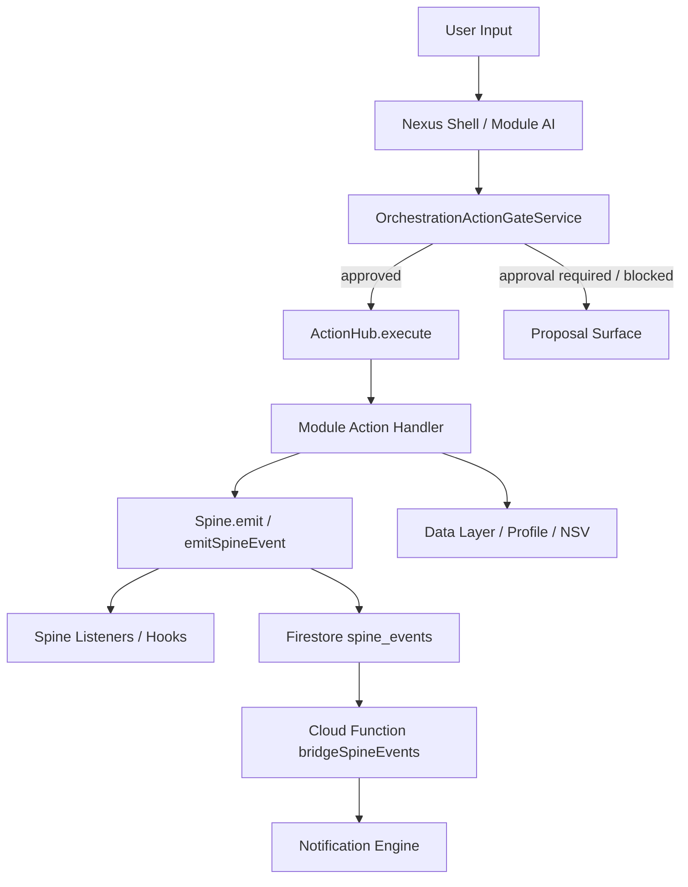
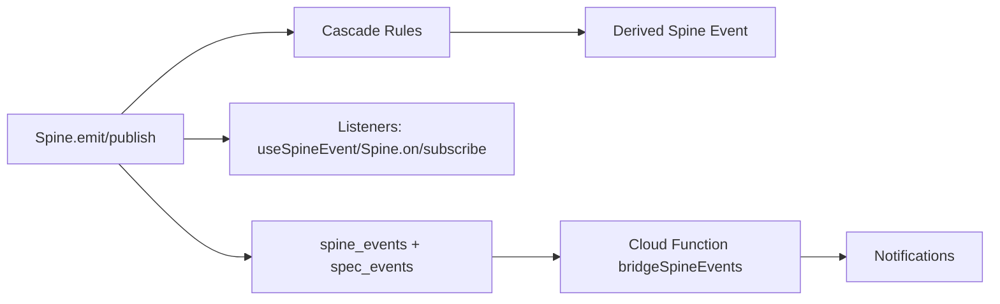
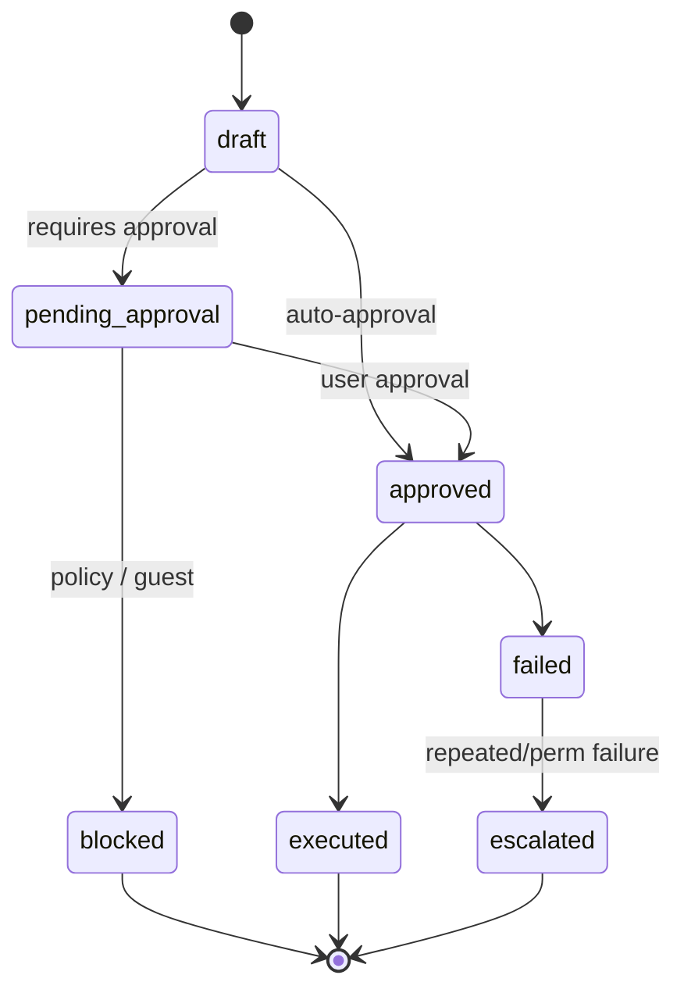
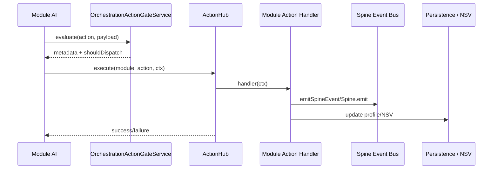

# Nexus Flow Atlas

Generated by `scripts/generate-nexus-flow-report.mjs`.

**Overview**

**Spine Event Bus**

## Spine Event Registry

Total event types: 153

| Event Type | Emitters | Listeners | Cascades To | Cascades From |
| --- | --- | --- | --- | --- |
| VITAL_UPDATED | emitSpineEvent (src/lib/actions/core-handlers.ts:978) emitSpineEvent (src/lib/actions/core-handlers.ts:989) emitSpineEvent (src/lib/actions/core-handlers.ts:999) emitSpineEvent (src/lib/actions/core-handlers.ts:1007) emitSpineEvent (src/lib/actions/core-handlers.ts:1022) Spine.emit (src/lib/hooks/use-module-ai.ts:584) Spine.emit (src/lib/hooks/use-module-ai.ts:815) Spine.emit (src/lib/spine/spine-event-bus.test.ts:123) Spine.emit (src/lib/spine/spine-event-bus.test.ts:137) Spine.emit (src/lib/spine/spine-event-bus.test.ts:152) emitSpineEvent (src/modules/agnes/services/actions.ts:93) emitSpineEvent (src/modules/agnes/services/actions.ts:103) emitSpineEvent (src/modules/agnes/services/actions.ts:123) emitSpineEvent (src/modules/nexus/services/actions.ts:136) | Spine.on (src/lib/hooks/use-nexus-cross-module-blocker.ts:92) Spine.on (src/lib/spine/spine-event-bus.test.ts:39) Spine.on (src/lib/spine/spine-event-bus.test.ts:52) Spine.on (src/lib/spine/spine-event-bus.test.ts:100) Spine.on (src/lib/spine/spine-event-bus.test.ts:110) Spine.on (src/lib/spine/spine-event-bus.test.ts:121) Spine.on (src/lib/spine/spine-event-bus.test.ts:256) Spine.subscribe (src/modules/atlas/services/atlas-predictive-service.ts:336) Spine.on (src/modules/nexus/components/NexusDashboard.tsx:610) useSpineEvent (src/modules/nexus/hooks/useModuleHealth.ts:147) | BURNOUT_WARNING | GOAL_COMPLETED, PLANNING_STATE_UPDATED, ATLAS_TASK_COMPLETED, soma_poor_readiness, clearance_revoked |
| REDUCE_TRAINING_LOAD | Spine.publish (src/modules/nexus/components/DailyBriefSection.test.tsx:97) | useSpineEvent (src/modules/titan/TitanContent.tsx:525) |  | ATLAS_RECOVERY_SCHEDULED, soma_optimal_readiness |
| BLOCK_HIGH_INTENSITY | Spine.publish (src/lib/services/nexus-synthesis-service.ts:372) Spine.emit (src/modules/soma/actions/soma-field-actions.ts:212) Spine.emit (src/modules/titan/services/actions/core-actions.ts:177) | useSpineEvent (src/modules/atlas/AtlasPage.tsx:651) | FLATTEN_ENERGY_WAVE |  |
| FLATTEN_ENERGY_WAVE | Spine.emit (src/lib/actions/core-handlers.ts:897) Spine.emit (src/modules/titan/TitanContent.tsx:1207) | useSpineEvent (src/modules/atlas/AtlasPage.tsx:663) Spine.subscribe (src/modules/atlas/services/atlas-predictive-service.ts:346) |  | BURNOUT_WARNING, BLOCK_HIGH_INTENSITY, ATLAS_PREDICTIVE_ALERT |
| RECOVERY_AVAILABLE | Spine.emit (src/modules/soma/actions/soma-field-actions.ts:321) Spine.emit (src/modules/titan/TitanContent.tsx:1058) Spine.emit (src/modules/titan/TitanContent.tsx:1085) Spine.emit (src/modules/titan/services/actions/recovery-actions.ts:231) Spine.emit (src/modules/titan/services/actions/recovery-actions.ts:344) | useSpineEvent (src/modules/titan/TitanContent.tsx:548) |  |  |
| BURNOUT_WARNING | emitSpineEvent (src/modules/agnes/services/actions.ts:80) | Spine.on (src/lib/spine/spine-event-bus.test.ts:232) Spine.on (src/lib/spine/spine-event-bus.test.ts:282) useSpineEvent (src/modules/atlas/AtlasPage.tsx:639) useSpineEvent (src/modules/titan/TitanContent.tsx:479) | RISK_DETECTED, FLATTEN_ENERGY_WAVE, SOMATIC_SUPPORT_REQUESTED | VITAL_UPDATED |
| CLEARANCE_DENIED |  |  |  |  |
| CLEARANCE_GRANTED |  |  |  |  |
| COGNITIVE_OVERLOAD |  |  |  |  |
| SECURITY_POLICY_UPDATED |  |  |  |  |
| FINANCIAL_STRESS | Spine.publish (src/lib/services/nexus-synthesis-service.ts:384) Spine.emit (src/lib/spine/spine-event-bus.test.ts:184) | useSpineEvent (src/modules/titan/TitanContent.tsx:510) |  |  |
| MEDICAL_ALERT | Spine.emit (src/modules/titan/services/actions/biomarker-actions.ts:292) |  |  |  |
| CRISIS_DETECTED | Spine.publish (src/modules/agnes/services/actions.ts:58) emitSpineEvent (src/modules/agnes/services/actions.ts:52) |  | CRISIS_MODE |  |
| DRAFT_PROPOSED | Spine.emit (src/lib/actions/core-handlers.ts:267) | Spine.on (src/core/components/NeuralDraftPanel.tsx:33) |  |  |
| DRAFT_APPROVED | Spine.emit (src/core/components/NeuralDraftPanel.tsx:58) |  |  |  |
| DRAFT_DISMISSED | Spine.emit (src/core/components/NeuralDraftPanel.tsx:42) |  |  |  |
| SESSION_STARTED | Spine.emit (src/lib/hooks/use-module-ai.ts:528) Spine.emit (src/lib/services/data-transfer-service.ts:658) Spine.publish (src/lib/spine/spine-event-bus.test.ts:167) Spine.emit (src/modules/scout/services/actions.ts:67) Spine.emit (src/modules/scout/services/actions.ts:109) | Spine.subscribe (src/lib/spine/spine-event-bus.test.ts:165) Spine.subscribe (src/modules/scout/ScoutPage.tsx:323) | WEEKLY_REVIEW_DUE, MORNING_BRIEF_DUE, EVENING_CHECKIN_DUE |  |
| SESSION_ENDED | Spine.emit (src/lib/hooks/use-module-ai.ts:1204) Spine.emit (src/lib/services/data-transfer-service.ts:327) | useSpineEvent (src/modules/nexus/hooks/useModuleHealth.ts:146) |  |  |
| MODULE_DELEGATED | Spine.emit (src/lib/actions/core-handlers.ts:314) Spine.emit (src/lib/actions/core-handlers.ts:361) Spine.emit (src/lib/actions/core-handlers.ts:405) Spine.emit (src/lib/actions/core-handlers.ts:428) Spine.emit (src/lib/hooks/useHandoffProcessor.ts:161) Spine.emit (src/lib/hooks/useHandoffProcessor.ts:189) Spine.emit (src/lib/services/module-ai-action-execution-service.ts:127) Spine.emit (src/lib/services/soma-titan-delegation-service.ts:33) Spine.emit (src/lib/services/soma-titan-delegation-service.ts:71) Spine.emit (src/modules/atlas/AtlasPage.tsx:340) Spine.emit (src/modules/nexus/components/nexus-edge-cases.test.tsx:529) emitSpineEvent (src/modules/nexus/services/actions.ts:77) Spine.emit (src/modules/titan/services/actions/biomarker-actions.ts:268) | Spine.on (src/core/components/NexusRouteBanner.tsx:43) Spine.on (src/lib/hooks/use-nexus-cross-module-blocker.ts:91) Spine.subscribe (src/lib/hooks/useHandoffProcessor.ts:267) Spine.on (src/modules/nexus/components/NexusDashboard.tsx:609) |  |  |
| MODULE_HANDOFF_RECEIVED | Spine.emit (src/lib/hooks/useHandoffProcessor.ts:208) | useSpineEvent (src/modules/titan/TitanContent.tsx:433) |  |  |
| TITAN_PROPOSAL | emitSpineEvent (src/modules/titan/services/actions/proposal-actions.ts:5) emitSpineEvent (src/modules/titan/services/actions/proposal-actions.ts:19) emitSpineEvent (src/modules/titan/services/actions/proposal-actions.ts:33) | useSpineEvent (src/modules/titan/TitanContent.tsx:313) |  |  |
| PLANNING_OVERLOAD | Spine.emit (src/modules/atlas/services/atlas-predictive-service.ts:200) | Spine.subscribe (src/modules/atlas/services/atlas-predictive-service.ts:367) |  |  |
| DEADLINE_CRUNCH |  | Spine.on (src/lib/services/intelligence-pipeline.ts:47) |  | DEADLINE_PRESSURE_CHANGED |
| COMPOUND_STRESS | emitSpineEvent (src/modules/agnes/services/actions.ts:91) emitSpineEvent (src/modules/agnes/services/actions.ts:121) | useSpineEvent (src/modules/titan/TitanContent.tsx:459) |  | SOMA_READINESS_UPDATED, TITAN_BODY_WEIGHT_LOGGED |
| CRISIS_MODE | Spine.publish (src/lib/services/nexus-synthesis-service.ts:396) Spine.emit (src/modules/atlas/services/atlas-predictive-service.ts:404) | Spine.subscribe (src/modules/atlas/services/atlas-predictive-service.ts:376) |  | CRISIS_DETECTED |
| EXECUTION_COLLAPSE |  |  |  |  |
| STREAK_BROKEN |  |  |  |  |
| TASK_COMPLETED | emitSpineEvent (src/modules/atlas/__tests__/atlas-data-integrity.test.ts:565) |  |  |  |
| DEADLINE_APPROACHING | emitSpineEvent (src/modules/atlas/services/actions/task-actions.ts:410) |  |  |  |
| HABIT_STREAK_BROKEN | emitSpineEvent (src/modules/atlas/services/actions/habit-actions.ts:65) Spine.emit (src/modules/atlas/services/atlas-review-service.ts:31) |  | SOMATIC_SUPPORT_REQUESTED |  |
| TEMPORAL_REVIEW_COMPLETE | emitSpineEvent (src/modules/atlas/services/actions/routine-actions.ts:169) |  |  |  |
| DELEGATION_REQUEST | emitSpineEvent (src/modules/atlas/services/actions/task-actions.ts:438) |  |  |  |
| NSV_CALIBRATION_REQUEST | emitSpineEvent (src/lib/actions/analysis-actions.ts:489) emitSpineEvent (src/lib/actions/analysis-actions.ts:747) emitSpineEvent (src/modules/atlas/services/actions/energy-actions.ts:91) |  |  |  |
| SCHEMA_EXTENDED | Spine.emit (src/lib/schema-registry.ts:327) |  |  |  |
| SCHEMA_MODIFIED | Spine.emit (src/lib/schema-registry.ts:358) |  |  |  |
| SCHEMA_MIGRATED | Spine.emit (src/lib/schema-registry.ts:500) Spine.emit (src/lib/services/migration-service.ts:257) Spine.emit (src/lib/services/migration-service.ts:355) |  |  |  |
| FIELD_CREATED | emitSpineEvent (src/lib/actions/field-suggestion-actions.ts:470) emitSpineEvent (src/modules/ledger/actions/ledger-field-actions.ts:381) |  |  |  |
| FIELD_DELETED | emitSpineEvent (src/lib/actions/field-suggestion-actions.ts:592) emitSpineEvent (src/modules/ledger/actions/ledger-field-actions.ts:414) |  |  |  |
| FIELD_VALUE_UPDATED | emitSpineEvent (src/modules/ledger/actions/ledger-field-actions.ts:573) |  |  |  |
| SPENDING_DETECTED |  | Spine.on (src/lib/services/intelligence-pipeline.ts:21) |  |  |
| CONFLICT_DETECTED | Spine.publish (src/lib/services/nexus-synthesis-service.ts:310) | Spine.on (src/lib/hooks/use-nexus-conflict-blocker.ts:52) |  |  |
| CONFLICT_RESOLVED | Spine.publish (src/lib/services/nexus-synthesis-service.ts:338) | Spine.on (src/lib/hooks/use-nexus-conflict-blocker.ts:53) |  |  |
| ATLAS_RECOVERY_SCHEDULED | Spine.emit (src/modules/atlas/components/WeeklyReviewModal.tsx:287) |  | REDUCE_TRAINING_LOAD |  |
| ATLAS_PREDICTIVE_ALERT | Spine.emit (src/modules/atlas/services/atlas-predictive-service.ts:167) Spine.emit (src/modules/atlas/services/atlas-predictive-service.ts:349) |  | FLATTEN_ENERGY_WAVE |  |
| ATLAS_STATE_CHANGED | emitSpineEvent (src/modules/atlas/services/actions/checkin-actions.ts:67) emitSpineEvent (src/modules/atlas/services/actions/routine-actions.ts:407) Spine.emit (src/modules/atlas/services/atlas-predictive-service.ts:421) |  | WEEKLY_REVIEW_DUE | ATLAS_GOAL_UPDATED |
| GOAL_MISSING_PROGRESS | Spine.emit (src/modules/atlas/services/atlas-review-service.ts:56) |  |  |  |
| ATLAS_TASK_COMPLETED | emitSpineEvent (src/modules/atlas/services/actions/task-actions.ts:284) |  | VITAL_UPDATED |  |
| ATLAS_HABIT_LOGGED | emitSpineEvent (src/modules/atlas/services/actions/habit-actions.ts:238) |  |  |  |
| ATLAS_GOAL_MILESTONE |  |  | SOMATIC_SUPPORT_REQUESTED | ATLAS_GOAL_UPDATED |
| ATLAS_GOAL_COMPLETED | emitSpineEvent (src/modules/atlas/services/actions/goal-actions.ts:107) emitSpineEvent (src/modules/atlas/services/actions/goal-actions.ts:252) |  |  |  |
| ATLAS_ENERGY_UPDATED |  |  |  |  |
| ATLAS_ENERGY_OVERLOAD |  |  |  |  |
| ATLAS_RECOVERY_WINDOW_CREATED |  |  |  |  |
| ATLAS_TASK_CREATED |  |  |  |  |
| ATLAS_TASK_BLOCKED |  |  |  |  |
| ATLAS_TASK_UNBLOCKED |  |  |  |  |
| ATLAS_HABIT_MILESTONE |  |  |  |  |
| ATLAS_FIELD_CREATED |  |  |  |  |
| ATLAS_FIELD_DELETED |  |  |  |  |
| ATLAS_FIELD_VALUE_UPDATED |  |  |  |  |
| ATLAS_GOAL_UPDATED | emitSpineEvent (src/modules/atlas/services/actions/goal-actions.ts:51) emitSpineEvent (src/modules/atlas/services/actions/goal-actions.ts:98) emitSpineEvent (src/modules/atlas/services/actions/goal-actions.ts:168) emitSpineEvent (src/modules/atlas/services/actions/goal-actions.ts:204) emitSpineEvent (src/modules/atlas/services/actions/goal-actions.ts:243) |  | ATLAS_STATE_CHANGED, ATLAS_GOAL_MILESTONE |  |
| DEADLINE_PRESSURE_CHANGED | emitSpineEvent (src/modules/atlas/services/actions/task-actions.ts:424) |  | DEADLINE_CRUNCH |  |
| PLANNING_STATE_UPDATED | emitSpineEvent (src/modules/atlas/services/actions/habit-actions.ts:89) emitSpineEvent (src/modules/atlas/services/actions/routine-actions.ts:247) emitSpineEvent (src/modules/atlas/services/actions/task-actions.ts:431) |  | VITAL_UPDATED |  |
| BUDGET_UPDATED |  |  |  | TRANSACTION_CREATED |
| GOAL_PROGRESS | emitSpineEvent (src/modules/ledger/services/actions.ts:388) |  | FINANCIAL_HEALTH_CHECK |  |
| FINANCIAL_FRICTION_CHANGED | emitSpineEvent (src/modules/ledger/actions/ledger-field-actions.ts:446) | Spine.on (src/lib/services/intelligence-pipeline.ts:83) | SOMATIC_SUPPORT_REQUESTED | RISK_DETECTED |
| RESONANCE_ROI_UPDATED | emitSpineEvent (src/modules/ledger/actions/ledger-field-actions.ts:477) |  |  |  |
| FINANCIAL_PLAN_CREATED | emitSpineEvent (src/modules/ledger/services/actions.ts:113) |  |  |  |
| DOCUMENT_ANALYZED |  |  |  |  |
| TRANSACTION_CREATED | emitSpineEvent (src/modules/ledger/actions/transaction-actions.ts:109) emitSpineEvent (src/modules/ledger/services/actions.ts:314) emitSpineEvent (src/modules/ledger/services/actions.ts:667) emitSpineEvent (src/modules/ledger/services/actions.ts:735) |  | BUDGET_UPDATED |  |
| TRANSACTION_UPDATED | emitSpineEvent (src/modules/ledger/actions/transaction-actions.ts:184) |  |  |  |
| TRANSACTION_DELETED | emitSpineEvent (src/modules/ledger/actions/transaction-actions.ts:253) |  |  |  |
| BUDGET_CREATED | emitSpineEvent (src/modules/ledger/actions/transaction-actions.ts:306) |  |  |  |
| BUDGET_MODIFIED | emitSpineEvent (src/modules/ledger/actions/transaction-actions.ts:373) |  |  |  |
| GOAL_CREATED | emitSpineEvent (src/modules/ledger/actions/transaction-actions.ts:442) emitSpineEvent (src/modules/ledger/services/actions.ts:455) |  |  |  |
| GOAL_COMPLETED | emitSpineEvent (src/modules/ledger/actions/transaction-actions.ts:503) emitSpineEvent (src/modules/ledger/services/actions.ts:374) |  | VITAL_UPDATED |  |
| FINANCIAL_HEALTH_CHECK | emitSpineEvent (src/modules/ledger/actions/transaction-actions.ts:551) |  |  | GOAL_PROGRESS, STRESS_SPIKE |
| RISK_DETECTED | emitSpineEvent (src/modules/ledger/actions/transaction-actions.ts:579) emitSpineEvent (src/modules/ledger/services/actions.ts:679) |  | FINANCIAL_FRICTION_CHANGED | BURNOUT_WARNING |
| FINANCIAL_FRICTION_UPDATED |  |  |  |  |
| BUDGET_ALERT |  |  |  |  |
| OVERSPEND_DETECTED |  |  |  |  |
| DEBT_MILESTONE |  |  |  |  |
| SAVINGS_MILESTONE |  |  |  |  |
| INCOME_CHANGE |  |  |  |  |
| EXPENSE_SPIKE |  |  |  |  |
| CASHFLOW_POSITIVE |  |  |  |  |
| CASHFLOW_NEGATIVE |  |  |  |  |
| SOMA_BIOMARKER_COMMITTED | Spine.publish (src/modules/titan/services/actions/biomarker-actions.ts:23) Spine.publish (src/modules/titan/services/actions/biomarker-actions.ts:119) |  |  |  |
| SOMA_READINESS_UPDATED | Spine.publish (src/modules/titan/services/actions/core-actions.ts:185) Spine.publish (src/modules/titan/services/actions/core-actions.ts:199) | Spine.on (src/lib/services/intelligence-pipeline.ts:34) | COMPOUND_STRESS |  |
| SOMA_CLEARANCE_CHANGED |  |  |  |  |
| SOMA_FIELD_CREATED |  |  |  |  |
| SOMA_FIELD_UPDATED |  |  |  |  |
| SOMA_FIELD_DELETED |  |  |  |  |
| SOMA_VITAL_LOGGED | Spine.emit (src/modules/soma/components/VitalsEntryForm.tsx:94) |  |  |  |
| SOMA_LAB_REPORT_PARSED | Spine.emit (src/modules/soma/services/lab-import-service.ts:65) Spine.emit (src/modules/titan/services/actions/biomarker-actions.ts:141) |  |  |  |
| SOMA_PROFILE_UPDATED | Spine.emit (src/modules/soma/actions/soma-field-actions.ts:341) Spine.emit (src/modules/soma/actions/soma-field-actions.ts:862) |  |  |  |
| SOMA_DIAGNOSIS_MERGED | Spine.emit (src/modules/soma/actions/soma-field-actions.ts:880) Spine.publish (src/modules/soma/services/diagnosis-session-service.ts:523) |  |  |  |
| SOMA_DIAGNOSIS_DISCARDED | Spine.emit (src/modules/soma/actions/soma-field-actions.ts:898) Spine.publish (src/modules/soma/services/diagnosis-session-service.ts:534) |  |  |  |
| HEALTH_CONTEXT_STALE |  | useSpineEvent (src/lib/global-soul-context.tsx:120) |  |  |
| MODULE_PROFILE_UPDATED | Spine.emit (src/lib/hooks/use-module-ai.ts:596) Spine.emit (src/lib/hooks/use-module-ai.ts:829) Spine.emit (src/modules/atlas/AtlasPage.tsx:358) Spine.emit (src/modules/soma/SomaPage.tsx:218) | useSpineEvent (src/lib/hooks/use-module-profile.ts:40) |  |  |
| MODULE_REMINDER_DUE |  |  |  |  |
| MODULE_REMINDER_COMPLETED |  |  |  |  |
| REMINDER_PROPOSED | Spine.emit (src/lib/actions/core-handlers.ts:482) | useSpineEvent (src/lib/hooks/use-reminder-proposals.ts:20) |  |  |
| REMINDER_CONFIRMED | Spine.emit (src/lib/actions/core-handlers.ts:628) |  |  |  |
| REMINDER_DISMISSED | Spine.emit (src/lib/actions/core-handlers.ts:641) |  |  |  |
| ROUTINE_PROPOSED | Spine.emit (src/lib/actions/core-handlers.ts:541) Spine.emit (src/lib/hooks/use-routine-proposals.test.tsx:24) Spine.emit (src/lib/hooks/use-routine-proposals.test.tsx:60) | useSpineEvent (src/lib/hooks/use-routine-proposals.ts:19) |  |  |
| ROUTINE_CONFIRMED | Spine.emit (src/lib/actions/core-handlers.ts:530) Spine.emit (src/lib/actions/core-handlers.ts:573) | useSpineEvent (src/lib/hooks/use-routine-proposals.ts:30) |  |  |
| ROUTINE_DISMISSED | Spine.emit (src/lib/actions/core-handlers.ts:586) | useSpineEvent (src/lib/hooks/use-routine-proposals.ts:38) |  |  |
| CYCLE_STARTED | Spine.emit (src/modules/titan/services/actions/cycle-actions.ts:72) |  |  |  |
| CYCLE_COMPLETED | Spine.emit (src/modules/titan/services/actions/cycle-actions.ts:115) Spine.emit (src/modules/titan/services/actions/cycle-actions.ts:208) |  |  |  |
| WORKOUT_COMPLETED | Spine.emit (src/modules/titan/services/actions/body-actions.ts:153) Spine.emit (src/modules/titan/services/actions/workout-actions.ts:117) | Spine.on (src/lib/services/intelligence-pipeline.ts:70) useSpineEvent (src/modules/soma/SomaPage.tsx:174) |  |  |
| TITAN_BODY_WEIGHT_LOGGED | Spine.emit (src/modules/titan/services/actions/body-actions.ts:77) | useSpineEvent (src/modules/soma/SomaPage.tsx:161) | COMPOUND_STRESS |  |
| TITAN_RECOVERY_NEEDED | Spine.emit (src/modules/titan/TitanContent.tsx:994) Spine.emit (src/modules/titan/services/actions/recovery-actions.ts:155) Spine.emit (src/modules/titan/services/actions/workout-actions.ts:141) |  | SOMATIC_SUPPORT_REQUESTED |  |
| TITAN_TRAINING_STREAK | Spine.emit (src/modules/titan/services/actions/workout-actions.ts:173) |  | SOMATIC_SUPPORT_REQUESTED |  |
| SOMA_VETO_OVERRIDDEN | Spine.emit (src/modules/titan/TitanContent.tsx:1190) |  |  |  |
| ai_validation_suggestion | emitSpineEvent (src/lib/actions/validation-actions.ts:278) |  |  |  |
| ai_contextual_validation | emitSpineEvent (src/lib/actions/validation-actions.ts:415) |  |  |  |
| ai_error_explanation | emitSpineEvent (src/lib/actions/validation-actions.ts:567) |  |  |  |
| AI_LINK_FAILURE | Spine.emit (src/lib/hooks/use-module-ai.ts:1077) |  |  |  |
| SOUL_WRITE_REQUESTED | Spine.publish (src/lib/services/global-projection-service.ts:342) | Spine.on (src/core/components/SoulWriteInbox.tsx:38) |  |  |
| SOUL_WRITE_APPROVED | Spine.publish (src/lib/services/global-projection-service.ts:439) |  |  |  |
| SOUL_WRITE_REJECTED | Spine.publish (src/lib/services/global-projection-service.ts:490) |  |  |  |
| CONTEXT_HINT_DETECTED | Spine.publish (src/lib/actions/core-handlers.ts:1170) | useSpineEvent (src/lib/hooks/use-cross-module-hint-listener.ts:55) |  |  |
| CONTEXT_HINT_CONFIRMED | Spine.publish (src/lib/hooks/use-cross-module-hint-listener.ts:121) |  |  |  |
| CONTEXT_HINT_DISMISSED | Spine.publish (src/lib/hooks/use-cross-module-hint-listener.ts:90) |  |  |  |
| WEEKLY_REVIEW_DUE | Spine.publish (src/modules/atlas/AtlasPage.tsx:134) | useSpineEvent (src/modules/atlas/AtlasPage.tsx:148) |  | SESSION_STARTED, ATLAS_STATE_CHANGED |
| ROUTINE_UPDATED | emitSpineEvent (src/modules/atlas/services/actions/routine-actions.ts:401) |  |  | COMMITMENT_MISSED |
| SOMATIC_SUPPORT_REQUESTED |  | useSpineEvent (src/modules/agnes/AgnesPage.tsx:135) |  | FINANCIAL_FRICTION_CHANGED, BURNOUT_WARNING, HABIT_STREAK_BROKEN, ATLAS_GOAL_MILESTONE, TITAN_RECOVERY_NEEDED, TITAN_TRAINING_STREAK |
| MORNING_BRIEF_DUE | Spine.publish (src/modules/atlas/AtlasPage.tsx:115) | useSpineEvent (src/modules/atlas/AtlasPage.tsx:156) |  | SESSION_STARTED |
| EVENING_CHECKIN_DUE |  | useSpineEvent (src/modules/atlas/AtlasPage.tsx:162) |  | SESSION_STARTED |
| COMMITMENT_MISSED | Spine.publish (src/modules/atlas/AtlasPage.tsx:194) | useSpineEvent (src/modules/titan/TitanContent.tsx:497) | ROUTINE_UPDATED |  |
| MORNING_BRIEF |  |  |  |  |
| ATLAS_OVERLOAD_DETECTED | Spine.publish (src/lib/hooks/use-atlas-predictive-state.ts:38) |  |  |  |
| SOMATIC_SESSION_COMPLETE | Spine.publish (src/modules/agnes/AgnesPage.tsx:664) | Spine.on (src/lib/services/intelligence-pipeline.ts:57) |  |  |
| JOURNAL_ENTRY_CREATED | emitSpineEvent (src/modules/atlas/services/actions/journal-actions.ts:78) |  | HABIT_STREAK_MILESTONE |  |
| JOURNAL_ENTRY_UPDATED | emitSpineEvent (src/modules/atlas/services/actions/journal-actions.ts:158) |  |  |  |
| HABIT_STREAK_MILESTONE |  |  |  | JOURNAL_ENTRY_CREATED |
| DEEP_RESEARCH_REQUESTED |  |  |  |  |
| DEEP_RESEARCH_BACKUP_FOUND |  |  |  |  |
| DEEP_RESEARCH_STARTED | Spine.publish (src/modules/scout/hooks/useDeepResearch.ts:162) Spine.emit (src/modules/scout/services/actions.ts:316) | Spine.subscribe (src/modules/scout/ScoutPage.tsx:294) |  |  |
| DEEP_RESEARCH_COMPLETED | Spine.publish (src/modules/scout/hooks/useDeepResearch.ts:401) |  |  |  |
| DIGEST_GENERATION_STARTED | Spine.emit (src/modules/scout/services/scout-digest-service.ts:173) | Spine.subscribe (src/modules/scout/ScoutPage.tsx:319) |  |  |
| DIGEST_GENERATED | Spine.emit (src/modules/scout/services/scout-digest-service.ts:246) | Spine.subscribe (src/modules/scout/services/scout-projection-listener.ts:53) |  |  |
| DIGEST_GENERATION_FAILED | Spine.emit (src/modules/scout/services/scout-digest-service.ts:270) |  |  |  |
| EXPORT_REQUESTED |  | Spine.subscribe (src/modules/scout/ScoutPage.tsx:300) |  |  |
| SOURCE_ADDED | Spine.emit (src/modules/scout/services/actions.ts:156) |  |  |  |
| KNOWLEDGE_SYNTHESIZED | Spine.emit (src/modules/scout/services/actions.ts:191) | Spine.subscribe (src/modules/scout/services/scout-projection-listener.ts:42) |  |  |
| SCOUT_PROFILE_UPDATED | Spine.publish (src/modules/scout/services/scout-knowledge-service.ts:112) | Spine.subscribe (src/modules/scout/services/scout-projection-listener.ts:23) |  |  |
| HABIT_SUGGESTED | Spine.emit (src/modules/scout/services/actions.ts:341) |  |  |  |
| RESEARCH_SEARCHING | Spine.emit (src/modules/scout/services/actions.ts:214) |  |  |  |
| RESEARCH_RESULTS | Spine.emit (src/modules/scout/services/actions.ts:234) |  |  |  |
| LEDGER_FIELD_SUGGESTION | emitSpineEvent (src/modules/ledger/services/actions.ts:705) |  |  |  |
| FINANCIAL_STREAK_MILESTONE |  |  |  |  |

**Dynamic Spine Event References**

- Dynamic emitters:
  - src/lib/actions/core-handlers.ts:267 -> eventType
  - src/lib/hooks/use-module-ai.ts:528 -> node.actionType
  - src/lib/hooks/use-module-ai.ts:584 -> a.type
  - src/lib/schema-registry.ts:327 -> ${field1.type
  - src/lib/services/migration-service.ts:257 -> this.inferFieldType(value)
  - src/lib/services/module-ai-action-execution-service.ts:127 -> eventType
  - src/lib/spine/scheduler-service.ts:272 -> def.spineEventType
  - src/modules/atlas/AtlasPage.tsx:115 -> SpineEventType
  - src/modules/nexus/components/nexus-edge-cases.test.tsx:529 -> string
  - src/modules/soma/actions/soma-field-actions.ts:212 -> SomaSpineEvents.BIOMARKER_COMMITTED
  - src/modules/soma/actions/soma-field-actions.ts:235 -> SomaSpineEvents.READINESS_UPDATED
  - src/modules/soma/actions/soma-field-actions.ts:261 -> SomaSpineEvents.CLEARANCE_CHANGED
  - src/modules/soma/actions/soma-field-actions.ts:304 -> SomaSpineEvents.FIELD_CREATED
  - src/modules/soma/actions/soma-field-actions.ts:362 -> SomaSpineEvents.FIELD_DELETED
  - src/modules/soma/actions/soma-field-actions.ts:525 -> SomaSpineEvents.FIELD_UPDATED
  - src/modules/soma/actions/soma-field-actions.ts:667 -> SomaSpineEvents.BIOMARKER_COMMITTED
  - src/modules/soma/actions/soma-field-actions.ts:698 -> SomaSpineEvents.VITAL_LOGGED
  - src/modules/soma/actions/soma-field-actions.ts:776 -> SomaSpineEvents.LAB_REPORT_PARSED
  - src/modules/soma/actions/soma-field-actions.ts:822 -> SomaSpineEvents.PROFILE_UPDATED
  - src/modules/soma/services/soma-data-service.ts:352 -> SomaSpineEvents.PROFILE_UPDATED
  - src/modules/soma/services/soma-data-service.ts:397 -> SomaSpineEvents.PROFILE_UPDATED
  - src/modules/titan/TitanContent.tsx:361 -> plan.type
  - src/modules/titan/services/actions/body-actions.ts:77 -> sessionType
  - src/modules/titan/services/actions/cycle-actions.ts:72 -> cycle.type
  - src/modules/titan/services/actions/cycle-actions.ts:115 -> cycle.type
  - src/modules/titan/services/actions/cycle-actions.ts:208 -> cycle.type
  - src/modules/titan/services/actions/recovery-actions.ts:155 -> plan.type
- Dynamic listeners:
  - src/lib/spine/spine-event-bus.ts:217 -> type
  - src/modules/ledger/LedgerContent.tsx:587 -> evtType

## Action Registry

Total actions (unique types): 157

| Action Type | Modules | Handler Sources |
| --- | --- | --- |
| (spread:biomarkerHandlers) | titan | src/modules/titan/services/actions/index.ts:26 |
| (spread:bodyHandlers) | titan | src/modules/titan/services/actions/index.ts:26 |
| (spread:cycleHandlers) | titan | src/modules/titan/services/actions/index.ts:26 |
| (spread:journalActions) | atlas | src/modules/atlas/services/actions/index.ts:23 |
| (spread:recoveryHandlers) | titan | src/modules/titan/services/actions/index.ts:26 |
| (spread:sleepHandlers) | titan | src/modules/titan/services/actions/index.ts:26 |
| add_sources | scout | src/modules/scout/services/actions.ts:33 |
| approve_diagnosis_merge | soma | src/modules/soma/actions/soma-field-actions.ts:451 |
| approve_health_entry | soma | src/modules/soma/actions/soma-field-actions.ts:451 |
| broadcast_spine_event | nexus | src/lib/actions/core-handlers.ts:265 src/modules/nexus/services/actions.ts:95 |
| budget_event | forge | src/modules/forge/services/actions.ts:38 |
| Cap | titan | src/modules/titan/services/actions/field-actions.ts:7 |
| commit_biomarker | soma | src/modules/soma/actions/soma-field-actions.ts:451 |
| complete_check_in | atlas | src/modules/atlas/services/actions/checkin-actions.ts:14 |
| complete_goal | atlas, ledger | src/modules/atlas/services/actions/goal-actions.ts:9 src/modules/ledger/actions/transaction-actions.ts:613 |
| complete_habit | atlas | src/modules/atlas/services/actions/habit-actions.ts:9 |
| complete_orchestrator_onboarding | nexus | src/lib/actions/core-handlers.ts:447 |
| complete_task | atlas | src/modules/atlas/services/actions/task-actions.ts:13 |
| compute_readiness | soma | src/modules/soma/actions/soma-field-actions.ts:451 |
| compute_resonance_roi | ledger | src/lib/actions/core-handlers.ts:1142 src/modules/ledger/actions/ledger-field-actions.ts:597 |
| confirm_reminder | nexus | src/lib/actions/core-handlers.ts:447 |
| confirm_routine | nexus | src/lib/actions/core-handlers.ts:447 |
| create_budget | ledger | src/modules/ledger/actions/transaction-actions.ts:613 |
| create_checklist | forge | src/modules/forge/services/actions.ts:38 |
| create_document | forge | src/modules/forge/services/actions.ts:38 |
| create_field | nexus, ledger, soma, titan | src/lib/actions/field-suggestion-actions.ts:627 src/modules/ledger/actions/ledger-field-actions.ts:597 src/modules/soma/actions/soma-field-actions.ts:451 src/modules/titan/services/actions/field-actions.ts:7 |
| create_goal | atlas, ledger | src/modules/atlas/services/actions/goal-actions.ts:9 src/modules/ledger/actions/transaction-actions.ts:613 |
| create_habit | atlas | src/modules/atlas/services/actions/habit-actions.ts:9 |
| create_module_handoff | nexus | src/modules/nexus/services/actions.ts:61 |
| create_recovery_window | atlas | src/modules/atlas/services/actions/energy-actions.ts:10 |
| create_task | atlas | src/modules/atlas/services/actions/task-actions.ts:13 |
| create_transaction | ledger | src/modules/ledger/actions/transaction-actions.ts:613 |
| crisis_flag | agnes | src/modules/agnes/services/actions.ts:51 |
| daily_plan | atlas | src/modules/atlas/services/actions/routine-actions.ts:20 |
| delegate_to_module | nexus, atlas | src/lib/actions/core-handlers.ts:265 src/modules/atlas/services/actions/task-actions.ts:13 |
| delete_field | nexus, ledger, soma, titan | src/lib/actions/field-suggestion-actions.ts:627 src/modules/ledger/actions/ledger-field-actions.ts:597 src/modules/soma/actions/soma-field-actions.ts:451 src/modules/titan/services/actions/field-actions.ts:7 |
| delete_goal | atlas | src/modules/atlas/services/actions/goal-actions.ts:9 |
| delete_habit | atlas | src/modules/atlas/services/actions/habit-actions.ts:9 |
| delete_task | atlas | src/modules/atlas/services/actions/task-actions.ts:13 |
| delete_transaction | ledger | src/modules/ledger/actions/transaction-actions.ts:613 |
| detect_data_hint | nexus | src/lib/actions/core-handlers.ts:1163 |
| detect_risk | ledger | src/modules/ledger/actions/transaction-actions.ts:613 |
| dismiss_reminder | nexus | src/lib/actions/core-handlers.ts:447 |
| dismiss_routine | nexus | src/lib/actions/core-handlers.ts:447 |
| draft_email | forge | src/modules/forge/services/actions.ts:38 |
| edit_section | forge | src/modules/forge/services/actions.ts:38 |
| execute_code | forge | src/modules/forge/services/actions.ts:38 |
| explain_validation_error | nexus | src/lib/actions/validation-actions.ts:610 |
| financial_health_check | ledger | src/modules/ledger/actions/transaction-actions.ts:613 |
| flatten_schedule | atlas | src/lib/actions/core-handlers.ts:892 src/lib/services/nexus-action-dispatch-execution-service.test.ts:9 src/modules/atlas/services/actions/routine-actions.ts:20 |
| flatten_schedule_fail_once | atlas | src/lib/services/nexus-action-dispatch-execution-service.test.ts:69 |
| focus_bio | nexus | src/lib/actions/core-handlers.ts:447 |
| focus_identity | nexus | src/lib/actions/core-handlers.ts:447 |
| focus_review | nexus | src/lib/actions/core-handlers.ts:447 |
| generate_daily_schedule | atlas | src/modules/atlas/services/actions/routine-actions.ts:20 |
| generate_digest | scout | src/modules/scout/services/actions.ts:33 |
| get_biomarker_history | soma | src/modules/soma/actions/soma-field-actions.ts:451 |
| get_lab_history | soma | src/modules/soma/actions/soma-field-actions.ts:451 |
| get_medical_summary | soma | src/modules/soma/actions/soma-field-actions.ts:451 |
| Guards | titan | src/modules/titan/services/actions/field-actions.ts:7 |
| handoff_to_atlas | scout | src/modules/scout/services/actions.ts:33 |
| issue_clearance | soma | src/modules/soma/actions/soma-field-actions.ts:451 |
| list_sessions | scout | src/modules/scout/services/actions.ts:33 |
| log_field_value | titan | src/modules/titan/services/actions/field-actions.ts:7 |
| log_habit_metric | atlas | src/modules/atlas/services/actions/habit-actions.ts:9 |
| log_vital | soma | src/modules/soma/actions/soma-field-actions.ts:451 |
| log_workout_session | titan | src/modules/titan/services/actions/workout-actions.ts:10 |
| log_workout_set | titan | src/modules/titan/services/actions/workout-actions.ts:10 |
| medical_image_analysis | soma | src/modules/soma/actions/soma-field-actions.ts:451 |
| modify_budget | ledger | src/modules/ledger/actions/transaction-actions.ts:613 |
| move_task | atlas | src/modules/atlas/services/actions/task-actions.ts:13 |
| navigate_to_module | nexus | src/modules/nexus/services/actions.ts:43 |
| nexus_link_command | forge | src/modules/forge/services/actions.ts:38 |
| Optional | titan | src/modules/titan/services/actions/field-actions.ts:7 |
| parse_lab_report | soma | src/modules/soma/actions/soma-field-actions.ts:451 |
| pause_habit | atlas | src/modules/atlas/services/actions/habit-actions.ts:9 |
| plan_trip | forge | src/modules/forge/services/actions.ts:38 |
| prioritize | atlas | src/modules/atlas/services/actions/task-actions.ts:13 |
| propose_draft | nexus | src/lib/actions/core-handlers.ts:265 |
| propose_reminder | nexus | src/lib/actions/core-handlers.ts:447 |
| propose_routine | nexus, titan | src/lib/actions/core-handlers.ts:447 src/modules/titan/services/actions/proposal-actions.ts:3 |
| propose_sleep_log | titan | src/modules/titan/services/actions/proposal-actions.ts:3 |
| propose_workout_log | titan | src/modules/titan/services/actions/proposal-actions.ts:3 |
| query_knowledge | scout | src/lib/actions/action-hub.test.ts:541 src/modules/scout/services/actions.ts:33 |
| query_module | nexus | src/lib/actions/core-handlers.ts:265 |
| query_module_data | nexus | src/lib/actions/core-handlers.ts:265 |
| query_reminders | nexus | src/lib/actions/core-handlers.ts:447 |
| read_file | forge | src/modules/forge/services/actions.ts:38 |
| record_transaction_retry_fail | ledger | src/lib/services/orchestration-execution-service.test.ts:220 |
| record_transaction_retry_success | ledger | src/lib/services/orchestration-execution-service.test.ts:175 |
| reject_diagnosis_merge | soma | src/modules/soma/actions/soma-field-actions.ts:451 |
| reject_health_entry | soma | src/modules/soma/actions/soma-field-actions.ts:451 |
| request_clearance | titan | src/lib/actions/core-handlers.ts:872 |
| request_nsv_calibration | atlas | src/modules/atlas/services/actions/energy-actions.ts:10 |
| resume_session | scout | src/modules/scout/services/actions.ts:33 |
| schedule_block | atlas | src/lib/services/nexus-action-dispatch-execution-service.test.ts:8 src/modules/atlas/services/actions/routine-actions.ts:20 |
| schedule_block_after_fail | atlas | src/lib/services/nexus-action-dispatch-execution-service.test.ts:70 |
| search_memory | nexus | src/lib/actions/core-handlers.ts:447 |
| search_web | scout | src/modules/scout/services/actions.ts:33 |
| self_clearance_check | titan | src/modules/titan/services/actions/core-actions.ts:16 |
| set_daily_intention | atlas | src/modules/atlas/services/actions/routine-actions.ts:20 |
| set_deadline | atlas | src/modules/atlas/services/actions/task-actions.ts:13 |
| set_field_value | ledger | src/modules/ledger/actions/ledger-field-actions.ts:597 |
| set_task_recurrence | atlas | src/modules/atlas/services/actions/task-actions.ts:13 |
| start_deep_research | scout | src/modules/scout/services/actions.ts:33 |
| start_session | scout | src/modules/scout/services/actions.ts:33 |
| suggest_field | nexus, ledger, titan | src/lib/actions/field-suggestion-actions.ts:627 src/modules/ledger/actions/ledger-field-actions.ts:597 src/modules/titan/services/actions/field-actions.ts:7 |
| suggest_field_fix | nexus | src/lib/actions/validation-actions.ts:610 |
| suggest_reply | forge | src/modules/forge/services/actions.ts:38 |
| summarize_thread | forge | src/modules/forge/services/actions.ts:38 |
| sync_personality_provision | nexus | src/lib/actions/core-handlers.ts:447 src/modules/nexus/services/actions.ts:174 |
| sync_vitals | nexus, agnes, atlas, titan | src/lib/actions/core-handlers.ts:1054 src/modules/agnes/services/actions.ts:113 src/modules/atlas/services/actions/energy-actions.ts:10 src/modules/nexus/services/actions.ts:132 src/modules/titan/services/actions/core-actions.ts:16 |
| synthesize_knowledge | scout | src/modules/scout/services/actions.ts:33 |
| synthesize_research_trends | scout | src/lib/actions/core-handlers.ts:1006 |
| temporal_review | atlas | src/modules/atlas/services/actions/routine-actions.ts:20 |
| track_research_thread | scout | src/lib/actions/core-handlers.ts:988 |
| uncomplete_task | atlas | src/modules/atlas/services/actions/task-actions.ts:13 |
| update_active_load | atlas | src/lib/actions/core-handlers.ts:948 |
| update_agnes_profile | agnes | src/modules/agnes/services/actions.ts:39 |
| update_belief_graph | agnes | src/modules/agnes/services/actions.ts:20 |
| update_cns_fatigue | titan | src/lib/actions/core-handlers.ts:852 |
| update_conditions | soma | src/modules/soma/actions/soma-field-actions.ts:451 |
| update_deadline_pressure | atlas | src/lib/actions/core-handlers.ts:1038 |
| update_emotional_resilience | agnes | src/lib/actions/core-handlers.ts:821 src/modules/agnes/services/actions.ts:72 |
| update_emotional_state | agnes | src/lib/actions/core-handlers.ts:914 |
| update_energy_budget | atlas | src/lib/actions/core-handlers.ts:934 |
| update_energy_wave | atlas | src/lib/actions/core-handlers.ts:880 src/modules/atlas/services/actions/energy-actions.ts:10 |
| update_field | soma | src/modules/soma/actions/soma-field-actions.ts:451 |
| update_financial_friction | ledger | src/lib/actions/core-handlers.ts:1150 src/modules/ledger/actions/ledger-field-actions.ts:597 |
| update_focus_score | atlas | src/lib/actions/core-handlers.ts:941 |
| update_global_identity | nexus | src/lib/actions/core-handlers.ts:447 src/modules/nexus/services/actions.ts:149 |
| update_goal | atlas | src/modules/atlas/services/actions/goal-actions.ts:9 |
| update_goal_progress | atlas | src/modules/atlas/services/actions/goal-actions.ts:9 |
| update_habit | atlas | src/modules/atlas/services/actions/habit-actions.ts:9 |
| update_habit_streak | atlas | src/modules/atlas/services/actions/habit-actions.ts:9 |
| update_interest_diversity | scout | src/lib/actions/core-handlers.ts:1015 |
| update_mood_trend | agnes | src/lib/actions/core-handlers.ts:838 src/modules/agnes/services/actions.ts:97 |
| update_nsv_planning | atlas | src/modules/atlas/services/actions/routine-actions.ts:20 |
| update_orchestrator_intake | nexus | src/lib/actions/core-handlers.ts:447 |
| update_planning_load | atlas | src/lib/actions/core-handlers.ts:955 |
| update_research_interests | scout | src/lib/actions/core-handlers.ts:998 |
| update_research_load | scout | src/lib/actions/core-handlers.ts:971 |
| update_resonance_roi | ledger | src/lib/actions/core-handlers.ts:1045 |
| update_routine | atlas, titan | src/modules/atlas/services/actions/routine-actions.ts:20 src/modules/titan/services/actions/core-actions.ts:16 |
| update_sleep_quality | titan | src/lib/actions/core-handlers.ts:862 |
| update_soul_resilience | agnes | src/lib/actions/core-handlers.ts:811 |
| update_streak_health | atlas | src/lib/actions/core-handlers.ts:1031 |
| update_stress_load | agnes | src/lib/actions/core-handlers.ts:831 src/modules/agnes/services/actions.ts:84 |
| update_task | atlas | src/modules/atlas/services/actions/task-actions.ts:13 |
| update_task_completion_rate | atlas | src/lib/actions/core-handlers.ts:962 |
| update_task_graph | atlas | src/lib/actions/core-handlers.ts:907 src/modules/atlas/services/actions/task-actions.ts:13 |
| update_titan_profile | titan | src/modules/titan/services/actions/core-actions.ts:16 |
| update_transaction | ledger | src/modules/ledger/actions/transaction-actions.ts:613 |
| update_trauma_markers | agnes | src/lib/actions/core-handlers.ts:845 src/modules/agnes/services/actions.ts:106 |
| validate_with_context | nexus | src/lib/actions/validation-actions.ts:610 |
| web_search | nexus, scout | src/lib/actions/core-handlers.ts:447 src/modules/scout/services/actions.ts:33 |
| write_file | forge | src/modules/forge/services/actions.ts:38 |

## Proposal Flow

**Proposal Sources & Lifecycles**

- Mutation proposals: `OrchestrationActionGateService.evaluate` → `MasterThreadService` surfaces proposal cards.
- Routine proposals: `ROUTINE_PROPOSED` / `ROUTINE_CONFIRMED` / `ROUTINE_DISMISSED` (see `src/lib/hooks/use-routine-proposals.ts`).
- Reminder proposals: `REMINDER_PROPOSED` / `REMINDER_CONFIRMED` / `REMINDER_DISMISSED` (see `src/lib/hooks/use-reminder-proposals.ts`).
- Planning suggestions: `NexusActionPlannerService.buildPlanningSuggestion` (see `src/lib/services/nexus-action-planner-service.ts`).
- Routing suggestions: `MasterThreadService.createNexusShellSnapshot` with routingSuggestion input.

## Orchestration Execution Flow

